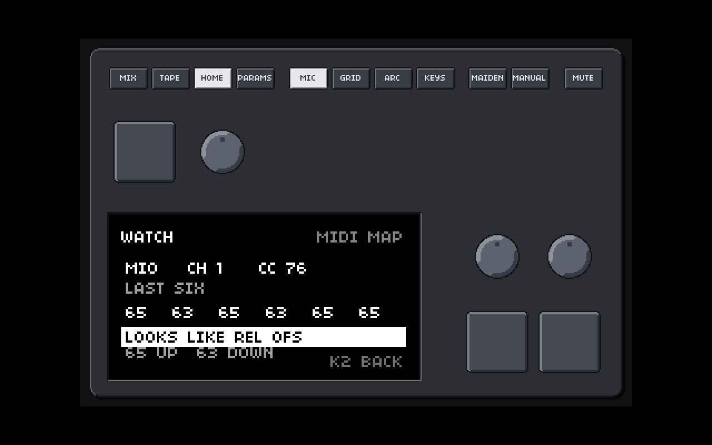
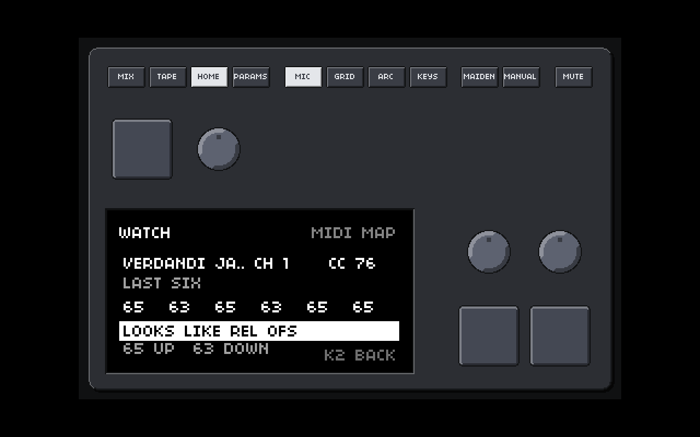

# The virtual arc from MIDI and the keyboard: plan (no product code)

Linux desktop build only (everything proposed is behind `NORNS_LINUX_DESKTOP` in C and `NORNS_PLATFORM` in Lua); `macos/` was only read; **nothing was built or changed in the product**. Each claim says whether it was **read** in this repository, **found on the web** (links at the end; forum-level evidence is marked), **my knowledge** (not checked here) or an **estimate**.

One picture, a **stand-in** (the view does not exist yet; it is drawn with the real screen API and font in the real window by a throw-away script, `arc-previews/standin_draw.lua`): the proposed WATCH view of MIDI MAP, which answers "which relative format does my Beatstep Pro send?".



## 0. Summary

- **What exists.** The virtual arc window (F8) is four knobs with a 64-LED ring each. It sends **1024 ticks per turn**, like the hardware (monome docs, web); a mouse drag round a knob is a quarter of that (256 ticks per turn of the pointer), a wheel notch is 2 ticks, Shift is four times finer. The ticks go through libmonome as raw `enc delta` messages and reach scripts untouched as `a.delta(n, d)` (`lua/core/arc.lua`): no scaling anywhere on norns's side.
- **MIDI MAP gets four more controls, A1 to A4**: each with its own CC (or learn by **clicking the ring in the virtual arc window**), device, channel, format (absolute or the three relative formats) and two arc-only settings, **GAIN** (ticks per MIDI unit) and **ACCEL**. Defaults are chosen so that **one full sweep of an absolute knob (127 values) is about one arc turn (8 ticks per value)** and a relative step is 8 ticks; a **calibration** ("turn the knob once round, press K3") sets the gain exactly for a given endless encoder, because the Beatstep Pro's step size per turn is not something I can know without the unit.
- **Feel like a real arc:** linear by default (an optical encoder has no acceleration), one tick message per MIDI message with no smoothing (a real arc's deltas are immediate), the carry of fractions kept, an optional gentle acceleration, a fine step with Shift for the keyboard, and the rule learned on the SCREEN page: **a key release or a delta of 0 never makes a step**.
- **Keyboard: 5/6, T/Y, G/H, B/N = encoder 1 to 4, left/right.** Checked against everything in the repository (section 5): **no clash** with the existing keyboard mapping, the F-keys, the menu keys, the Ctrl shortcuts or the colour picker, **provided the keys are active only when nothing else wants them**: (1) always while the **virtual arc window has the focus** (handled in C, the keys never reach a script), and (2) in the norns window only while the **virtual arc is open, a script is running (not the menu), no text entry is open, and the script has not set `keyboard.code` / `keyboard.char`** (the same rule as Q/W/A/S/Z/X). Your installed scripts (`~/Verdandi/dust/code`) **could not be scanned here** (the folder is not in this environment); `linux/scan-fkeys.sh` is extended to do it on your computer (section 5.3).
- **Beatstep Pro as the main test case:** relative CC through the mio. What is known from the web (forum level) is that the BeatStep family has **relative modes** and that "Relative 1" sends values around 64 (63/65 for a slow click, up to about 61 to 67 with speed); **I cannot verify the Pro's modes, its step size or its CC numbers without the unit.** The page gets a **WATCH** view (the picture): turn one encoder one click each way and read the numbers.
- **The split with E1 to E3:** the mapping is by CC number. Learn gives a CC to one control; **a CC (same device, channel and number) that another control already uses is refused for a second control with a plain question** ("CC 71 is E2: move it to A1?"), so the arc encoders always use other encoders of the unit (section 3.5, with a worked table).
- **Nothing is built until you say so.** Decisions in section 8.

## 1. What the virtual arc does today (read)

**The window** (`matron/src/platform/macos/sdl_bridge.cc`, shared with the Linux build; "virtual arc window"):
- `ARC_RINGS 4`, the device's name is `monome arc virtual` (`lua/core/startup.lua` tells an arc from a grid by `util.string_starts(name, "monome arc")`).
- `ARC_TICKS_PER_TURN 1024.0`, "as on the hardware". A **drag with the left button** round a knob (`arc_motion`): the angle change times `ARC_DRAG_GEAR 0.25` (a turn of the pointer is a quarter turn of the knob, "a small knob under a mouse would otherwise be far touchier than the hardware under a hand"), so **256 ticks per full pointer turn**. Near the centre (distance under 8 units) the angle jumps, so it waits.
- The **wheel** over a knob (`arc_wheel`): `ARC_WHEEL_TICKS 2` per notch (a trackpad scrolls in fractions).
- `turn_factor()`: **Shift = 0.25 (finer), the GUI key (Super on Linux) = 4 (faster)**.
- `arc_turn(n, ticks)`: the fractional ticks are **accumulated per knob** (`arc_acc`), only whole ticks go out (`vgrid_enc(varc, n, t)`), and the knob in the window turns by `t / 1024` of a turn (`arc_turns`, its knurl).
- The **right button** (or Ctrl-click) is the knob's push button, held while the button is held.

**The device** (`vgrid_device.c`, `vgrid_proto.c`): a pseudo-terminal that libmonome opens like a USB device. `vgrid_enc` writes **one 3-byte message per delta of -128 to 127** (a bigger delta is split); a key is a 2-byte message. The ring LEDs come back from norns the same way: **64 LEDs per ring, level 0 to 15**, LED 0 at the top, clockwise (`varc_skin.h`); `arc:led`, `arc:all`, `arc:segment` in `lua/core/arc.lua` use them; the window redraws on a coalesced event.

**What scripts get** (`device_monome.cc`, `lua/core/arc.lua`): libmonome's encoder delta event is turned into `EVENT_ARC_ENCODER_DELTA` with the number and the delta **unchanged**; `_norns.arc.delta(id, n, delta)` calls `device.delta(n, delta)` and the vport's `delta`. So a script sees exactly the integers the window sent. (Scripts then scale them themselves, for example `d / 100`.)

**A real arc** (web): the monome pages say the arc has **1024 steps per revolution** (the SuperCollider study and the norns study both say "high resolution (1024 steps per revolution)"); the norns study says nudges give deltas of +/-1 and larger turns larger deltas; the LED ring has 64 positions. **What I cannot verify:** how often a real arc reports, the largest delta of a fast turn, and the exact timing of its messages (no hardware, and I found no document with those numbers; the early protocol draft in the web results is preliminary and not authoritative). So "behave as close to a real arc as possible" means: same resolution (1024 per turn), same kind of numbers (small signed integers, ±1 for a nudge, larger for speed), immediate, and linear; the rest is a hardware check.

## 2. The Beatstep Pro, and how you can tell what it sends

**Known** (your description): 16 endless encoders sending relative CC through the mio (USB MIDI), already used for some of E1 to E3.

**Web (forum level, not Arturia's manual): ** the BeatStep family offers relative modes in Arturia's MIDI Control Center; "Relative 1" sends **63 or 65** for a slow click (offset binary around 64, `REL OFS` in MIDI MAP), reported up to roughly **61 to 67** with speed; an Arturia manual excerpt quoted on a forum says "Relative 1: 61-63 for negative turns, 65-67 for positive turns". Values for "Relative 2" and "Relative 3" were **not in what I found** (my knowledge, unverified: one is two's complement around 0 and one sign-magnitude around 64, which are `REL 2S` and `REL SIGN`). Some other Arturia models differ (a MiniLab page lists 17-19 for positive), so "same company" proves nothing.

**What I cannot verify without the unit:** which relative mode your Pro is set to, the step size per physical click or per turn (how many units a full turn of an encoder gives), the CC numbers of its 16 encoders (they are configurable in the Control Center), the channel, and whether fast turns send bigger values or the same value faster.

**How you can check, on the MIDI MAP page (proposed WATCH row, the picture):** open MIDI MAP > WATCH, turn one encoder **one click to the right, then one click to the left**, a few times. The view shows the last message's **device, channel, CC**, the **last six values** of that CC, and a verdict line:
- values like `65 63 65 63` are **REL OFS** (offset binary: 65 up, 63 down);
- `1 127 1 127` are **REL 2S** (two's complement: 1 up, 127 down);
- `1 65 1 65` are **REL SIGN** (1 up, 65 down);
- a growing or falling run (`40 41 43 44`) is an **absolute** knob; the view says "CHECK THE MODE IN THE CONTROL CENTER".
Turn faster and watch the numbers grow (`67`, `5`): that tells whether speed is in the value. The verdict uses the suggestion code that learn already has (`V.suggest`, which needs four values and both directions); the view shows what it saw even when it cannot decide. Without the new view the same check can be done today with `amidi -d -p hw:X,0,0` or any MIDI monitor.

## 3. The design

### 3.1 Four more controls in MIDI MAP: A1 to A4

**Rows** on the page (after K3, before ON CLASH; the list scrolls as it does): `A1 A2 A3 A4`, each showing like the others (`CC76 REL OFS`, `-----`, `?` for a suggestion, `!` for a clash), plus a **WATCH** row (above PRESET's row group, see the picture) and, after ON CLASH, **ARC KEYS** (ON / OFF, section 3.4). **A control's view** (K3 on its row) has: `LEARN`, `NUMBER`, `DEVICE`, `CHANNEL`, `MODE` (ABS, REL 2S, REL SIGN, REL OFS), **`GAIN`** (ticks per MIDI unit, 1 to 64, default 8), **`ACCEL`** (OFF, LOW, HIGH; default OFF), **`ONE TURN`** (calibration), `CLEAR`. The existing `SENS 1 to 9` of the encoders is not used for arc encoders: GAIN replaces it, because the arc's unit is a tick, not a norns step.

**Learn by clicking in the virtual arc window.** The page's LEARN arms the pick exactly as for E1 to K3 (`midimap_arm`); while armed, a left click on a **ring** of the arc window is reported as `_norns.midimap_pick("a", n)` instead of starting a drag or a push, and the click on a norns control reports as before; the arc window rings the knob being learned the way the box lights its controls (a pulsing ring: new `varc_skin_draw` argument `lit`, blinking in LISTEN, turning one after the other in PICK). The window must be open: if it is not, PICK says "OPEN THE ARC (F8)". A click in the arc window outside the four rings ends a PICK, as elsewhere. **Learn of an arc encoder takes a CC only** (a note is refused with "A NOTE? USE A CC", as for E1 to E3) and uses the same suggestion at the end (the first six messages).

**How the turn reaches the arc.** The layer is Lua and the window is C, so one new call is needed, **`_norns.arc_turn(n, ticks)`** (Linux desktop only, like `_norns.toast`): it posts an event to the window's main thread, which calls the **same `arc_turn(n, ticks)`** the mouse uses, so the accumulator, the 1024-tick knob, the window's knurl and the messages to norns are all one path. It returns false when the virtual arc is not open; the layer then shows one toast ("ARC WINDOW IS CLOSED: F8") and does nothing (it does **not** open the window by itself; decision in section 8). A mapped arc encoder only ever drives the **virtual** arc; a real arc plugged in is untouched.

### 3.2 Getting the feel of a real arc

Everything below is per mapping, in `GAIN`, `ACCEL` and the format, and in the layer's pure value functions (`core/midimap_value.lua`).

| property of a real arc | how MIDI MAP gets close | default |
|---|---|---|
| 1024 ticks per turn | `ticks = units x GAIN`; **8 ticks per unit** means an **absolute knob swept over 127 values is about one turn (1016 ticks)**; a relative encoder gives 8 ticks per unit | GAIN 8 |
| deltas are small signed integers, ±1 for a nudge | whole ticks only, the **fraction carried** (as `arc_turn` already does); GAIN 1 gives ±1 ticks per unit | |
| linear: the delta is proportional to the speed | **no acceleration by default**; relative values that grow with speed (the Beatstep sends bigger numbers when turned faster, web, forum level) are already linear | ACCEL OFF |
| immediate | one `arc_turn` per MIDI message, no smoothing, no timer; the window redraw is coalesced by the window as for the mouse | |
| a fast turn is a burst of messages | nothing is dropped; the sum is exact (the carry) | |
| the turn of the physical knob matches the turn of the ring | **ONE TURN** calibration: turn the encoder exactly once round, press K3; the view counts the units and sets `GAIN = 1024 / units` (clamped to 1 to 64, rounded to a whole number) | |
| fine and coarse | **Shift = a quarter** (as the mouse's `turn_factor`) for the **keyboard** keys; MIDI messages have no modifier, so a MIDI-driven arc is fine only through GAIN | |

**Acceleration (optional).** `ACCEL LOW` and `HIGH` multiply the ticks of a message by `1 + a * (|unit| - 1)` for relative values (a = 0.25 and 0.5) and, for any format, by `2 / 3 / 4` when the previous message of the same encoder came less than 20 / 10 / 5 ms ago (the thresholds of norns's own `encoders.process_with_accel`, which is what the hardware encoders E1 to E3 use; `lua/core/encoders.lua`). It is **off by default** because a real arc has none; it is for encoders whose single clicks are too small to be useful. The arc path does **not** go through `encoders.lua` (the arc deltas are raw), so none of the norns E1 to E3 sensitivity or acceleration applies to the arc.

**Absolute knobs** (secondary case): the same absolute handling as E1 to E3 (baseline for the first message, no step after a pause of 1.5 s or a jump of more than 40 values) and then `ticks = (change in values) x GAIN`. **Push 2** (secondary, unverified numbers) uses its relative format with the same GAIN.

**What cannot be a real arc's feel:** the weight and inertia of the knob, the exact message rate, the largest delta, and how a script's own scaling feels with the Beatstep's step size: all hardware checks (section 6).

### 3.3 The keyboard

**Keys:** `5 6` = encoder 1 left/right, `T Y` = 2, `G H` = 3, `B N` = 4. Left means negative (counter-clockwise), right positive.
**Step:** one press = **16 ticks** (1/64 of a turn: **exactly one LED of the ring**), **Shift = 4 ticks**. **Key repeat** (the system's autorepeat, value 2 in `lua/core/keyboard.lua`) repeats the step, at about 25 per second after the system's delay: 400 ticks a second, a slow turn. An optional ramp (**ARC KEYS ACCEL**, off by default) multiplies the step by 2 after 10 repeats and by 4 after 25.
**The release lesson** (KNOWN-ISSUES 16: the SCREEN page changed a value on the press and jumped back on the *release* because it turned every delta into a step of one in the direction of its sign): **a key up, and any event with delta 0, produce no ticks.** Only a press and a repeat do; a release goes where the press went (`hw_down` in `keyboard.lua`) and emits nothing.
**Where the keys work, in two tiers:**
1. **The virtual arc window has the focus.** Handled in C in `handle_key` before anything else (as the keys window handles its own keys), so **no clash is possible**: the arc window never sends 5/6/T/Y/G/H/B/N on as a USB keyboard. Always on while the window is in front.
2. **The norns window (or any other window of Verdandi) has the focus.** In `lua/core/keyboard.lua` `hardware()`, **exactly the conditions of Q/W/A/S/Z/X**, plus three: `keyboard.hardware_keys`; no text entry open (`te_kbd_cb`); and `not _menu.mode and not script_wants_keyboard()`; **plus** the virtual arc is open (`_norns.arc_turn` answers) and `ARC KEYS` is ON. So while a script that reads the keyboard is running, or any menu page is up, these keys are the script's / the page's.

### 3.4 The settings and `midimap.conf`

The file stays version 1; old files read unchanged; a new file read by the old code would ignore the new keys (unknown keys are kept). New keys (the same rules: defaults, validation, a damaged value falls back with a log line):

```
a1.type=cc    a1.num=76    a1.dev=mio    a1.ch=0
a1.mode=relob a1.gain=8    a1.accel=off
arc_keys=1    arc_keys_accel=0
```
`type` is `none` or `cc` for the arc (a note is refused, as for the encoders), `gain` 1 to 64, `accel` off, low, high. **Presets** (`midimap-presets/`) carry the `a1.*` keys without `dev` and `ch`, as the others; the built-in presets keep A1 to A4 **empty**, and **no BEATSTEP PRO preset is shipped**: its CC numbers are configurable and unknown here. Once you tell me your unit's numbers (from WATCH), a preset can be made from them.

### 3.5 Splitting the Beatstep Pro's encoders between E1-E3 and A1-A4

One unit, one device (`mio`), one channel, sixteen CC numbers: the split is simply **which CC goes to which control**. Example (CC numbers are placeholders; learn fills in yours):

| Beatstep encoder | control | device / channel |
|---|---|---|
| 1, 2, 3 (as now) | E1, E2, E3 | `mio`, channel of the unit |
| 5, 6, 7, 8 | A1, A2, A3, A4 | `mio`, the same channel |
| 4, 9 to 16 | free (scripts' own `midi` handlers, or the params MAP) | |

**The rule that keeps them apart.** Two controls may not answer to the **same device, channel and CC**. When you learn or type a CC that another control already uses (same CC and overlapping device and channel filters: `ANY` overlaps everything), the page asks in plain words, **"CC 71 IS E2. MOVE IT TO A1? K3 YES, K2 NO"**; yes clears the other control, no leaves everything as it was. Today the layer lets two controls share a CC (both act); that is kept for different devices or channels, where it is deliberate, and a **`!` is shown on both rows** when the filters overlap on the same CC (the same mark as a params-MAP clash, with its own help line). **With the params MAP** the rule is the one decided for E1 to K3: **the params MAP wins**, the MIDI MAP skips that message, the page and the load check warn (extended to A1 to A4: `mm.clashes()` covers the six old and the four new controls).

## 4. Tests to write first (and to watch fail)

- **Value functions** (`midimap_value_test.lua`): `arc_ticks(units, gain, accel, fine)` for every format; GAIN 1 and 8 and 64; the carry (many 1-unit steps add up to the same ticks as one big step); absolute sweep of 127 values at GAIN 8 gives 1016 ticks, a reversal gives the same back; ACCEL tables (the 20/10/5 ms thresholds with an injected clock; the `1 + a(|u|-1)` factor; off is exactly linear); **a delta of 0 gives 0 ticks**; calibration (`gain_from_turn(units)`: 128 units gives 8, 4 gives 64 clamped, 2000 gives 1); the keyboard step (press 16, Shift 4, repeat, release 0, the ramp).
- **Settings** (`midimap_settings_test.lua`): `a1..a4` keys, defaults, round trip, every damaged value (gain 0, 65, `accel=fast`, a note type), an old file without arc keys, an unknown `a5.*` ignored and kept, presets with and without arc keys, built-in presets leave A1 to A4 empty, `arc_keys` default.
- **Layer** (`midimap_layer_test.lua`, through the real `midi.lua`): a mapped CC calls `_norns.arc_turn(n, ticks)` with the right numbers for each format; device and channel filters (the mio and its ports, ANY skips the iii grid); two controls with the same CC (the question, yes and no), overlapping filters get the `!`; the arc closed (one toast, no error, `arc_turn` false); the params MAP clash for an arc encoder; scripts still receive every message; held state nothing to release; learn of `a1` through `midimap_pick("a", 1)`, a note refused, the suggestion applied, the cancel paths; the window arm/disarm calls; the **WATCH view** data (last six values per CC, the verdict from known sequences: `65 63 65 63`, `1 127 1 127`, `1 65 1 65`, a ramp, a single value, two interleaved CCs).
- **Page** (`midimap_page_test.lua`): rows A1 to A4, WATCH, ARC KEYS; the view of an arc encoder (GAIN, ACCEL, ONE TURN, no SENS), every handler ends with a redraw, SYSTEM list unchanged.
- **Keyboard** (a new `arc_keys_test.lua` through the real `keyboard.lua` and menu bindings, as `ui_keys_test.lua` does): each of the eight keys calls `_norns.arc_turn` with the right ring and sign; **inactive** while a text entry is open, while a script sets `keyboard.code` or `keyboard.char`, while the menu is up, with `NORNS_HARDWARE_KEYS` off, with the arc closed; **no** key from the existing mapping (1 2 3, Enter, Space, Esc, Backspace, Q W A S Z X, the arrows, F1 to F12, Ctrl+letters) changes behaviour (a table of every key before and after); release emits nothing, repeat emits, Shift makes the step 4; a press whose release arrives after the arc closed does not raise.
- **Stress test** (`menu_stress_test.lua`): the arc keys and arc MIDI messages join the random events; invariants as for E1 to K3 plus "no ticks while the arc is closed", "no ticks from a key release", "the armed window agrees with the learn state" for the ring clicks.
- **C**: a hit test that the four rings are hit alike with the window at three sizes (`varc_skin_hit`), the arc-window key branch (a scancode table: the eight keys map to ring and sign, every other key is not taken; with a modifier other than Shift they are not taken), the pick branch (armed: a click on a ring reports `"a"`, outside ends a PICK, nothing is turned or pushed).
- **Real window** (Xvfb, the pattern of `midimap_scenario`): F8 opens the arc; with the arc window focused `xdotool key 5` gives `a.delta(1, -16)` in the script, `Y` gives `(2, 16)`, Shift+`G` gives `(3, -4)`; a CC played by `midimap_send` through JACK MIDI after a learn by clicking ring 3 turns ring 3 (script sees the deltas, the window's knob turned); a script that sets `keyboard.code` does not lose 5/6 from the norns window's focus unless it is the arc window; **Mac unchanged** (`box_c_test.sh`'s guard check extended to the new lines, `macos/` unchanged).

## 5. Do the keys clash? (read)

### 5.1 Against the existing keyboard mapping
`lua/core/keyboard.lua`: K1 K2 K3 = `1 2 3`, `ENTER KPENTER SPACE` = K3, `ESC BACKSPACE` = K2, E1 E2 E3 = `Q W`, `A S`, `Z X`; in scripts the arrows = E2 (up/down) and E3 (left/right); shift = 5 steps. C layer (`window_keys.h`): the same keys with Option or in "norns mode", everything else passed on as the USB keyboard. **None of 5 6 T Y G H B N is used.**

### 5.2 Against the menu, the pages, text entry, shortcuts
- F1 to F4 pages, F5 menu, F6 grid, F7 keys, F8 arc, F9 detach, F10 menu, F11 fullscreen; Ctrl+O, Ctrl+Q, Ctrl+M (mute), Ctrl+Shift+S, Ctrl+C / Ctrl+V on THEME and the picker: no letter or digit of the eight is involved.
- The menu's default bindings: arrows, Page up/down, `-` `=`: none. **The colour picker uses `H` (type a code), `C`, `R`**, and the text entry takes every letter: **`H` and `G` would clash there**, which is why tier 2 is limited to **script mode with no text entry** (the picker and the text entry only exist in the menu), and tier 1 is only while the arc window is in front. The virtual **keys** window takes letters for notes only while it has the focus (and only the keys window).
- The layout: the keys are **key codes** (positions), so on a national layout the same physical keys are used (`5 6` on the number row, `T Y`, `G H`, `B N` on the letter rows).

### 5.3 Against your scripts
`~/Verdandi/dust/code` is **not in this environment**: no scan was possible. `linux/scan-fkeys.sh` (read) already lists scripts that set `keyboard.code` / `keyboard.char` and name `F9`, `F11`, `F12`. The plan extends it with the eight keys (`"5" "6" "T" "Y" "G" "H" "B" "N"`, as scripts name them in `keyboard.code`, and the characters in `keyboard.char`), printing the scripts and lines that read them: **run it on your computer before the keys are switched on** (`linux/scan-fkeys.sh ~/Verdandi/dust/code`). A script that reads those keys keeps them in tier 2 by the rule above (a script that sets `keyboard.code` owns the keyboard); in tier 1 (the arc window in front) the keys are the arc's, which no script can have expected.

### 5.4 Against the params MAP
Different mechanisms (MIDI against the computer keyboard): the keys never touch the params MAP. For the MIDI side, section 3.5.

## 6. What needs real hardware

- The **Beatstep Pro**: its relative mode(s), the values of one click each way, whether speed is in the value, the step size per turn (for the default GAIN and for ONE TURN), the CC numbers and channel of its 16 encoders, the delay and bursts over the mio's DIN link.
- The **feel** of GAIN 8, ACCEL, and the keyboard step (16 ticks, repeat 25 per second): with the scripts you use on an arc (a real arc beside it if you have one: does the ring turn like the arc under the hand?).
- The **mio's ports** and channels (as in the MIDI MAP checklist), the **Push 2** as a secondary relative case, an absolute knob.
- **Real arc comparison:** the largest delta and the message rate of a real arc, which I could not find.
- A real window manager: the focus rules (tier 1 vs tier 2), key repeat rate and delay of your desktop.

## 7. Risks

| risk | answer |
|---|---|
| GAIN 8 is too fast or too slow for the Beatstep | ONE TURN calibration; GAIN is per mapping; nothing about the unit is assumed |
| a wrong relative format | the same manual choice and suggestion as E1 to K3, and the WATCH view |
| the eight keys steal a key a script needs | tier 2 only when no script reads the keyboard; the scan; ARC KEYS OFF |
| two controls answer to the same encoder | the question at assignment, `!` for overlaps |
| a stuck turn or a release step | the release/0 rule, tested; ticks only on press and repeat |
| the new C calls break the mouse use of the arc | a pick branch only while armed; the same `arc_turn` for the mouse and MIDI; Xvfb scenario and the stress test; Mac guard check |
| the arc window is closed when MIDI arrives | no error, one toast; no auto-open unless you choose it |
| presets from an older version | the file version stays 1; unknown keys are kept |

## 8. Decisions for you (recommendation first)

1. **Defaults:** GAIN 8 (an absolute sweep is about a turn), ACCEL off, calibration available. Alternative: a different default once the Beatstep's step size is known.
2. **Arc closed:** do nothing and say so once (recommended); alternative: open the arc window when a mapped encoder first moves.
3. **Keyboard tiers:** both (arc window always; norns window under the Q/W rule). Alternative: arc window only.
4. **Keyboard step:** 16 ticks (one LED), Shift 4, no ramp by default.
5. **Two controls on one CC:** the question at assignment (recommended); alternative: refuse silently, or keep the old "both act".
6. **No BEATSTEP PRO preset** until its numbers are known from WATCH.
7. **WATCH view** as part of this work (recommended): it is also the quickest way to check any other controller.
8. **Order of work** when you say go: value functions and settings, then layer and page (WATCH included), then the window (`arc_turn` call, pick, key branch), then the keyboard tier 2, then docs and the hardware checklist.

## Sources (web)

- [monome norns study 4b: arc, the full 1024-step resolution, deltas of ±1 for nudges](https://monome.org/docs/norns/study-4b) and [monome arc SuperCollider study: 1024 steps per revolution](https://monome.org/docs/arc/studies/sc); [norns arc reference](https://monome.org/docs/norns/reference/arc) (64 LEDs per ring)
- BeatStep relative mode, forum level: [Patch parameter control with beatstep encoder issue](https://community.blokas.io/t/patch-parameter-control-with-beatstep-encoder-issue/5425), [Loopy Pro forum: the quoted Arturia excerpt, relative 1 = 61-63 / 65-67](https://forum.loopypro.com/discussion/comment/1367343/), [Arturia Beatstep and endless encoders (Image-Line forum)](https://forum.image-line.com/viewtopic.php?p=1248220), [BeatStep manual (Scribd)](https://www.scribd.com/doc/286238741/BeatStep-Manual-1-0-1-En), [MiniLab relative modes (a different unit)](https://manualshive.com/en/manual/arturia/minilab-mk-ii/2978926?page=38)

## 9. What was built, and where it differs from the plan above

**Built** (Linux desktop only; `macos/` untouched; shared files guarded by `NORNS_LINUX_DESKTOP` / `NORNS_PLATFORM`), tests first and seen to fail:

| piece | where |
|---|---|
| value functions: arc ticks with GAIN and ACCEL, absolute deltas, ONE TURN gain, the key step and ramp, overlap of two mappings, the WATCH data and verdict | `lua/core/midimap_value.lua`, `linux/tests/midimap_value_test.lua` |
| settings: `a1` to `a4` (type, num, dev, ch, mode, gain, accel), `arc_keys`, `arc_keys_accel`; presets carry the arc encoders | `lua/core/midimap_settings.lua`, `midimap_settings_test.lua` |
| the layer: arc turns through `_norns.arc_turn` (the closed window said once), `find_overlap` / `overlaps`, the question at assignment (`ask`, `answer`), WATCH (`watch_*`), ONE TURN (`calib_*`) | `lua/core/midimap.lua`, `midimap_layer_test.lua` |
| the page: A1 to A4, WATCH, ARC KEYS, the arc view (GAIN, ACCEL, ONE TURN), the question and the WATCH / ONE TURN views | `lua/core/menu/midimap.lua`, `midimap_page_test.lua` |
| the keys in the norns window (tier 2) | `lua/core/keyboard.lua`, `linux/tests/arc_keys_test.lua` |
| the keys in the arc window (tier 1), `_norns.arc_turn`, the pick on a ring, the lit ring | `matron/src/platform/linux/arc_keys.c/.h`, `sdl_bridge.cc/.h`, `varc_skin.c/.h`, `weaver.cc`; `arc_keys_c_test.c`, the `arc_scenario` of `run_all.sh` (`probe_arc.lua`) |
| the stress test: arc rows, WATCH, ONE TURN, the question, an arc that opens and closes, the arc keys among the random keys | `menu_stress_test.lua` (a deliberately broken WATCH stop was caught at seed 13) |
| `scan-fkeys.sh` lists scripts that read the keyboard and name 5 6 T Y G H B N | `linux/scan-fkeys.sh`, `scan_fkeys_test.sh` |

**Where it differs from the plan above:**
1. **Presets and the arc encoders.** The built-in presets (NONE, PUSH 2, GENERIC REL 2S) have no arc section and **leave A1 to A4 as they are** (applying PUSH 2 must not wipe the arc mappings you made); your own presets save A1 to A4 and bring them back; a preset file from before the arcs leaves them alone. Presets still carry no device or channel.
2. **The question is asked when a CC is learned or typed**, not when E3 steps the NUMBER (that would ask at every step): there the overlap shows as `!` on both rows and the help line says `CC72 ALSO A1`. A learn assigns "any device, any channel", so it overlaps any control with that CC and asks.
3. **WATCH** is a row after A4 (not above PRESET), its data comes from every device (the iii grid too: it is a monitor), and while it is open nothing is mapped and no learn runs. The view has the layout of the stand-in (`arc-previews/`), with the device name cut to fit.
4. **ARC KEYS** is a page row (ON/OFF) for the norns window only; the arc window always has the keys (tier 1). **The key ramp** (`arc_keys_accel`) is a file setting only, no page row, and it is pushed to the window's C code (`_norns.arc_keys_config`) so that both tiers use it. Ctrl, Alt (and AltGr in the norns window, Super in the arc window) make the keys shortcuts, not arc keys.
5. **The lit ring** is a gold circle round the knob in the arc window (PICK: the four in turn; LISTEN: the one being learned, blinking), drawn by the arc skin; the box is lit as before for E1 to K3.
6. **A closed arc window:** `_norns.arc_turn` answers false from a flag the window keeps (open or not, readable from any thread); the layer says so once with the box's toast and says it again only after a turn got through.
7. **Tier 2 only takes a key if the window took the turn:** with the arc closed the first press makes the call, is refused and the key goes on its way (to the script or nothing).
8. **The stand-in picture** of the plan is replaced by a real capture, `arc-previews/arc-watch-real.png` (the WATCH view in the real window).

**Test run:** `linux/tests/run_all.sh` from a clean environment: 124 passed, 0 failed (the first runs failed on two mistakes in my new checks, a count and a test name too long for its log file; fixed).



**Not verified here (hardware):** the Beatstep Pro's relative mode, step size and CC numbers (WATCH and ONE TURN are how you find out), the feel of GAIN 8 and of the keys on your desktop, a real arc's delta behaviour, your installed scripts (run `linux/scan-fkeys.sh`). The checks are in `HARDWARE-CHECKLIST.md`.
