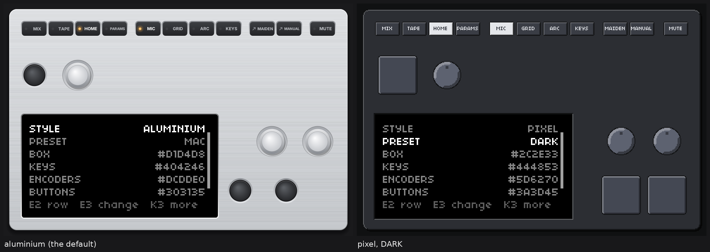
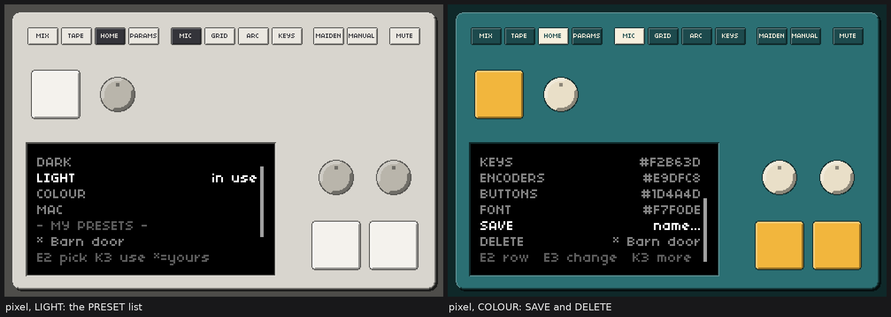

# Box style plan, step 5: a pixel-art box, five colours, saved looks, a hideable top row (PLAN ONLY)

Nothing in the product was changed for this note. Everything is for the Linux desktop build (`NORNS_LINUX_DESKTOP`); the Mac and the device are not touched, `macos/` was only read.
**Status: BUILT** (section 7 says what was built and where it differs from the plan; the plan below is kept as it was written, with the owner's answers in section 5). The two pictures of section 4 were first
stand-ins made before any code existed; **they are now captures of the real window of the real norns** (`box-style-previews/make_box_real_pictures.sh`: headless norns, the real SYSTEM > BOX page, the real
pixel style and the real aluminium style). The layout numbers are checked by a script (`box-style-previews/check_layout.py`, output `layout-check.txt`: 0 failed checks).

## 0. Summary, and what needs the owner's word

| | proposal |
|---|---|
| the look | one pixel style, drawn by code: a 2-unit **block** grid (the box is 480 x 315 blocks; one screen pixel is exactly 2 x 2 blocks), hard edges, matt, no brushed metal, no files |
| keys | **112 units square** (56 blocks, corners cut by a pixel circle), 1.40 x the encoder (the owner's 1.3 to 1.5), 95 percent bigger than today's key cap |
| encoders | pixel discs **80 units** across (today: knob 71.3, washer 87.4), a notch that turns with the detents |
| top row | button text in **`resources/norns.ttf` 8 px** (the screen's font, one text pixel = one block), buttons 70 x 28 units, lit = the colours inverted |
| colours | five: BOX, KEYS, ENCODERS, BUTTONS, FONT, each a hex code; the edges and shadows are two shades computed by one formula |
| looks | three built-in (DARK default, LIGHT, COLOUR) and **the owner's own**, saved as one small file each in `box-presets/` |
| page | **SYSTEM > BOX** below UI: STYLE, PRESET, BOX, KEYS, ENCODERS, BUTTONS, FONT, SAVE, DELETE (only for an own look) |
| settings | `box.conf` in the norns home (like `ui.conf`), applied at once |
| hide the row | right-click item "Show the page buttons" (ticked, saved, applied at once); the box and the window keep their size, the row is simply not drawn |
| mute | **Ctrl+M** (handled in C like Ctrl+Q and Ctrl+O, works from both windows, with the row hidden), an item "Mute output  Ctrl+M" in the right-click menu, and a small MUTE chip that stays drawn while muted even if the row is hidden |
| default style | **aluminium** until the owner decides; the aluminium drawing is not changed at all |

Questions only the owner can settle are collected in section 5.

## 1. How it is drawn today, and what a second style needs

### 1.1 The drawing code

One file draws the box for macOS and Linux: `matron/src/platform/macos/device_skin.c` (788 lines, pure cairo, no SDL), selected by `NORNS_LINUX_DESKTOP` for the Linux layout table. Public API (`device_skin.h`):
`skin_geom` (scale, box origin, the screen's rectangle), `skin_hit` (which control is under a pixel), `skin_nearest_enc`, `skin_in_bezel`, `skin_oled_pixel`, `skin_draw_static` (background, box, bezel, washers, key wells: only changes with the size), `skin_draw_controls` (buttons, toast, keys, knobs: changes with the state), `skin_draw_oled`, `skin_draw_placeholder`. The window code that calls it is `matron/src/platform/macos/sdl_bridge.cc` (shared with the Mac, Linux parts under `#ifdef`), the in-window menu is `matron/src/platform/linux/menu_skin.c` and `desktop_shell_linux.cc`.

| part | how it is drawn today (Linux layout, units; window = 960 x 630 units + 16 margin = 992 x 662 px at 100 percent) |
|---|---|
| box | rounded rectangle, radius 22; a soft shadow of ten stacked translucent rounded rectangles; a vertical gradient `dfe1e4` to `c4c7cb`; **brushed aluminium**: one faint light or dark streak per device pixel row from a fixed-seed random generator (`draw_box`, clipped to the box); a 1.5 unit edge stroke, light on top, dark below |
| bezel | a recess: a rounded rectangle 3 units bigger with a gradient lip (dark above, light below), then the black window at x 36, y 300.667, 556 x 293.333; the screen (512 x 256 units, 4 device pixels per screen pixel at 100 percent) sits in it; its position comes from `skin_geom` (`oled_x/oled_y/oled_w/oled_h`) |
| keys | circles: a well of radius 35.65 (gradient ring, dark centre), a cap of radius 28.75 (radial gradient, rim light), 26.45 and 2 units lower while pressed; hover adds a translucent white wash. Centres K1 (71.65, 188.33), K2 (655.65, 517.48), K3 (785.65, 517.48) |
| encoders | a washer of radius 43.7 (gradient, thin dark ring), a knob of radius 35.65 with 60 knurl lines and a top face of radius 28.75 (radial gradient); `enc_ticks` turns the knurl by a third of its spacing per detent. Centres E1 (194.7, 188.33), E2 (745.35, 377.18), E3 (875.35, 377.18) |
| top row | 11 buttons at y 36, 70 x 40 units, positions `36 112 188 264 | 359.33 435.33 511.33 587.33 | 682.67 758.67 | 854`: MIX TAPE HOME PARAMS, MIC GRID ARC KEYS, MAIDEN MANUAL, MUTE (ids `SKIN_PAGE1..SKIN_MUTE`). A well (rounded rectangle, gradient), a face (gradient, rim light), an **LED** (amber when lit) or a small "opens elsewhere" arrow, and the label. Lit: the four pages (the one shown), MIC (input not off), GRID/ARC/KEYS (window open), MUTE (muted) |
| text | **`draw_button`: cairo's "toy" font API, `cairo_select_font_face(cr, "Helvetica Neue", NORMAL, BOLD)`, size 12 units, shrinking to 8 until the label fits.** Cairo hands that name to fontconfig; "Helvetica Neue" is not shipped, so the font is whatever fontconfig substitutes on the machine (here `fc-match "Helvetica Neue:bold"` says Inter Bold; on the owner's laptop it is not known to me). The toast uses the same family at 14, the screen placeholder at `17 x scale`. No font file is shipped for any of this, so there is no licence question today |
| the screen's font | not drawn by the box: `matron/src/hardware/screen.cc` loads `$HOME/norns/resources/norns.ttf` (font 1, the norns default) with FreeType; the box could load the same file the same way |
| hit-testing | `skin_hit`: the 11 button rectangles (+3 units), then keys (distance <= radius + 6), encoders (distance <= washer + 6). The ids are fixed; `skin_nearest_enc` picks the encoder for the mouse wheel |
| scaling | `skin_geom`: `s` = the smaller of window/(960+32) and window/(630+32); the screen is a whole multiple of 128 x 64 when 4 s is within 0.02 of a whole number (crisp), else an even width in between: enlarged to a whole multiple with nearest neighbour, then scaled down with the best filter (`skin_draw_oled`) |
| state | `skin_state_t`: keys down, encoder ticks, hover, shown page, windows open, input mode, button held, recording, toast, muted, screen detached |

### 1.2 Other places that matter

- **Menu and keys:** the right-click menu (`desktop_shell_linux.cc`, `menu_build`/`menu_do`/`shell_menu_key`, at most `MENU_MAX` 32 items; 28 are possible today) has no item for MUTE, MAIDEN or MANUAL: those exist only as buttons. Ctrl+O, Ctrl+Q and Ctrl+Shift+S are handled there in C and work from the main window and the screen window (`menu_event`). The function keys: F1 to F4 the four pages and F5 the menu toggle (Lua, `lua/core/keyboard.lua`, not while a text entry has the keyboard), F6 to F8 the virtual grid, keyboard and arc, F9 the screen window, F10 the menu, F11 fullscreen of the screen window, F12 kept for "snap to a whole scale". **So every F key is taken.**
- **Mute:** `button_action(SKIN_MUTE)` calls Lua `_norns.output_mute` (`lua/core/menu.lua`), which sets the output level to -inf and restores it; the lit state comes back as `SDL_BRIDGE_SHOW_OUT` (`skin.out_muted`).
- **Settings pattern:** `lua/core/ui_settings.lua` (file `ui.conf`, key=value, defaults, parse and format per key, unknown keys kept and logged, damaged value falls back with a log line, `_norns.ui_look` tells C) and the page `lua/core/menu/ui.lua` (E2 row, E3 value, K3 on HEX opens `lib/textentry` with `ui.hex_hint`). The window's own checkbox "Open the file dialog when a script loads a file" shows the C-to-Lua path for a menu setting: C flips it and calls `ui_file_dialog_changed`, Lua saves it, Lua tells C at start.
- **SYSTEM page list:** `lua/core/menu/system.lua` (`m.list`/`m.pages`: DEVICES AUDIO UI CLEAN UP MODS RESET RESTART).
- **Detached screen:** the placeholder is drawn inside the bezel by `skin_draw_placeholder`; a click on it re-docks (`HIT_PLACEHOLDER`); F9 works from both windows.

### 1.3 What a second style needs

1. A **style switch** in the skin: `skin_set_style(STYLE_ALUMINIUM | STYLE_PIXEL)` and the five colours (`skin_set_colours`), both compiled only with `NORNS_LINUX_DESKTOP`. Every public function above dispatches on it; with `STYLE_ALUMINIUM` it runs today's code untouched.
2. **The pixel style in its own new file** `matron/src/platform/linux/box_style.c` (+ `.h`), plain C, no SDL, no cairo needed for the shapes (it writes pixels itself), so it is testable like `menu_skin.c`. `device_skin.c` only gets small guarded hooks (dispatch lines); nothing under `macos/` besides that one shared file changes, and only inside `#ifdef NORNS_LINUX_DESKTOP`.
3. Its **own layout table** (section 2.2), its own hit test, a palette function, and a block-resolution renderer (2.5).
4. Lua: `lua/core/box_settings.lua` (like `ui_settings.lua`), the page `lua/core/menu/box.lua`, one new C function to hand the look over (`_norns.box_look(style, box, keys, encoders, buttons, font, show_buttons)`), and two C-to-Lua notifications (menu checkbox changed; mute state).
5. The right-click menu items, the Ctrl+M shortcut, the manual.

## 2. The design

### 2.1 The pixel grid

One **block = 2 layout units**. The box is 480 x 315 blocks (960 x 630 units: both exact), the window with its 16 unit margin 496 x 331. One screen pixel is 4 units = 2 x 2 blocks, so the box and the screen share one grid at 100 percent: the screen's pixels are exactly twice as coarse as the box's, nothing else is mixed. The bezel (x 36, y 300.667) is **not** moved (it stays exactly as in the aluminium style: the screen, its bezel and margin, the detached window and the resizing must not change); its 0.667 unit offset from the grid is absorbed by drawing the bezel's pixel frame outward from the exact black window, rounded to whole blocks.

### 2.2 The layout table (units; every number is a multiple of 2, except the button x of the row, kept as today)

| part | today | pixel style | change |
|---|---|---|---|
| K1 | centre (71.7, 188.3), well 71.3 across | centre (100, 188), square 112 | +57 percent size; moved 28 right so that its edge stays 8 units inside the 36 unit margin |
| K2 | (655.6, 517.5), 71.3 | (734, 530), 112 | +57 percent; 78 right, 12.5 down |
| K3 | (785.6, 517.5), 71.3 | (864, 530), 112 | +57 percent; 78 right, 12.5 down |
| E1 | (194.7, 188.3), washer 87.4 | (240, 188), disc 80 | -8 percent vs the washer (+12 vs the knob 71.3); 45 right |
| E2 | (745.4, 377.2), 87.4 | (734, 376), 80 | -8 percent; 11 left |
| E3 | (875.4, 377.2), 87.4 | (864, 376), 80 | -8 percent; 11 left |
| buttons | 11 x (70 x 40) at y 36 | 11 x (**70 x 28**) at y 36, same x | height -30 percent (the LED is gone: lit is shown by inverting the colours); hit areas +2 units |
| bezel, screen | x 36, y 300.667, 556 x 293.333; screen 512 x 256 | **identical** | 0 |

Proportions: key / encoder = 112 / 80 = **1.40** (the owner's reference: keys 1.3 to 1.5 times the encoder; the shield's encoders are the "round chunky" ones, the keys "large rounded squares"). K1 sits top left next to E1 (44 units between them), K2 and K3 under E2 and E3 (centres 130 apart, 18 units between the keys).

Checks (`check_layout.py`, all pass): every control inside the box's 36 unit margin (K1's left edge is at 44); every control at least 56 units from the bezel (K1 56.7, K2 86); keys and encoders more than 20 units under the button row; the closest pair of controls is two neighbouring buttons, **6 units apart**, so the hit areas (+2 on every side) never overlap; the toast pill (it sits right of E1: x up to 300..865, y 157..193) is clear of every control by at least 20 units. The keys and encoders sit on the 2 unit grid. The full table is in `box-style-previews/layout-check.txt`.

### 2.3 The shapes (all drawn into a block image: no antialiasing anywhere)

- **Box:** a rounded rectangle of 480 x 315 blocks, corner = a quarter pixel circle of radius 11 blocks (22 units, as today); a 1 block outline in the *darker* shade, then a 1 block bevel: *light* along the top and left edges, *dark* along the bottom and right; a **hard shadow**: the same shape moved 2 blocks right and down in the window's surround colour (no blur). Matt: no gradient, no streaks.
- **Bezel:** a 2 block frame in the darker shade around the black window, a 1 block *light* line below and right.
- **Keys:** a pixel rounded square, corner radius 5 blocks, 1 block darker outline, 2 block bevel (light top-left, dark bottom-right). Pressed: the whole key moves 1 block down, the top-left bevel is dropped and the face takes the *dark* shade. Hover: the face takes the *light* shade (only when not pressed).
- **Encoders:** a pixel disc of radius 20 blocks: darker outline, face, a light crescent top-left and a dark crescent bottom-right (rim 4 blocks wide), an inner disc of radius 14 blocks (light on hover), and a **notch** (a 2 x 2 block dot) on a circle of radius 11 blocks that turns by 10 degrees per detent (it replaces the knurl; the number of positions is 36).
- **Buttons:** pixel rounded rectangles, 35 x 14 blocks, corner radius 2, darker outline, 1 block bevel; pressed: 1 block down, no highlight. Lit: **face and text swap** (face = the font colour, text = the buttons colour), a strong cue that needs no sixth colour. MIC shows OFF, MIC, SYS or APP as today. The "opens elsewhere" arrow of MAIDEN and MANUAL is dropped (no room; the buttons look the same).
- **Text:** `norns.ttf` at 8 px, drawn without smoothing (FreeType `FT_LOAD_TARGET_MONO`), one text pixel = one block, centred in the button. `PARAMS` is 31 px = 62 units wide (button 70: 4 units each side); MANUAL 60, MAIDEN 58. If a label were ever wider than the button minus 8 units (another font), that label is drawn with the built-in fallback font below.
- **Toast** (a short message right of E1): a button-style pill in the BUTTONS and FONT colours, same font, same place; the recording dot stays red.

### 2.4 The palette: five colours, two derived shades, one formula

Per channel `v` (0 to 255), computed once when a colour changes:
`dark(v) = round(v x 0.60)`, `darker(v) = round(v x 0.36)`, `light(v) = round(v + (255 - v) x 0.30)`.
The five colours are the faces: **BOX** (the box; its shades are the edges, bevel, bezel frame, the outline of every part and the window surround `darker(BOX)`), **KEYS**, **ENCODERS**, **BUTTONS**, **FONT** (button labels and the toast text). Nothing else is chosen: pressed = `dark`, hover = `light`, lit button = BUTTONS and FONT swapped.

Built-in looks (box, keys, encoders, buttons, font; the pictures use exactly these):

| look | BOX | KEYS | ENCODERS | BUTTONS | FONT | font on buttons (contrast ratio) |
|---|---|---|---|---|---|---|
| **DARK** (the default of the pixel style, matt) | 2C2E33 | 444853 | 5D6270 | 3A3D45 | E4E6EA | 8.7 |
| **LIGHT** | D8D5CE | F4F2ED | B9B5AB | EBE8E1 | 34343A | 10.1 |
| **COLOUR** (teal and amber) | 2B6F73 | F2B63D | E9DFC8 | 1D4A4D | F7F0DE | 8.6 |

(`dark`/`light` of every colour are in the picture generator; for DARK the box edges are 6B6D70 / 1A1C1F.) The built-in sets are a first guess to be judged on the pictures; the owner changes any of them with the hex rows and keeps his version with SAVE.

### 2.5 Rendering and scaling (the same crisp-or-slightly-soft rule as the screen)

The pixel box is drawn into a **480 x 315 block image** (RGB, one pixel per block) by plain pixel writes (a static layer: box, bezel; a controls layer with transparency: buttons, keys, encoders, toast), then placed in the window like the screen is:
`k = 2 s` device pixels per block. When `|k - round(k)| <= 0.02` and `round(k) >= 1`: nearest neighbour at the whole multiple, origin on whole pixels (**crisp**). In between: enlarge to the next whole multiple with nearest neighbour, then scale to the window with the best filter (**slightly soft**, no blur inside a block), as `skin_draw_oled` does. At 100 percent a block is 2 device pixels; at 150 percent 3; at 125 percent 2.5 (soft). The screen is unchanged (`skin_geom`, `skin_draw_oled`).

### 2.6 SYSTEM > BOX (new page, below UI)

`m.list` gets `"BOX >"` after `"UI >"`, `m.pages` gets `"BOX"`. Controls as every page: **E2 row, E3 value, K3 act, K2 back**. The screen shows six rows of 9 px and a hint line, scrolling with a thin bar at the right edge (9 rows, 6 visible).

| row | value | E3 | K3 |
|---|---|---|---|
| STYLE | ALUMINIUM or PIXEL (default ALUMINIUM) | toggle, applied at once | |
| PRESET | the look in use: `DARK`, `* BARN DOOR` (his own), `DARK~` (colours changed since) or `CUSTOM` | step through the list | open the list (2.7) |
| BOX | `#2C2E33` | | text entry "HEX COLOUR (3 or 6 digits):" |
| KEYS, ENCODERS, BUTTONS, FONT | the same | | the same |
| SAVE | `name...` | | text entry "NAME FOR THIS LOOK:" |
| DELETE | `* BARN DOOR` | | confirm |

- **Hex rows** reuse `lib/textentry` and `ui_settings.parse_hex`/`hex_hint` unchanged (3 or 6 digits, with or without `#`, either case). A bad value is **rejected with a message on the hint line** ("bad hex: 3 or 6 digits (0-9, a-f)") and **the previous colour is kept**. Unlike the screen colour, black is allowed (a black box is fine). A colour pair that is hard to read (contrast ratio of FONT on BUTTONS below 2.5) is accepted with the message "low contrast: labels hard to read".
- A hex edit changes **only that part** and turns the PRESET value into `NAME~` ("changed since"): the hex codes override the look afterwards, as asked.
- While STYLE is ALUMINIUM the colour rows are shown dim and the hint says "pixel style only"; the settings are kept for when the owner switches.
- Everything applies at once and is saved at once (2.9).

### 2.7 Looks: built-in and the owner's own

A **look** = the five colours (changed after the owner's test, see section 8; this reverses the earlier "option A"). Choosing one sets the colours and never the style; STYLE changes only the style and keeps the colours. A saved look stores the colours only (a `style=` line in an old file is read and ignored).

- **PRESET list** (K3 on PRESET; E3 on the row steps through the same order): the built-in looks first (`DARK`, `LIGHT`, `COLOUR`), then a dim separator line `- MY PRESETS -` (only when he has any), then his own, each with a leading **`* `**; the look in use has `in use` at the right. E2 moves, K3 uses it and returns, K2 goes back. **Long list:** six rows are visible, the list scrolls, a bar at the right edge shows the position; at most 64 own looks (more files are ignored with a log line). **Long name:** at most 18 characters, so `* ` + name + `in use` fits the 128 px line; a name that is longer than the room (only from a hand-made file) is cut with `..`.
- **SAVE** (K3): the same text entry as the hex rows asks for a name. Validation (shown as a message, nothing is written when it fails): 1 to 18 characters after trimming; letters, digits, space, `-`, `_` and `.` (not as the first character); **no path characters** (`/ \ : * ? " < > |`, control characters, a leading `.`, `..`); not a built-in name (`DARK`, `LIGHT`, `COLOUR`, `CUSTOM`: "DARK is a built-in name"). Names that differ only in case, or in space vs `-`, are the same look. **If the name exists: the page asks "OVERWRITE BARN DOOR?  K3 yes  K2 no"** and writes only after K3; without a confirmation nothing changes. After saving, the new look is the one in use, shown with the star.
- **DELETE** appears only while one of his own looks is in use (the row is not in the list otherwise). K3 asks once: "DELETE BARN DOOR?  K3 yes  K2 no". Yes removes the file; the colours on the box stay as they are and PRESET reads `CUSTOM`. **Built-in looks cannot be changed or deleted**: they have no file, SAVE refuses their names, a file in `box-presets/` that carries a built-in name is ignored with a log line.
- **No separate favourites list:** his saved looks are the favourites. The `* ` marks them; the legend is on the list's hint line ("* = yours").
- **Files:** one small file per look in `<norns home>/box-presets/`, `<slug>.box`, where the slug is the name in lower case with spaces turned into `-`; copy the file to another computer's `box-presets/` and it appears in the list at the next start of the BOX page. Format (text, `key=value`, like `ui.conf`):
  ```
  verdandi-box=1
  name=Barn door
  style=pixel
  box=2C2E33
  keys=444853
  encoders=5D6270
  buttons=3A3D45
  font=E4E6EA
  ```
  Validation when it is read: at most 2 KB, text only; the first line must be `verdandi-box=1`; `name` valid by the rules above and matching the file name's slug; `style` one of the two; the five colours 6 hex digits (3 digits are accepted and expanded). **A damaged, unknown or too-new file is ignored with one log line** (`box-presets: barn-door.box: <why>, ignored`), never an error; unknown keys are ignored. The file is written to a temporary name and renamed, so a crash never leaves half a file.

### 2.8 The right-click menu, the hidden row, mute

New items (and `MENU_MAX` raised from 32 to 40, because about 28 items are possible today and this adds 5):

| item | hint | |
|---|---|---|
| **Show the page buttons** | | ticked by default; saved in `box.conf` and applied at once; works in both styles |
| **Mute output** | **Ctrl+M** | ticked while muted; next to the Input items |
| Open maiden, Open the manual | | the menu twins of the MAIDEN and MANUAL buttons, which have no other way to be reached while the row is hidden |

- **Hidden row:** the buttons are not drawn and **their hit areas are gone** (a click there is a click on the box). Their keyboard shortcuts are unchanged: F1 to F4 the pages, F5 the menu toggle, F6 to F8 the virtual windows (and the existing menu items), the MIC input choices are menu items already. **The box and the window stay the same size and nothing moves** (recommended: it keeps the layout, the placeholder and the muscle memory; the strip above the keys is just empty box).
- **Mute while the row is hidden:** **Ctrl+M** toggles it (also with the row shown), and the menu item does the same. So that muting is never silent: **while muted, a MUTE chip is drawn in the MUTE button's place (x 854, y 36) even with the row hidden** (the button, lit; clicking it unmutes), and a toast "Output muted (Ctrl+M)" appears when the key or the menu mutes. With the row shown nothing changes.
- **Ctrl+M:** handled in C next to Ctrl+Q and Ctrl+O (`shell_menu_key`), so it works from the box window and the screen window, with the menu closed, and it is not passed on to scripts. It calls the same `output_mute` as the button. **Why this key:** every F key is taken (2.1); the other Ctrl shortcuts here are Ctrl+O, Ctrl+Q, Ctrl+Shift+S; M is for mute. Alternative if the owner prefers: **Ctrl+Shift+M** (rarer in scripts).
- **Is Ctrl+M read by a script? Checked as far as I can:** the 18 scripts of the owner's list (awake, awake-rings, bistro, bloom, cheat_codes_2, concrete, dronecaster, eterna, fall, granchild, meadowphysics, mlre, nb_mxsynths, nb_plyprc, orgn, orgnwrms, sidvagn, wrms: clones of the installed ones; **I cannot see `~/Verdandi/dust/code` itself, which is on the laptop**): none sets `keyboard.code` or `keyboard.char` or names `keyboard.ctrl`, so none reads the keyboard at all. In the catalog clone (351 scripts): 16 read the keyboard, 6 files of 5 scripts test `keyboard.ctrl()` (schicksalslied, NISP, silos, flora, phonotype; checked: none names the letter M on a line with ctrl). Not proven for code that builds the key name at run time. **To check the real folder, `verdandi scan-fkeys` will take Ctrl+M as one more thing to look for** (the plan's build step 1), the same way F9, F11 and F12 were checked.
- **The detached screen:** unaffected. The placeholder is inside the bezel (not the row); its hit area, the sentence and F9 stay as they are. In the pixel style the placeholder is first built as today's (a dark rectangle, one plain sentence); drawing its sentence in the pixel font is optional later.

### 2.9 Where settings are saved

`<norns home>/box.conf`, key=value lines (the `ui.conf` pattern: defaults, validation per key, a damaged value falls back to its own default with a log line, unknown keys ignored with a log line and kept when the file is written again, one `apply()`):

```
style=aluminium        aluminium (default) or pixel
preset=DARK            the name of the look in use (a label: the colours below are what counts); CUSTOM when none
box=2C2E33  keys=444853  encoders=5D6270  buttons=3A3D45  font=E4E6EA     6 hex digits each; defaults = DARK
show_buttons=1         1 (default) or 0, the right-click item
```
Missing keys take the DARK defaults. `preset=` naming a look whose file is gone falls back to `CUSTOM` with a log line (the colours stay). Own looks live in `box-presets/` (2.7). `_norns.box_look(...)` tells C at start and after every change; the menu checkbox calls `box_buttons_changed` in Lua (as the file dialog does), which saves it. None of this exists on macOS or the device (no `_norns.box_look` there: the Lua file returns early, like `ui_settings`).

### 2.10 Hit-testing for the new shapes

Same ids and the same `skin_hit` entry point; the style picks the table. Keys: the exact pixel rounded square (an axis-aligned square of 112 + 4 units with the corner radius, so a corner outside the cut is a miss). Encoders: a circle of radius 40 + 2. Buttons: the face rectangle + 2 units, **skipped when the row is hidden** except the MUTE chip while muted. Nearest-encoder for the wheel uses the pixel table. The hit areas of two controls never overlap (2.2); the bezel, `skin_in_bezel` and the placeholder hit are the aluminium style's, unchanged.

## 3. Tests to write first, and the risks

All in the existing style (`linux/tests/*`, registered in `run_all.sh`; C tests render without a window; Lua tests with a fake `_norns`). Each must fail before the code exists.

1. **Geometry and hit tests** (`box_style_geometry_test.c`): every table entry (section 2.2) as a number; no overlap of any two hit areas; every control inside the margin and clear of the bezel and the toast; hit points for the centre, the rim, a key's cut corner (miss), the gap between K2 and K3, the gap between buttons, the screen (not a control), a click in the hidden row (no button), the MUTE chip when muted and hidden; `skin_nearest_enc`.
2. **Pixel tests at the design size and other sizes** (same file): render the pixel style at 992 x 662 and compare **exact pixels** to a golden image of the 480 x 315 block image (generated once by the first run and reviewed by eye); at 60, 80, 100, 125, 150, 200 percent: crisp sizes are exact multiples of the block image (every block a flat colour), in-between sizes contain no colour that is not between its neighbours' colours; no anti-aliasing check: the block image has only palette colours (every pixel one of the colours the formula gives (the five, their shades, black for the screen, the shadow and the surround)).
3. **Palette formula** (`box_palette_test.c` or the Lua twin): the table in 2.4 for the three looks; black and white inputs; 3-digit input; idempotence; `dark < base < light` per channel where possible.
4. **Hex validation** (`box_settings_test.lua`): 3 and 6 digits, `#`, case, blanks, bad input rejected with the message and the previous colour kept, black accepted, low-contrast message.
5. **Settings saved and loaded** (same): defaults, round trip of all keys, unknown key kept and logged, damaged value (each key) falls back with a log line, `preset=` of a missing look, the other keys not lost when one is written, applied at once (`_norns.box_look` called with the new values), nothing happens without `_norns.box_look`.
6. **Looks and the BOX page** (`box_presets_test.lua`, `box_page_test.lua`): save, load (the file format of 2.7 byte for byte), overwrite **with and without** the confirmation, delete with confirmation and with cancel, **built-in protected** (no file, name refused, a file with a built-in name ignored, DELETE row absent), a **damaged or unknown file** ignored with one log line (binary file, too big, wrong first line, bad colour, wrong style, name not matching the file), **name validation** (empty, 19 characters, `/`, `\`, `..`, leading dot, control characters, built-in names, case and space/dash duplicates), the list order and markers, 64 looks and a 65th ignored, a long name cut, the copied file appears; the rows, hex rows, hint messages, STYLE toggle, DELETE row visible only for an own look.
7. **Aluminium unchanged byte for byte** (`device_skin_linux_test.c` extended): before the change, record the SHA-256 of the rendered window at several sizes and states (key down, hover, toast, muted, detached placeholder); after the change, STYLE aluminium must give **the same hashes**; every existing check of that test stays. Also the Mac layout (`macos/tests/device_skin_test.c` built without the define, which I can compile but not run on a Mac) must give the same output as before.
8. **Hidden row and mute** (window scenario under Xvfb with xdotool, as the detach scenarios): untick the item: the row's pixels are the box colour, a click where MIX was does nothing, F1 to F4 still switch pages, Ctrl+M mutes (the chip appears, the output level goes to -inf) and unmutes, a click on the chip unmutes, the item and the key agree, the setting survives a restart, both styles; the menu item "Mute output" is ticked while muted.
9. **Keys and menu** (`menu_skin_test.c` extended): the new items, `MENU_MAX` 40, the hints; Ctrl+M reaches `output_mute` from the box window and from the screen window and is not passed to scripts; Ctrl+Shift+M does nothing.
10. **The Mac and the device unchanged:** `git diff --stat` shows `device_skin.c`/`.h` changed only inside `#ifdef NORNS_LINUX_DESKTOP` (a test greps that every added line of a shared file sits inside such a block, as the earlier steps did), the macOS build of the skin compiles (`cc` without the define), and `macos/` has no change.

**Risks**
- **Font licence:** `norns.ttf` is one of the four fonts with no licence file (`DEPS.md`, "OPEN"); it is already shipped for the screen, so the box adds no new exposure, but the box would depend on it. If the question is settled against it, the box falls back to a built-in 5 x 7 pixel font written for this project (about 40 glyphs of data: no licence issue). That fallback is also used when the file is missing. A third option with a known licence is the `tom-thumb` bitmap font already in `resources/bmp` (CC-BY-4.0: needs the attribution line the package already carries for those fonts); it is 4 x 6 and would make the labels one third smaller.
- **Text fit:** PARAMS needs 62 of 70 units; any other font must be measured (a test does it for every label and every font choice).
- **Fixed unit grid vs. the bezel's 0.667 offset:** handled by drawing the frame outward from the exact window (2.1); a one-block jitter at the bezel is possible at odd sizes: the pixel test at other sizes looks at it.
- **Soft sizes:** between whole multiples the box is slightly soft (as the screen is); that is the stated rule, not a defect.
- **Menu size:** 33 items with every app of the Input group; `MENU_MAX` is raised; `menu_skin_open` is meant to keep the menu inside the window (a test at a small window size will confirm it with 33 items).
- **The page is long (9 rows):** it scrolls; one-handed use with E2 only.
- **Shared file:** `device_skin.c` is shared with the Mac; the hooks are a handful of guarded lines, the pixel code is in a Linux-only file; test 7 and 10 guard it. I cannot run the Mac build here.
- **Colour choices:** the built-in sets are a first guess; they are data (a table), easy to change after the owner has seen them.
- **Muting by key while typing:** Ctrl+M is taken before a text entry sees it; with a text entry open it still mutes (and shows the toast). Acceptable; the entry does not use Ctrl+M.

### Build order (after the owner's go; each step with its tests first)

1. Settings in Lua (`box_settings.lua`, `box-presets/`), `box_look` stub, `scan-fkeys` for Ctrl+M, tests 4 to 6.
2. The BOX page and the SYSTEM entry (stand-in apply), tests 6.
3. `box_style.c`: palette, shapes, layout table, hit-testing, block renderer; tests 1 to 3, 7, 10.
4. Hooks in `device_skin.c`/`sdl_bridge.cc`, `_norns.box_look`; the aluminium hashes stay equal.
5. Right-click items, Ctrl+M, the chip, hide the row; tests 8 and 9; the manual (section 10 Settings and the keys list), `STATUS.md`, `KNOWN-ISSUES.md` if anything turns up, `HARDWARE-CHECKLIST.md` (the look on the laptop's real display, the soft sizes, a real mute while sound plays).

## 4. The pictures

Both are captures of the real window (`box-style-previews/make_box_real_pictures.sh`; in the first version of this plan they were stand-ins).

1. `box-style-previews/box-style-dark-vs-aluminium.png`: **left, today's aluminium window; right, the pixel style in the dark matt default (real window, real BOX page).** Look at: the keys (now big rounded squares, 1.4 times the encoders), the flat matt surfaces with hard edges, and the labels in the screen's own pixel font; both screens show the BOX page (STYLE and the PRESET row), the right one with PRESET selected; the three keys are one colour.
   
2. `box-style-previews/box-style-light-and-colour.png`: **the pixel style in the LIGHT set (left, with the PRESET list: built-in looks, then `- MY PRESETS -` and his own with a `*`, a scroll bar and "in use") and in the COLOUR set (right, the end of the BOX page: SAVE selected, DELETE showing an own look).** Look at: how the formula gives edges and shadows for light and coloured sets alike, the inverted lit buttons (the page shown and MIC), and the list markers. (In the first, stand-in version of this picture K3 was a different colour: that was the *pressed* state of the stand-in, not a mistake; all keys are one colour unless one is pressed, and a test checks it.)
   

## 5. Questions for the owner (answered: see the end of this section)

1. **The font:** `norns.ttf` as proposed (matches the screen; its licence stays an open item), or the built-in 5 x 7 font (no dependency) from the start?
2. **The mute key:** Ctrl+M, or Ctrl+Shift+M?
3. **The built-in colour sets:** do the three in the pictures do, or which one should change?
4. **Button height:** 28 units (as in the pictures; text 5 blocks high) or keep 40 (more face, the same tiny text)?
5. **Keys 112 or smaller:** 1.4 times the encoder; 104 (1.3) or 120 (1.5) are possible if the picture feels too big.
6. **Choosing a look also switches the style** (so DARK switches to pixel): as proposed, or colours only?
7. **Default style:** aluminium until you decide, as asked.

## 6. Stage 1 of the colour work: how the brushed aluminium takes a tint (decided after section 5)

(The section below is the stage-1 note: how the brushed finish is computed, what the tint does, and its verdict.)

## 7. What was built, and where it differs from the plan

**Built, with tests written first for everything except the C drawing (written right after the first working render; the Lua, the page, the menu items and the scenario were tests first):**
`matron/src/platform/linux/box_palette.[ch]` (hex, the shade formula, the aluminium tint, contrast, the four built-in looks), `box_style.[ch]` + `box_style_font.inc` (the pixel style: layout table, 496 x 331 block image, shapes, the font, placing, hit tests), small guarded hooks in `device_skin.[ch]` (`skin_set_look`, `skin_set_buttons_shown`, the tinted gradient stops, the hidden row), `lua/core/box_settings.lua` + `lua/core/menu/box.lua` (the page, `box.conf`, `box-presets/`), `_norns.box_look` (`weaver.cc`, `sdl_bridge.cc`), the right-click items, **Ctrl+M**, the MUTE chip and its toast, `verdandi scan-fkeys` for Ctrl+M, the manual, `tidy` (box.conf and box-presets are never moved).
Tests: `box_palette_test.c`, `box_style_test.c`, `box_c_test.sh` (also: the aluminium style with default colours byte for byte the old renders, 24 of them; the Mac build and the Mac skin test), `box_settings_test.lua`, `box_page_test.lua`, `box_menu_test.sh`, `scan_fkeys_test.sh`, `tidy_test.sh`, and the window scenario `box_scenario` in `run_all.sh` (real window under Xvfb).

**Differences from the plan (and why):**
- **The built-in fallback font is 3 x 5, not 5 x 7.** With the buttons at 70 units, "PARAMS" in a 5 x 7 font is 35 blocks wide and the button's usable width is 31; a 3 x 5 font gives 23. It is drawn for this project (`box_style_font.inc`), used when `norns.ttf` is missing and for a label that does not fit.
- **Buttons are 70 x 40** (the owner's answer 4), not 28; the layout checks were run again (0 failed). **Colours** and the other numbers of section 2.2 are as planned.
- **"Changed since" (`NAME~`) compares the colours only**, not the style: the default state (aluminium with the Mac look's colours) is just `MAC`, and STYLE is a choice of its own. The defaults in `box.conf` are the MAC colours; the first time PIXEL is chosen with the colours untouched the DARK look is taken (as planned, now tested).
- **The five colours work for the aluminium style** (answer 6, option A, section 6): one colour changes only that part's gradients; a part at its default is the original code, so the default aluminium window is byte for byte unchanged.
- **Crisp rule for the block image uses a tolerance of 0.01** of a whole number of device pixels per block (the screen's is 0.02), so that the box and the screen stay within about a pixel of each other at any size.
- **The hint lines are shorter** (the real screen is narrower than my stand-in: "E2 pick K3 use *=yours").
- **MENU_MAX is 40** (33 items are possible), the menu has the new items as planned.
- **The pixel style draws its own toast pill** (button colours, same place); MIC shows OFF, MIC, SYS or APP as before. The screen placeholder (detached screen) is the aluminium one in both styles, as planned for the first version.
- **Not built:** the pixel-font placeholder sentence, Ctrl+Shift+M as an alternative (Ctrl+M was chosen), a configurable font. **Not tested here:** the laptop (HARDWARE-CHECKLIST: the look on a real display, soft sizes, Ctrl+M with real sound), the installed `.deb` (the package copies `lua/`, `resources/` and the build; `norns.ttf` is found as the screen finds it), Wayland.


## 8. Fixes after the owner's test (installed .deb 0.1~git20261030.3318.5f4909cb)

**1. Hex entry pile-up.** Cause: the text and the right-aligned hint were on one line, the default text was appended to, and nothing limited the length. Now a hex entry takes an optional `#` and at most 6 hex digits (`box.hex_accept` / `ui.hex_accept`); anything else is refused with a short hint on its own line ("6 digits max", "0-9 and a-f only"); the first typed character replaces the code shown; a long entry is cut at the left with `..` and never wider than the screen; the screen is cleared on every redraw. Names (SAVE) accept 18 characters of `[%w _.-]`. The new behaviour is behind `NORNS_PLATFORM` (the launcher sets it); the device path is the original code. Test: `linux/tests/textentry_test.lua` (fails on the old `textentry.lua`).

**2. Navigation stuck on BOX.** I could not reproduce the exact stuck state with real key flows. Demonstrable causes fixed: a second `enter` while an entry was open overwrote the saved handlers (now ignored), a stale redraw after exit crashed when the menu mode had changed (guarded), and the page now takes its handlers back (`reclaim()`) at the start of `hex_done` / `name_done` if the entry did not hand them back. Test: every way of closing (Return, Esc, OK row, K2) x inputs (valid, nothing, over-long, letters) on the BOX and UI pages, double enter, double exit, menu mode changed under the entry. If it still happens, the log line and the key sequence would let me find it.

**3. Style and look independent (reverses option A, section 6).** PRESET sets only colours, STYLE sets only the style. Saved looks store the five colours; no style. `NAME~` compares colours. Tests, manual, BOX page text updated.

**4. Choppy scaling.** Measured with `linux/tests/box_frame_bench.c` under Xvfb (software rendering), average ms per frame over 121 window sizes 640..1600 wide, per component:

| look | before the fix: layers / controls / screen | before total | dragged (fast) total | settled total |
|---|---|---|---|---|
| aluminium (before the box styles, same code path) | 9.9 / 3.9 / 11.9 | 44.7 incl. present 17.5 | 13.6 (no present) | 27.3 |
| aluminium (now) | same | 44.6 | 13.6 | 27.3 |
| aluminium tinted | | 46.0 | 14.0 | 25.7 |
| pixel | 85.7 / 63.1 / 11.9 | 176.7 (worst 387) | 4.4 | 142 |

The pixel style dominated: the 496x331 block image was rendered again at every size, once for the box and once for the controls. Fixes that keep the look: the block images are cached (box by colours, controls by state) and enlarged copies by multiple; while the window is being dragged the box is drawn the quick way (`skin_set_fast(1)`: cached image, no filter on the screen picture); the bridge draws only the newest size when several are queued, and a 180 ms settle timer then draws the crisp picture; layers rebuilt for a new size force a full redraw (the ghost frames were a partial blit onto fresh, empty layers). Regression test: `linux/tests/box_frame_test.sh` (time budget per dragged frame, 250 ms by default, and the final image after resizing equals a cold direct draw, for aluminium, tinted and pixel; the settled final image is identical).

**Measured and not measured.** Measured: the drawing steps (software, Xvfb), a live window resized by xdotool under Xvfb (no crash, clean crisp frame). Not measured: the owner's real display and Muffin's live resize (compositor behaviour, GPU presentation), the real feel of the drag; the "present" step was only measured earlier (17.5 ms) and is not part of the test. Added to the hardware checklist.
