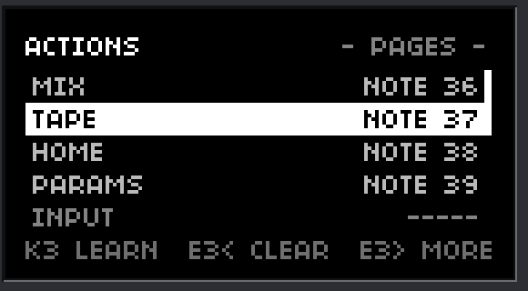
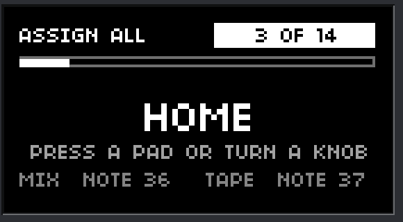

# MIDI actions: the box's buttons and a few utility actions from a controller (plan, no product code)

Linux desktop build only (everything proposed is behind `NORNS_LINUX_DESKTOP` in C and `NORNS_PLATFORM` in Lua); `macos/` was not touched (the shared window code under `matron/src/platform/macos/` was read); **nothing was built or changed in the product**. Each claim says whether it was **read** in this repository, **found on the web**, **my knowledge** (not checked here) or an **estimate**. Controller: an Arturia Beatstep Pro through the mio (16 pads sending notes, 16 endless encoders sending relative CC); its exact numbers are unknown here, so the layout in section 6 is marked **unverified**.

Two pictures, both **stand-ins** drawn with the real screen API in the real window (`midi-actions-previews/`):

| the list | the walkthrough |
|---|---|
|  |  |

## 0. Summary

- **One new row on the MIDI MAP page: `ACTIONS`.** It opens a short list in two groups, **PAGES** (MIX, TAPE, HOME, PARAMS, INPUT = the MIC/SYS/OFF button, GRID, ARC, KEYS, MAIDEN, MANUAL) and **UTILITY** (MUTE, DETACH SCREEN, FULLSCREEN, SCREENSHOT), each showing what it is assigned to. 14 actions. **No quit, no menu navigation, no typing, no in-window menu, no F6/F7/F8 of their own** (the GRID, ARC and KEYS actions open and close those windows, as the buttons do). The list ends with a line that says "QUIT IS NOT MAPPABLE", on purpose.
- **Easy and uncluttered:** the list row is the whole interface. **K3** on an action learns it (press a pad or turn an encoder); **E3 left** clears it; **E3 right** opens a small view (device, channel, format, direction, a typed number) for the rare case. **ASSIGN ALL** at the top is a guided walkthrough: one action at a time, "press a pad", **K3 skips, K2 stops**, a progress bar. **CLEAR ALL** at the bottom.
- **One code path with the mouse.** A click on a top-row button ends in `button_action(control)` in `sdl_bridge.cc`; a MIDI action calls the **same function** through one new Lua call, `_norns.window_action(name)`, which posts an event to the main thread. So behaviour is identical, **including with the top row hidden** (hiding the row only removes the buttons from the hit test; `button_action` never looks at it) and with the screen detached. Fullscreen, screenshot and detach get the same treatment (the F11 handler and the menu item are made to call the same small functions).
- **Safe by design:** pads act on **press only** (note on with velocity above 0; the note off, velocity 0, a CC of 0 and every key release do nothing); an encoder acts on **one step in one direction**, then waits for a pause; a **guard time** (0.25 s) stops a double hit from toggling twice; a master switch `ACTIONS ON/OFF` on the page; while a text entry is open nothing acts.
- **The existing rules hold:** the params MAP wins a CC clash and the page says so; scripts still receive every message (the layer is a tap); a note or CC another control or action already uses triggers the plain question ("NOTE 36 IS MIX. MOVE IT TO MUTE?"); every handler ends with a redraw; the page joins the random-event stress test.
- **Saved** in `midimap.conf` (`act.mix.type=note`, ...) and in your own presets; the built-in presets leave the actions alone; a damaged value falls back with a log line.
- Not verified here: the Beatstep's pad notes and channel, whether its pads can also send CC, how its pads feel for triggers (section 7).

## 1. How each action is implemented today (read)

The top row of the box is the "page buttons". Their ids come from `device_skin.h` and are the same in the aluminium and the pixel style:

| button | id | what the click does (`button_action` in `sdl_bridge.cc`, on mouse release over the same button) |
|---|---|---|
| MIX, TAPE, HOME, PARAMS | `SKIN_PAGE1..4` | `post_window_button(1..4)` -> an `EVENT_WINDOW_BUTTON` -> Lua `_norns.window_button(n)` (`lua/core/menu.lua`): if that page is up and not locked, leave the menu, else open the menu and `goto_panel(n)` |
| MIC (the MIC / SYS / OFF button) | `SKIN_MIC` | `post_window_button(6)` -> `_menu.next_input()` |
| GRID, ARC, KEYS | `SKIN_GRID`, `SKIN_ARC`, `SKIN_KEYS` | `toggle_grid()`, `toggle_arc()`, `toggle_keys()` (open and close the virtual windows; F6/F7/F8 and the in-window menu items reach the same functions) |
| MAIDEN | `SKIN_MAIDEN` | `open_maiden()` (Linux: checks maiden's port and the console, says why in a note on the screen when it cannot) |
| MANUAL | `SKIN_MANUAL` | `post_window_button(5)` -> Lua opens the manual file (a note when it is missing) |
| MUTE | `SKIN_MUTE` | `call_lua("output_mute")` -> Lua `_norns.output_mute` (`menu.lua`): remembers the output level and sets it to -inf, and back; the state returns to the window through `SDL_BRIDGE_SHOW_OUT` (the chip, and the toast "Output muted (Ctrl+M)" when the row is hidden) |
| detach / re-dock the screen | no button (F9, the right-click item, the placeholder) | `screen_toggle()` (`sdl_bridge.cc`): `screen_window_open` or `screen_window_close`, `skin.screen_out`, the menu tick |
| fullscreen | F11, in the **screen window only** | `set_fullscreen(!conf.fullscreen)` inside the screen window's event handler (`screen_window.cc`); nothing in the box |
| screenshot | the right-click item, Ctrl+Shift+S | `save_screenshot()`: the screen at four times its size to `dust/` (or the desktop), with a toast |

Facts that matter for the design:
- **`button_action(control)` does not look at whether the row is shown.** Hiding the row (`skin_buttons_shown`) only makes `skin_hit` / `box_style_hit` skip the buttons (the six controls and the MUTE chip while muted are tested separately, verified in the MIDI MAP work). So a MIDI action that ends in the same function works with the row hidden, which is the point of the owner's "MUTE must be mappable".
- Everything else that a mouse click does around `button_action` is only feedback: the pressed look (`skin.button_down`, then `redraw`) and the cursor.
- The in-window menu and the keyboard shortcuts already call these same functions (`menu_item(id)` in `sdl_bridge.cc`: `SHELL_MENU_MUTE` -> `call_lua("output_mute")`, `SHELL_MENU_SCREEN` -> `screen_toggle()`, `SHELL_MENU_SCREENSHOT` -> `save_screenshot()`, `SHELL_MENU_MAIDEN` -> `open_maiden()`), which is the proof that one more entry point is cheap and safe.
- **No Lua-callable entry point exists** for MAIDEN, detach, fullscreen or screenshot (GRID/ARC/KEYS have `_norns.grid_window(...)`, the pages have `_norns.window_button(n)` directly). F11's fullscreen is also a static function inside the screen window.

## 2. How a MIDI action calls the same code

**One new Lua call, `_norns.window_action(name)`** (Linux desktop only, like `_norns.toast` and `_norns.arc_turn`; registered in `weaver.cc`), answers true if it handed the action to the window. Names: `mix tape home params input grid arc keys maiden manual mute detach fullscreen screenshot`. It posts an SDL event; the main thread's handler does, for the ten buttons and MUTE, exactly `button_action(SKIN_xxx)` (the function the mouse release calls); for the three utility actions it calls `screen_toggle()`, `screen_window_toggle_fullscreen()` (the F11 code, moved into an exported function that the key handler now calls as well) and `save_screenshot()`. It also **flashes the button** for 150 ms like a click (`skin.button_down`, then `redraw`) so you see which pad did what; no toast on success.

**Cases with a plain message instead of an action** (a short toast, never silent):
- FULLSCREEN while the screen is docked: it is the screen window's, so "FULLSCREEN: DETACH THE SCREEN FIRST" (the DETACH action is next to it). Recommendation: it does **not** detach by itself (it would be a surprise during a performance).
- MAIDEN not running, MANUAL file missing: the existing notes of `window_button` and `open_maiden` (they already say why).
- The window not ready (no window yet): the call answers false and the layer says "WINDOW NOT READY".

**Identical behaviour is tested, not assumed** (section 4): for each action the C-side effect through `window_action` equals the effect of the mouse path (same page, same toggle state, same mute level), with the row shown and hidden, in both box styles, with the screen docked and detached.

## 3. The design

### 3.1 The page

Rows of MIDI MAP now: PRESET, LEARN, E1-E3, K1-K3, A1-A4, **ACTIONS**, WATCH, ON CLASH, ARC KEYS, SAVE AS (DELETE). `ACTIONS` shows how many are assigned (`5 OF 14`). K3 opens the list.

**The list** (first picture): header `ACTIONS` and the group in view; rows: `ASSIGN ALL`, then PAGES (MIX, TAPE, HOME, PARAMS, INPUT, GRID, ARC, KEYS, MAIDEN, MANUAL), then UTILITY (MUTE, DETACH, FULLSCREEN, SCREENSHOT), then `CLEAR ALL`, then a dim line `QUIT IS NOT MAPPABLE`. Group names are separators, not selectable. Each action row shows `NOTE 36`, `CC76 UP`, `CC76 DN` or `-----`, with `!` when the CC is in the script's params MAP (as the other rows) or when another control answers to the same message (the help line says which, as `CC72 ALSO A1` does today). The master switch `ACTIONS ON/OFF` is the first thing on the list's help line area? **No:** to keep the list short it is one more row of the page itself, after ARC KEYS (`ACTIONS`' own on/off is only for emergencies: a lock).

| key | on an action row | on ASSIGN ALL | on CLEAR ALL |
|---|---|---|---|
| E2 | move | move | move |
| K3 | **learn this action** | start the walkthrough | ask once ("CLEAR ALL? K3 YES K2 NO") |
| E3 left | **clear** this action (a message "MIX CLEARED") | | |
| E3 right | open the action's view | | |
| K2 | back to the page | back | back |

**The action's view** (E3 right): `LEARN`, `KIND` (NOTE, CC BUTTON, ENCODER STEP), `NUMBER` (E3, or K3 types it), `DEVICE` (ANY or a name, the same list and the same name matching as the controls: `mio` means every port), `CHANNEL`, for an encoder step `FORMAT` (REL 2S, REL SIGN, REL OFS) and `DIRECTION` (UP or DOWN), `CLEAR`. For a CC button there is a `THRESHOLD` as for the keys. This is the only place with settings; the list itself has none.

**Learn** works as for the other rows (the banner `LEARN MUTE`, the target row `PRESS A PAD / TURN A KNOB`, the seconds left, K2 or Esc cancels, 15 seconds ends it). The first **note on with velocity above 0** is taken as a NOTE, the first **non-zero relative step** of a CC as an ENCODER STEP with the direction you turned (read with the format chosen for new actions: the format of the last encoder or arc mapping you made, else REL OFS; the WATCH view tells you the true one), a **CC above the threshold** as a CC BUTTON when the same CC came as 127/0 (pads in CC mode: see the risks). Notes, clock, active sensing and the iii grid / keys window (`ANY` never takes them) are ignored as everywhere.

**ASSIGN ALL** (second picture): "3 OF 14", a progress bar, the action in large type, "PRESS A PAD OR TURN A KNOB", and the last two assignments in small type. The first message that is not ignored assigns it, shows `HOME = NOTE 38` for half a second and goes on. **K3 skips** (keeps what the action had), **K2 stops** (what was done stays, "STOPPED AT 3 OF 14"), the 15-second time-out of one step stops the walkthrough rather than skipping silently. A pad or encoder **already used by another action or control** asks first ("NOTE 36 IS MIX. MOVE IT TO HOME? K3 YES K2 NO"); there **K2 means no, skip this action** (not "stop"). At the end: `DONE: 11 ASSIGNED, 3 SKIPPED`.

### 3.2 When an action fires (the rules)

1. **Only press.** A pad: note on with velocity above 0. A CC button: a value above the threshold while it was below (an edge, like the keys). An encoder step: the decoded step has the chosen sign. **Never** a note off, a note on with velocity 0, a CC of 0, a relative step of 0 (value 64 in offset binary, 0 in the others), the other direction of an encoder, a key release, or a **delta of 0** (the lesson of KNOWN-ISSUES 16: nothing is done for a release or a zero).
2. **One trigger per gesture.** A guard time of **0.25 s** per action after a trigger (a pad bounce or a double hit does not toggle MUTE twice), and for an encoder **one trigger per burst**: after a step the action waits until the encoder has been quiet for 0.3 s (a fast turn does not open and close the grid ten times).
3. **Where the layer stands:** the same place as the controls (a tap after the scripts and the params MAP in `_norns.midi.event`; `norns.midimap.event`); nothing is removed from what scripts receive. The order inside the layer: text entry open -> nothing; WATCH, ONE TURN, learn, ask -> their own; else the params MAP clash check, then the controls and **then the actions**; a message that matches both a control and an action (not allowed to be set up, see 3.3) would act on both.
4. **The clash rules, extended:** `find_overlap` and `overlaps` look at the ten controls **and the 14 actions** (an ENCODER STEP and a CC BUTTON count as CC messages, a NOTE as a note); the question at assignment is the same sentence; `clashes()` (the params MAP) covers the CC-type actions, `on_clash=params` skips them like the controls and the page says so on the row and in a toast at load.
5. **An action does not fire** while the master switch is OFF, while a text entry is open, while a learn, ask, WATCH or ONE TURN is running, and while the window is not ready.

### 3.3 Splitting the Beatstep Pro's pads and encoders

One unit, one device, one channel; the split is by number and the question (section 3.1) keeps two things from sharing a note or a CC. **Pads** carry the actions (notes); **encoders** keep E1-E3 and A1-A4. If a script plays notes from the same pads (the risk below), set the actions to a channel the script does not use (CHANNEL in the action's view, or the pad channel of the unit in its Control Center) or use pads the script does not read.

### 3.4 Files

In `midimap.conf` (same rules: defaults, validation, a damaged value falls back with a log line, unknown keys kept; file version stays 1; old files read unchanged):

```
actions=1
act.mix.type=note   act.mix.num=36   act.mix.dev=ANY  act.mix.ch=0
act.mute.type=cc    act.mute.num=77  act.mute.mode=relob  act.mute.dir=up
act.tape.type=ccbutton  act.tape.num=20  act.tape.threshold=63
```
`type` is `none`, `note`, `ccbutton` or `step`; `mode` and `dir` only for `step`; `threshold` only for `ccbutton`. The 14 ids are fixed (`mix tape home params input grid arc keys maiden manual mute detach fullscreen screenshot`); an unknown `act.xyz.*` is ignored and kept. **Presets:** your own presets (`midimap-presets/`) carry the actions without device or channel (like the arc encoders); **built-in presets have no action section and leave the actions as they are** (applying PUSH 2 must not wipe your pads); a preset file from before this leaves them alone.

## 4. Tests to write first (and to watch fail)

- **Value functions** (`midimap_value_test.lua`): press detection for notes (on, on with velocity 0, off), CC buttons (edge at the threshold, 0, repeated high values), encoder steps in each format and direction (the other direction, 0, the burst rule with an injected clock), the guard time (a second trigger inside 0.25 s ignored, one after it accepted), the learned direction from the first step.
- **Settings** (`midimap_settings_test.lua`): defaults (all `none`, `actions=1`), round trip, every damaged value (type, number 128, dir, mode, threshold, an unknown action id kept), presets with and without the section, built-in presets leave actions alone, own presets bring them back without device and channel, `CLEAR ALL`.
- **Layer** (`midimap_layer_test.lua`, through the real `midi.lua`): each action calls `_norns.window_action(name)` with the right name on a press and **never** on a release, a velocity-0 note, a CC of 0, a zero step or a delta of 0; the guard; the burst rule; the master switch; a text entry open; learn (a note, a CC step with direction, the cancel paths, the 15-second time-out, an ignored realtime message); the question at assignment against a control and against another action, yes and no; the params MAP clash (a CC action is skipped, the clash is listed); `overlaps` covering actions; the walkthrough (order, skip, stop, a question inside it with K2 = skip, the time-out stops it, the summary); scripts still receive every message; the window answering false.
- **Page** (`midimap_page_test.lua`): the ACTIONS row and its count, the list (groups as separators that cannot be selected, the values, `!` and the help line), K3 learn, E3 left clears, E3 right opens the view, the view's rows, CLEAR ALL asks once, the walkthrough screens, the "QUIT IS NOT MAPPABLE" line, **every handler ends with a redraw**, the SYSTEM list unchanged.
- **Stress test** (`menu_stress_test.lua`): the ACTIONS list and view, learn, the walkthrough, CLEAR ALL, and action messages (pads, steps, releases, zeros) join the random events; invariants: no action call on a release or a zero, at most one call per guard period, no call while an entry, learn or WATCH is open, the window flags agree with the learn state, the selection is on a selectable row, nothing is written while a learn waits, ESC leaves.
- **C** (`window_action_test.c`, no SDL window): the table from name to control id; `button_action` called for the ten buttons and MUTE with `skin_buttons_shown` 1 and 0 gives the same result (a stub records the calls: `post_window_button` numbers, `toggle_*`, `output_mute`); fullscreen answers false (and the toast) when the screen is docked; the action names are exactly the 14.
- **Real window** (Xvfb, the pattern of `midimap_scenario`): a JACK client plays pad notes into `Verdandi:midi_in`; after learning (clicking nothing: learn from the page), a note for MIX opens the menu page, the same note again closes it, the same as a click on MIX (compared with `xdotool` click); MUTE toggles the output level with the row **hidden** and the chip appears; GRID, ARC and KEYS windows open and close; DETACH opens and re-docks the screen window (the count of windows named `Verdandi screen`); FULLSCREEN with the screen docked gives the message and with it detached toggles (the window's size changes); SCREENSHOT writes a png to `dust/`; a note off and a velocity-0 note do nothing; a script's own `midi` handler sees every note; **Mac unchanged** (`box_c_test.sh` guard check extended, `macos/` untouched).

## 5. Risks

| risk | answer |
|---|---|
| a pad hit by accident during a performance (MUTE, DETACH, MAIDEN opening a browser) | press-only, the guard time, the master switch row, **the layout of section 6 keeps MUTE, DETACH and SCREENSHOT in the far corners of their own pad group**; DETACH and MUTE never ask (a question in a performance is worse), but the flash and the state show at once |
| a script reads the same pads as notes (a drum script on the Beatstep) | scripts still receive everything, so a mapped pad **also** fires its action while the script plays it; use a channel or pads the script does not read (3.3); the page marks a note that is in use by an action; no swallow option (decision 3 of the MIDI MAP work stands) |
| the params MAP uses the same CC | the params MAP wins, the action is skipped, the page warns |
| the pads send CC instead of notes in some modes of the unit | CC BUTTON is supported (an edge at a threshold); learn tells which came |
| an encoder burst triggers an action many times | one trigger per burst (0.3 s quiet), plus the guard |
| the top row hidden hides the feedback | the 150 ms flash is drawn on the hidden button's place? **No:** the buttons are not drawn when the row is hidden, so there is no flash; MUTE shows its chip and toast as today; for the others the page changes or the window opens, which is the feedback |
| the MIDI action path differs from the mouse path | one function (`button_action`) for both; the C test and the Xvfb comparison |
| FULLSCREEN needs the screen window | a plain message, no automatic detach |
| a damaged `midimap.conf` | defaults with a log line, never an error |
| more rows make the page long | one row `ACTIONS` on the page; the detail is in the list; the page already scrolls |

## 6. A Beatstep Pro starting layout (UNVERIFIED)

I do not have the unit and could not find its pad numbering or default notes in what I read; **learn fills in the real notes**. The idea is only the *arrangement*: mirror the box (top row of the box = top row of pads) and keep the risky actions away from where you play. Pads numbered 1-8 left to right on each of two rows (which of the unit's rows is "top" is a guess):

| | 1 | 2 | 3 | 4 | 5 | 6 | 7 | 8 |
|---|---|---|---|---|---|---|---|---|
| **upper row** | MIX | TAPE | HOME | PARAMS | INPUT | GRID | ARC | KEYS |
| **lower row** | MAIDEN | MANUAL | - | - | - | SCREENSHOT | FULLSCREEN | **MUTE** (far corner) |
| | | | | | | | **DETACH** goes on a pad you do not play, e.g. lower row 3 | |

Use ASSIGN ALL and press the pads in this order (the walkthrough follows the order of the list: MIX, TAPE, HOME, PARAMS, INPUT, GRID, ARC, KEYS, MAIDEN, MANUAL, MUTE, DETACH, FULLSCREEN, SCREENSHOT), then rearrange with the list. If your pads send on a channel your scripts use for notes, set the actions' CHANNEL. The sixteen encoders: three keep E1-E3, four are A1-A4, the rest are free.

## 7. What needs the real hardware

- The Beatstep Pro's **pad notes and channel** in the mode you use (and whether the pads can send CC), the velocity range (hard hits, soft taps: does a light touch reach velocity above 0 every time?), whether a pad sends a note on twice (the guard handles 0.25 s; if it is longer, say so), and pad release behaviour (note off or nothing).
- **Whether you can hit the pads you want without hitting the risky ones**: the layout in section 6.
- The **feel** of the 150 ms flash, the guard and the burst rule with your encoders; whether an encoder step is a good trigger at all.
- The **window manager**: fullscreen of the screen window and detach on your desktop (the headless tests use no window manager).
- A script that plays notes from the same pads (the channel question).

## 8. Decisions for you (recommendation first)

1. **Fullscreen while docked:** a message only (recommended); alternative: detach and then fullscreen.
2. **Encoder steps as triggers:** supported with the one-per-burst rule (recommended); alternative: pads and CC buttons only.
3. **The format used when learning a step:** the format of your last encoder or arc mapping, else REL OFS, with WATCH to tell the truth (recommended); alternative: ask the format first.
4. **Guard times:** 0.25 s per action, 0.3 s quiet for encoders.
5. **ASSIGN ALL** walks through all 14 in the list's order and keeps what an action already has when you skip it (recommended); alternative: only the unassigned ones.
6. **The master switch** as a page row (recommended); alternative: none (the list's CLEAR ALL is the off switch).
7. **No flash when the row is hidden**, no toast on success.
8. **Order of work** when you say go: value functions and settings, then the layer and the page, then `_norns.window_action` and the C functions, then the real-window scenario, then docs and the hardware checklist.
