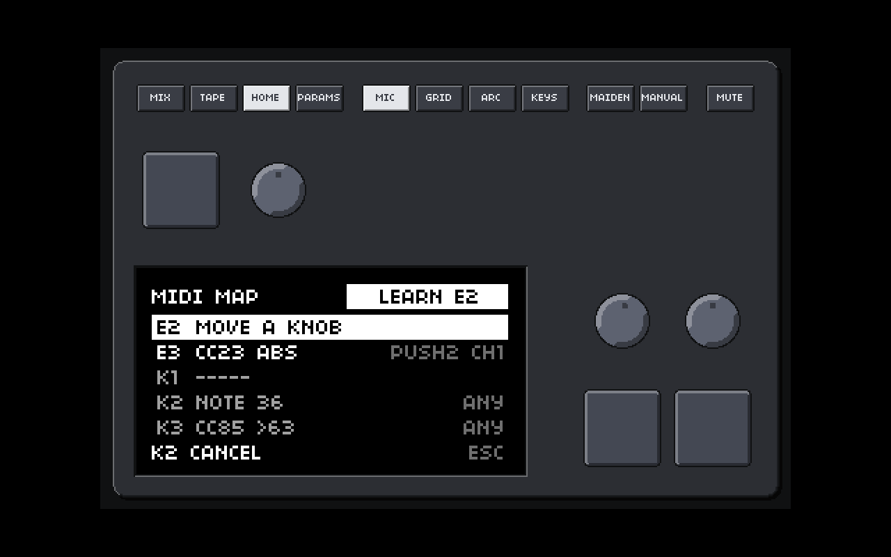

# MIDI MAP: control the on-screen keys and encoders from MIDI (plan, no product code)

Linux desktop build only. Everything proposed here lives behind `NORNS_PLATFORM` (Lua) and `NORNS_LINUX_DESKTOP` (C), `macos/` was only read, and **nothing was built or changed in the product**. Each claim says whether it was **read** in this repository, **found on the web** (links at the end), **my knowledge** (not checked here) or an **estimate**.

One picture: `midi-map-previews/midi-map-learn-standin.png`. **It is a stand-in:** the page does not exist, so a throw-away function (`midi-map-previews/standin_draw.lua`) draws what this plan proposes with the **real screen API, the real font and the real window and box** (headless: Xvfb, dummy jackd, `linux/tests/norns_probe.sh`). The rows, wording and the learn banner are the proposal, not code that will be shipped.



## 0. Summary

- **What it is.** A small layer, `lua/core/midimap.lua`, that **listens** to every MIDI message norns already receives and turns mapped ones into the same key and encoder events the mouse and the computer keyboard make today (`_norns.show_control` + `_norns.key` / `_norns.enc`, the way `lua/core/keyboard.lua` does it). Six controls: E1 to E3 and K1 to K3. No MUTE, no page buttons.
- **It never takes anything away from scripts.** It is a **tap**: `_norns.midi.event` already hands each message to the script's handlers first; the layer looks at the same message afterwards and removes nothing. By default **mapped and unmapped messages both reach scripts**. A setting to swallow mapped messages is listed as a later option, not planned.
- **The params MAP wins a clash.** The existing params MAP (`core/pmap.lua`, `core/menu/params.lua`) is a user's explicit choice for one script's parameter; the MIDI MAP is a general convenience. When both want the same device, channel and CC, the params map gets it and the MIDI MAP **skips that message** and says so once in plain words. The clash is checked when you assign (a warning, the assignment is allowed) and again each time a script loads.
- **Encoders:** an **absolute** knob (0 to 127) becomes steps by its change, with a sensitivity, a baseline for the first message, and a re-baseline after a jump or a pause. **Relative** encoders: three formats exist in the wild (**two's complement**, **sign-magnitude**, **offset binary**); the format is chosen per mapping, and learn makes a **suggestion** that you confirm (a detection can be wrong, section 2.5).
- **Keys:** a CC (press when the value is above a threshold, release at 0) or a note (note on / note off).
- **Learn by mouse:** on the MIDI MAP page you start LEARN, **click E1 to E3 or K1 to K3 in the window** (the click selects, it does not turn or press anything), then move the knob or press the button on the controller. Typing a CC number and clearing a mapping are rows on the same page.
- **The owner's main route is USB: the "mio" (section 1.5).** It is an ordinary ALSA raw MIDI device. norns names it with the USB product string, **`mio`**, and gives **one norns device per MIDI port**: one port is `mio`, several are `mio 1`, `mio 2`, ... Device-by-name works for it (section 2.1a: names are normalised, a stored name `mio` means *the whole interface, every port*, `mio 2` means that port only, so restarts, re-plugging into another USB socket and a changed port-number suffix do not break a mapping). **What the mio cannot do:** controllers on the *same* port are one device, separated only by **channel and CC number**; controllers on *different* ports are different devices.
- **The network case stays supported (section 1.4):** a network MIDI link such as RTP-MIDI shows up on Linux as **ALSA sequencer ports**, not as an ordinary ALSA raw MIDI device. The only way such a source reaches norns today is the **JACK MIDI input** ("Verdandi JACK in"), and there **every connected source is one merged device**. So for the Push 2 over the network, "device: pick by name" cannot tell it from another network source; "any device" is what works, and a per-source device needs a decision (section 8, decision 1).
- **Saved** in `midimap.conf` (the `ui.conf` pattern), built-in presets and the user's own in `midimap-presets/` (the THEME pattern). A Push 2 preset can be written but its **numbers cannot be checked without the hardware**.
- **What can only be tested with real hardware:** the Push 2, the network link, real endless-encoder feel (section 4).

## 1. How MIDI reaches Lua today, and where the layer sits

### 1.1 The path (read)

```
USB controller ──ALSA rawmidi (udev "sound" subsystem, midiCxDy)──┐
"Verdandi keys" window ──pipe─────────────────────────────────────┤  device_midi.cc: one reader thread per device,
JACK MIDI input "Verdandi:midi_in" ──lock-free queue + pipe───────┘  one parser (dev_midi_consume_buffer)
                         │ midi_input_msg_post -> EVENT_MIDI_EVENT (id, bytes)
                         ▼
   weaver.cc w_handle_midi_event -> _norns.midi.event(id, data)   (data = a Lua table of bytes)
                         │
   lua/core/midi.lua  _norns.midi.event:
        1. d.event(data)                  the device's own callback (what `midi.connect(n).event` sets)
        2. vports[d.port].event(data)     (the same device through its vport number)
        3. norns.menu_midi_event(data, d.port)   "hack = send all midi to menu for param-cc-map"  -> the params MAP
```

- **ALSA devices** are found by udev (`device_monitor.cc`, `get_alsa_midi_node`: the `sound` subsystem, `midiC<card>D<dev>`); each becomes a norns MIDI device with a name. **Network MIDI is not among them** (1.4).
- **The JACK MIDI input** (`matron/src/platform/linux/jack_midi_in.*`): a JACK client "Verdandi" with one MIDI input port `midi_in`, shown to norns as one device, "Verdandi JACK in". Nothing connects to it by itself unless `midi_in_from=` is set in `audio.conf` (`midi_autoconnect.cc`, prefixes such as `Midi-Bridge:`).
- **The params MAP** (`norns.menu_midi_event` in `lua/core/menu/params.lua`, data in `lua/core/pmap.lua`): it only looks at **control change** messages (`ch = data[1] - 175`, valid for 1 to 16, so status bytes 0xB0 to 0xBF) and only acts when `pmap.rev[dev][ch][cc]` holds a parameter. `dev` is the **vport number (1 to 16)**, not a name. The data is **per script**: `pmap.clear()` when a script loads, `pmap.read()` from `<script>.pmap` in the script's data folder (`script.lua` lines 118 and 247). It **does not remove** the message from scripts: the script has already had it (step 1 and 2 run before step 3). While the params page is in its own "learn" state (`m.midilearn`, a local of `params.lua`), the next CC is taken for the assignment.
- **Scripts** receive everything through `midi.connect(n).event` (or `midi.devices[id].event`): all bytes, every message type.

### 1.2 Where the mapping layer sits

One call added at the end of `_norns.midi.event`, after the existing three steps, guarded so that nothing changes where the layer is absent (macOS keeps the file as it is):

```lua
if midimap then midimap.event(d, data) end   -- tap: nothing is consumed, nothing is changed
```

Why there and not in C: all the information (device name, vport number, the params MAP) is in Lua, the volume is small (CC and notes only; the layer ignores every status byte of 0xF0 and above at once, so a clock at 24 ppqn costs one comparison per message), and the layer is testable with plain Lua. The events go back to norns through `_norns.key`/`_norns.enc` exactly like the computer keyboard's (`keyboard.lua`, `hw_press` and `hw_turn`), so **the window shows the key lighting up and the knob turning** (`_norns.show_control`) and everything that listens to keys and encoders (menu or script) behaves as if the user had used the mouse.

### 1.3 What the layer does not touch

`pmap` data, the params page, the scripts' handlers, vports, `midi.connect`. The only shared-file change is **one accessor** (section 2.6) so the layer knows when the params page is learning: a few lines in `lua/core/menu/params.lua`, guarded by `NORNS_PLATFORM`.

### 1.4 The Push 2 over a network link (secondary route): what it looks like here (web, partly read)

- The owner's plan: Push 2 on Windows, sent over **RTP-MIDI** to this Linux machine. On Linux the usual tool, **rtpmidid**, "exposes network RTP-MIDI devices as local **ALSA sequencer** ports" (web). The repository's own notes say the same shape of problem for norns: raw MIDI devices come from udev; sequencer ports need a bridge (`docs/port/INVENTORY.md` and `clock-notes.md`: *"A seq port may need the a2jmidid bridge or PipeWire to show up"*).
- So the realistic route is: network → ALSA sequencer port → **PipeWire's Midi-Bridge (or a2jmidid) → JACK MIDI port → `Verdandi:midi_in`**, which is exactly what `midi_in_from=Midi-Bridge:...` does (`docs/port/RUN-ON-LAPTOP.md`; a Reaper virtual port was verified on the owner's laptop, `HARDWARE-CHECKLIST.md`). norns then sees **one** device, "Verdandi JACK in".
- Consequence for **"device per mapping"**: any number of controllers through that one port are the same device to norns, so a mapping set to "Verdandi JACK in" matches all of them; "ANY" matches all devices. A name-per-controller choice exists only for **USB controllers plugged into this machine** (each is its own ALSA device).
- The ALSA-raw-device wording of the request (an RTP link "appearing as an ordinary ALSA MIDI device") is true only if the link software creates a kernel virtual raw MIDI device (`snd-virmidi` with a connection to the sequencer port); I did not find a ready recipe for that in what I read. This is an open question (section 8) and goes to the hardware checklist.

### 1.5 The mio: how it appears to the midi module (read in the code; the port count is not known here)

**What the code does** (`device_monitor.cc` `add_dev_sound`, `device_list.cc` `dev_list_add`, `device_midi.cc`, `lua/core/midi.lua`, `lua/core/vport.lua`):
1. udev reports the sound card's `midiC<card>D<dev>` node. The **name is the USB `product` attribute** of the device (or of a parent): for the owner's interface that is `mio`, the string in `norns.log` (`dev_monitor: adding midi device mio`). That log line is printed **once per interface, before the ports are split**, so it does not say how many ports there are.
2. `dev_midi_port_count` asks ALSA for the number of sub-devices of that raw MIDI device (**one per MIDI port / cable**). norns makes **one MIDI device per port**: with one port the device is called **`mio`**; with several (`> 1`) each is called `<name> <port + 1>`: **`mio 1`, `mio 2`, ...** (the log then also says `assigned device name with port: mio 1`). Each is opened as `hw:<card>,<dev>,<port>`; a port with no input is added without a reader.
3. `midi.lua` `Midi.new` makes a Lua device from each, with `vport.get_unique_device_name`: if the name is already taken by **another** device (two identical interfaces, or a one-port `mio` next to a second `mio`) a **` 2`, ` 3`, ...** suffix is appended in the order the devices were enumerated. Each device gets the next free **vport** (1 to 16) the first time its name is seen; the vport assignment is by name.
4. Scripts and the layer get the bytes of **one port** per device (`_norns.midi.event(id, data)`); the device's `id` changes on every re-plug and restart, the **name does not**.

**What it means for several controllers behind the mio.**
- Controllers on **different ports** (`mio 1`, `mio 2`) are **different norns devices**: the device filter separates them completely (that is the clean way if the interface has more than one port).
- Everything arriving on **one port** is **one device**: a DIN cable carries no identity, so two controllers merged onto one cable (a Windows MIDI router, a thru box, the Push 2 and another controller through Ableton's output) can only be told apart by **MIDI channel** and **CC/note number**. The mapping's channel filter is therefore the separator: give each controller its own channel, or choose CC numbers that do not overlap; if two send the same CC on the same channel they are the same control to norns and to every script.
- The Push 2 itself is a USB device on the Windows side; what reaches the mio is whatever Windows sends out (probably Live's or a router's output), so numbers and **channels may differ from the Push 2's own** and have to be learned, not assumed (Push 2 preset caveat in 2.7).
- A 5-pin DIN link is 31.25 kbaud: a fast turn of several endless encoders can queue messages and arrive late or in bursts; the layer takes the sum of what arrives (the carry in 2.3), so nothing is lost, but **the feel may lag** (hardware check, section 4).
- **I cannot tell from here** how many ports the owner's mio has (I have no log with the `mio 1` line and no `amidi -l`). Ask for `amidi -l` and the first lines of `norns.log` after plugging it in; section 4.

## 2. The design

### 2.1 What is stored for one control

| field | values | default |
|---|---|---|
| `type` | `none`, `cc`, `note` (keys only for `note`) | `none` |
| `num` | CC 0 to 127 / note 0 to 127 | none |
| `dev` | `ANY` or a device name as the DEVICES page lists it (matching: 2.1a) | `ANY` |
| `ch` | `0` = any, 1 to 16 | `0` |
| encoders: `mode` | `abs`, `rel2c` (two's complement), `relsm` (sign-magnitude), `relob` (offset binary) | `abs` |
| encoders: `sens` | 1 to 9 (a log scale, 5 = normal, section 2.3) | 5 |
| keys: `threshold` | 0 to 126 (CC only): pressed when value is **above** it | 63 |

#### 2.1a Device selection by name (USB devices such as the mio)

The goal: a mapping made today for `mio` still works after a restart, after the interface is plugged into another USB socket, after the order of devices changes, and whether norns calls it `mio`, `mio 1` or (a second identical interface) `mio 2`.

- **Stored value** is the name string shown on the page. The mapping never stores an id, a vport number or a `/dev` path (they change; `pmap` stores vport numbers, this does not).
- **Normalising** both sides before comparing: trim, collapse runs of blanks, ignore case, ignore a trailing `(ABSENT)` marker. Control characters are removed; a name is kept as UTF-8 and compared bytewise after that (no locale-dependent folding).
- **Rule (in this order):** a device `D` matches a stored name `S` when (1) `norm(D) == norm(S)`; or (2) `norm(D)` is `norm(S)` followed by a single blank and **digits only** (`mio` matches `mio`, `mio 1`, `mio 2`: **the whole interface, every port**). The reverse is not true: a stored `mio 2` matches only `mio 2`. A name that really ends in a number (`Push 2`) stays correct under rule (1) and, under rule (2), also matches `Push 2 1`, `Push 2 2` (its ports), never `Push 3`.
- **The DEVICE row offers**: `ANY`; one entry per **interface** (`MIO (ALL PORTS)` stores `mio`); one entry per **port** when the interface has several (`MIO 1`, `MIO 2` store those names); and a remembered name of an absent device marked `(ABSENT)`. When there is one port the two entries are the same and only `MIO` is shown.
- **Re-plugging and restarts:** the name comes from the USB product string, so it is the same for the same model in any socket; the row shows the mapping as **ABSENT** while it is unplugged (dim, no error) and it starts working again the moment the device is added (the layer matches on every message, no cached device object). The first message after an add re-baselines an absolute knob (2.3).
- **Two identical interfaces** are the one case that name matching cannot fix: norns suffixes the second as `mio 2` in enumeration order, which can swap after a re-plug. The page says so on that row's help line; the stored `mio` then matches both. Telling them apart would need the USB serial number, which `midi.lua` does not receive (a possible later change to `device_monitor.cc`, not planned).
- **Port-number suffix tolerance** is rule (2); **a changed port count** (a firmware or a different mode) keeps `mio` valid and breaks only a stored `mio 3` that no longer exists.

Global: `on_clash=params` (the params MAP wins, default) or `both`. `ANY` never matches the keys window's own device "Verdandi keys" (the on-screen virtual keyboard); naming it explicitly allows it. Realtime and system messages (status 0xF0 and above, so clock, start, stop, active sensing, sysex) are never looked at.

### 2.2 Who gets a message: the conflict rule

For every incoming CC (or note), **in this order**:

1. Scripts' own handlers have already received it (step 1 and 2 above). **Never changed.** This is why "unmapped messages still reach scripts" and "by default mapped messages reach scripts too": the layer has no power to stop either.
2. The params MAP (`norns.menu_midi_event`) runs as before.
3. The MIDI MAP looks at the message. It **skips** the message when:
   - the params page is in learn (the learn gets the message, the layer stands down; one learner at a time), or
   - `on_clash=params` and the params MAP has this exact device (vport of the device), channel and CC (for an "any channel" mapping: any channel of that CC on that vport; for "any device": any vport), or
   - the learn flow of this page is not the one waiting for it (below).
   
   Otherwise it acts.

**At assignment** (learn, typed number, preset): if the params MAP of the loaded script uses that CC, the page shows a plain warning on the screen and in the window toast: `CC 71 IS ALSO IN THE PARAMS MAP OF THIS SCRIPT (<param name>). THE PARAMS MAP GETS IT.` The assignment is kept (the user might load a different script tomorrow); the row shows `!`. **At load** (a `script_post_init` hook; `hook.script_post_init` exists, read) the layer rechecks all six and logs one line per clash (`midimap: E2: CC 71 is in the params map of <script>, left to the script`), and shows **one** toast per script load. **Later conflicts** (the user maps a param to a CC that a control already uses): `pmap.assign` is not changed; the layer's check on every message (a table lookup) just makes it skip. The reverse case (a script's own `midi` handler using the same CC) **cannot be known** to the layer; both will react. That is the price of "scripts are never touched", and the plain wording on the page's help line says so.

Why "params wins" and not "the user chooses each time": the params map belongs to one script and one session of work, the user set it deliberately and it is saved with the script; a global convenience that silently stole its CC would break a script that worked yesterday. The `both` setting exists for the user who wants one knob to do both.

### 2.3 Value handling

**Absolute CC (0 to 127) to encoder steps.** Per mapping state: `last` (nil at first), `acc` (a fraction).
- **First message** (after learn, after a mapping change, after the device appeared, or after **1.5 s without a message**): it only sets `last`; **no steps**. This avoids a jump when the hand takes a knob whose position differs from the old one.
- Otherwise `d = v - last`; `last = v`. A **jump** (`|d| > 40`) is a re-baseline with no steps (a controller recalled a preset, a DAW moved the knob, or the knob wrapped), logged at debug level only.
- Steps: `acc += d * factor`; `n = trunc(acc)` toward zero; `acc -= n`; call `enc(n)` if `n ~= 0` (one call with a count, the same as the mouse drag, `post_enc(n, ticks)`). Remainders carry over, so a slow turn is never lost.
- `factor = 0.5 * 2^((sens - 5) / 2)`: sens 5 = **one step per two CC values** (a full sweep of 127 is about 64 steps), sens 1 = one step per eight, sens 9 = two steps per value. (The base is an estimate; the real feel is a hardware check.)
- **At the ends:** a knob at 0 or 127 sends nothing more, so the user lifts and re-turns; nothing special is done. If the owner's controller prefers it, a later row "AT THE END" could be added; not proposed.

**Relative CC.** One message `v` (0 to 127) gives a signed amount `r`; zero or ignored values are dropped; then `acc += r * factor_rel` with `factor_rel = 2^((sens - 5) / 2)` (sens 5 = **one step per unit**), the same carry as above. Formats (my knowledge of how controllers send them; the Push 2's own scheme is **not verified**, section 4):

| format | name on the page | `r` for v |
|---|---|---|
| two's complement | `REL 2S` | 1 to 63: `+v`; 65 to 127: `v - 128` (127 = -1, 65 = -63); 64 and 0: no change |
| sign-magnitude (bit 6 = sign) | `REL SIGN` | 1 to 63: `+v`; 65 to 127: `-(v - 64)` (65 = -1, 127 = -63); 0 and 64: no change |
| offset binary (64 = no change) | `REL OFS` | `v - 64` (65 = +1, 63 = -1, 127 = +63, 0 = -64); 64: no change |

The one-step encoders some controllers call "inc/dec 1/127" are `REL 2S`, and the "Mackie V-Pot" type (bit 6 sign, low bits magnitude) is `REL SIGN`. Fine/fast turning (bigger numbers) works in all three; the sensitivity applies to the whole.

**How the format is chosen.** **By the user per mapping** (the MODE row) **and** by a **suggestion during learn**: while a knob is learned the layer keeps the first six messages of that CC (the user is told "TURN IT BOTH WAYS"). It suggests:
- all values in `1..16` or `112..127` and both a small and a large one present: **REL 2S**;
- values in `1..16` and `65..80`: **REL SIGN**;
- values within `48..80` of 64 on both sides, with 63/65 in the set: **REL OFS**;
- anything else (a smooth series that grows or falls): **ABS**.
The suggestion is shown on the MODE row with a `?` until the user changes or confirms it. The three signatures overlap in the one-direction case (a clockwise-only turn of 1, 2, 1 is the same in two formats), so a single direction gives **no suggestion** and the page says `TURN BOTH WAYS`. An absolute knob moved near its middle (63, 64, 65) looks like offset binary; that is why the suggestion is never silent (`ABS` stays the default when unsure), and why the page keeps the manual row.

**Keys.**
- **CC key:** a value **above** `threshold` (default 63, so 64 to 127) while released: **press** (`_norns.key(n, 1)`); value **0** while pressed: **release** (`_norns.key(n, 0)`). Values in between change nothing; repeated presses without a release are ignored. (Push buttons send 127 on press and 0 on release: my knowledge.)
- **Note key:** note on with velocity above 0 = press; note off, or note on with velocity 0 = release. The key mapping stores the channel the same way.
- **Safety:** a held key is **released** when the device is removed, when the mapping changes or is cleared, when learn starts, and when the page closes. K1 behaves as it does for the mouse and the computer keyboard (a short press toggles the menu, `menu.lua`).

### 2.4 The window: finding E1-E3 and K1-K3 by mouse

The window's own hit test already answers this: `skin_hit` (`matron/src/platform/macos/device_skin.c`, shared with Linux under `NORNS_LINUX_DESKTOP`) returns `SKIN_K1..SKIN_K3` and `SKIN_E1..SKIN_E3`; the pixel style has its own `box_style_hit` (`box_style.c`). **Read in both:** the **page buttons row is the only part that depends on `look_shown` / `buttons_shown`**; the six controls are tested in a separate loop with no such condition. So a hidden top row, the style, the pixel look (PIXEL, RETRO, 8-BIT, 16-BIT) and a detached screen do not change which of the six a click hits. The hit areas have goldens already (`box_pixel_hits_golden.txt` for the pixel style, `box_hit_dump.c`, row shown and hidden).

Learn's click goes through **`handle_button`** in `sdl_bridge.cc` (shared with the Linux window under `#ifdef NORNS_LINUX_DESKTOP`): one new guarded branch at the start of the left-button-down handler: **while a pick is armed**, a hit on `SKIN_K1..SKIN_E3` is **not** posted as a key or a drag (the existing `post_key` / `drag_enc` lines are skipped) and instead calls Lua `midimap_pick(kind, n)`. A click anywhere else cancels the pick. Outside a pick everything is as today. A pick is armed by Lua (`_norns.midimap_arm(1)`, cleared with `0`; new C function, Linux desktop only).

### 2.5 Learn flow

States of the page: `IDLE`, `PICK` (waiting for a click on a control), `LISTEN` (waiting for MIDI), `CONFIRM` (a suggestion for a relative format waiting for the user).

1. **Start.** Row **LEARN** on the page (K3), or `LEARN` inside a control's detail view (starts LISTEN directly for that control).
2. **PICK.** The screen shows `CLICK A CONTROL` and a countdown; the window outlines **all six controls** in a pulsing ring (new `_norns.midimap_show(state, n)`, drawn by the shared skin code under `NORNS_LINUX_DESKTOP`, in every style, with the top row shown or hidden). A click on one of the six picks it.
3. **LISTEN.** The screen shows the inverted banner `LEARN E2` (picture above) and `MOVE A KNOB` / `PRESS A BUTTON`; the window rings only that control, and the toast beside E1 says the same (`_norns.toast`). The **first** CC from any device (keys: also a note on) that is not realtime and not the keys window's own device is taken: device, channel and number are recorded, `ANY` stays the default for the filters unless the user changes them. For an encoder a **note is refused** (a short message: `A NOTE CANNOT TURN A KNOB, USE A CC`); for an encoder the layer keeps listening for the next five messages of that CC to make the suggestion (CONFIRM), and ends earlier on any key press or after 3 s of silence.
4. **Done.** The row shows the assignment; the file is written; a clash is announced as in 2.2.
5. **Cancel and time-out.** `Esc`, `2` (K2 on the computer keyboard) and `F1` cancel (the same as the THEME page's quit keys, `keyboard.lua` `ESC`/`2` map to K2); a click outside the six controls cancels PICK; **15 s** of nothing ends PICK or LISTEN with `LEARN STOPPED`. Leaving the page, a script error or the device list changing also cancel. Cancelling changes nothing and clears the ring.
6. **Typing a number.** Detail view rows `TYPE` (keys: CC / NOTE), `NUMBER` (E3 steps by one; K3 opens the text entry for digits, as THEME does for hex), `CLEAR` (K3).

### 2.6 The page: MIDI MAP below THEME

SYSTEM list (`core/menu/system.lua`, computers only): `DEVICES, AUDIO, MODS, SCREEN, THEME, MIDI MAP, CLEAN UP, RESET, RESTART` (id `MIDIMAP`, shown `MIDI MAP >`).

```
 MIDI MAP                                  list:  E2 row, E3 change, K3 open / do, K2 back
 PRESET   PUSH 2                           E3 chooses a preset, K3 applies it
 LEARN                                     K3: click a control, then move the controller
 E1       CC71 REL 2S         ANY CH-
 E2       CC72 REL 2S         ANY CH-
 E3       CC73 REL 2S         ANY CH-
 K1       CC102 >63           ANY CH-
 K2       -----
 K3       NOTE 36 (C2)        PUSH2 CH1
 ON CLASH PARAMS MAP WINS                  E3: PARAMS MAP WINS / BOTH
 SAVE AS...   DELETE                       own presets, as THEME
```

A control's **detail view** (K3 on its row): `LEARN`, `TYPE` (CC / NOTE; encoders: CC only), `NUMBER`, `DEVICE` (ANY, the connected devices by name, a remembered absent one shown with `(ABSENT)`), `CHANNEL` (ANY, 1 to 16), `MODE` (encoders: ABS, REL 2S, REL SIGN, REL OFS, with `?` when guessed), `SENS` (1 to 9, shown as a bar and a number), `THRESHOLD` (keys), `CLEAR`. K2 leaves the detail view. **Wording** is short and plain (`MOVE A KNOB`, `PRESS A BUTTON`, `CLICK A CONTROL`, `LEARN STOPPED`, `NO SIGNAL`), the same voice as the THEME page. **Visible learn:** inverted banner on the screen (picture), pulsing ring on the control in the window, toast beside E1.

**Redraws and the stress test.** Every `key`, `enc` and keyboard handler of the page ends with `_menu.redraw()` when the menu is up (`pcall` around the raw handlers and a `recover()` as `ui.lua`/`box.lua` do), and a MIDI-driven change (a learn result, a time-out, a device removal, a toast) redraws too. The page joins `linux/tests/menu_stress_test.lua`: its **invariants** (selection in range, modal flags consistent, "the screen shows the state", no handler error, ESC leaves) extended with: learn states agree with the window flag (a pick is armed only in PICK), no key stays pressed after leaving, no mapping written while a learn is open, the row list matches the state.

### 2.7 Files

**`<norns home>/midimap.conf`**, key=value lines like `ui.conf`:

```
verdandi-midimap=1
preset=PUSH 2
on_clash=params
e1.type=cc
e1.num=71
e1.dev=ANY
e1.ch=0
e1.mode=rel2c
e1.sens=5
k1.type=cc
k1.num=102
k1.threshold=63
...
```

Defaults for everything missing; a **damaged value falls back to its own default with a log line** (`midimap.conf: e2.num=300: not 0 to 127, using none`); **unknown keys are ignored with a log line and kept** when the file is written again; a too-new version number is read as far as understood and warned about; writes go through a temporary file and a rename. `dev` is a name, so the file works across reboots even if the vport numbers change (unlike `pmap`, which stores vport numbers).

**Presets.** The pattern of `box_settings.lua`: built-in presets in a table, the user's own one small file each in `<norns home>/midimap-presets/<slug>.midimap` (`verdandi-midimap-preset=1`, `name=...`, the same `e1.*`...`k3.*` keys **without `dev`**, so a preset moves between computers), a maximum of 64, invalid files ignored with one log line, the name must match the file's slug. Built in: **NONE** (all six cleared), **PUSH 2** (below), and **GENERIC REL 2S** (CC 16 to 18 relative two's complement, three of the commonest knob numbers; keys CC 64, 65, 66). Choosing a preset replaces the six mappings but not `on_clash`; `preset=` is a label, `CUSTOM` once anything is changed.

**The PUSH 2 preset: what I can and cannot say.** In my knowledge (unverified here: the vendor's interface document is on GitHub, **I could not read it in this session**, web results above) the Push 2's eight track encoders send **CC 71 to 78**, the buttons above the display **CC 102 to 109** (below it **CC 20 to 27**) with 127 on press and 0 on release, and the encoders are relative. The proposed preset is E1 to E3 = CC 71 to 73, `REL 2S`; K1 to K3 = CC 102 to 104. **This must be checked with a MIDI monitor and the real Push 2 (in its User mode) before the preset is called correct**; until then it is shipped marked `(UNVERIFIED)` in the list and in `HARDWARE-CHECKLIST.md`, and LEARN remains the way to set it up reliably.

## 3. Tests to write first

All Lua tests run under `lua5.3` without hardware and are added to `linux/tests/run_all.sh` (clean-environment run); C changes get their own small C tests; the real-window scenario follows the `picker_scenario` pattern. Order: pure value functions first, then the layer, then the page, then the window.

**3.1 `midimap_value_test.lua` (pure functions, no norns).**
- Absolute: first message gives no steps; ramps 0 to 127 and back give the expected total (with sens 1, 5, 9 and the carry across calls); a one-unit change at sens 1 gives a step only after the eighth; direction reversal; **jump** of exactly 40 and 41; **pause** over 1.5 s re-baselines (clock injected, no sleeping); 127→127 and 0→0 give nothing; values 0 and 127 at the ends.
- Relative, **each format**: every value 0 to 127 against a table written out independently of the code (`REL 2S`: 1, 63, 64, 65, 127, 0; `REL SIGN`; `REL OFS`: 63, 64, 65, 0, 127); sensitivity 1, 5, 9 with carry; large values (fast turn); the three formats **disagree** on the same value (127, 65, 1) as the table says.
- Detection: a clean series per format in both directions gives that format; one direction only gives no suggestion; a smooth absolute ramp gives ABS; a mid-range absolute wiggle (63, 64, 65) does **not** produce a confident relative suggestion without both directions.
- Keys: CC press above the threshold (threshold 0, 63, 126), value exactly at the threshold, release at 0, intermediate values while pressed, press twice without release, release without press; notes: on, off, on with velocity 0, other notes ignored, channel filter.

**3.2 `midimap_layer_test.lua` (the layer with fake devices; the real `core/midi.lua` event function).**
- A mapped CC calls `_norns.show_control` then `_norns.enc/_norns.key` with the right numbers; an unmapped one calls nothing.
- **Device filter:** any, a name, an absent name, two devices with the same CC; "Verdandi keys" is not matched by `ANY` but is by name. **Name matching, by table (2.1a):** `mio` against `mio`, `mio 1`, `mio 2`, `MIO`, `mio  ` (blanks), `mio 1x` (no), `mioxyz` (no), `mio 2` against `mio` and `mio 1` (no) and `mio 2` (yes); `Push 2` against `Push 2`, `Push 2 1` (yes), `Push 3` (no); trailing `(ABSENT)`; an empty or control-character name; a long name; non-ASCII. **Stability:** the same device re-added with a **new id** and a different vport still matches and acts; removed and re-added; added later than the mapping; the unique-name suffix swapped between two identical devices (documented behaviour); the DEVICE row's entries for one port, several ports, an absent remembered name, two interfaces; a file saved before the device existed loads and matches once it appears.
- **Several controllers behind one port:** two mappings on the same device with different channels act independently; the same channel and CC would be one control (asserted, so the rule is visible). **Channel filter:** any, a channel, the wrong one.
- **Scripts still receive everything:** a fake script handler on the device and on the vport receives the same bytes **in the same order and the same table contents**, mapped or not, with the layer on and off, with `on_clash` both values (the default leaves scripts untouched: nothing in the table the script sees is changed).
- **Conflict with the params MAP:** a real `pmap` with a mapped parameter on the same vport, channel and CC: `params` skips and the param still moves; `both` does both; an "any channel" mapping against a specific-channel pmap entry; the assignment warning text; the load-time recheck after `pmap.read()` of a script; a pmap entry added later; params page **in learn** takes the message and the layer stands down; a different vport is not a clash.
- **Safety:** device removal while a key is held releases it; changing, clearing, leaving the page and starting learn release; a thrown error in the layer is caught and does not stop the script's or pmap's handling (the layer is called under `pcall`).
- Realtime and system messages are not looked at (no allocation per clock message: a counter shows no table is created).

**3.3 `midimap_learn_test.lua`.** The learn states: PICK then a pick call then LISTEN then a CC then the row is assigned and the file is written once; PICK then click outside then cancelled; each cancel (Esc, `2`, F1, time-out with an injected clock, leaving the page, device list change); a note refused for an encoder and accepted for a key; the first message wins; realtime ignored; the click on another control during LISTEN re-picks; clear; a typed number; a clash on assignment; "no file is written while a learn is open and nothing else changed after a cancel".

**3.4 `midimap_settings_test.lua`** (pattern of `ui_settings_test.lua` / `box_settings_test.lua`). Defaults; round trip; each damaged value (out of range number, unknown mode, unknown type, empty device name, a name with `=` in it, a huge file, binary junk, a missing header) falls back with a log line and does not lose the other keys; unknown keys kept; preset files: valid, damaged, wrong slug, duplicates, more than the maximum, with a `dev` line (ignored); built-ins are the right shape and the PUSH 2 one is marked unverified; the save is atomic (a failed write leaves the old file).

**3.5 `midimap_page_test.lua` and the stress test.** Rows and wording against a golden screen text (like `box_page_test.lua`); every key and encoder handler ends with a redraw (a counting `screen.update` stub: a state change without a redraw fails the test, the lesson of the THEME bug); the page is added to `menu_stress_test.lua` with the invariants of 2.6 and with MIDI events (learn results, time-outs, device removals) mixed in with the random keys.

**3.6 C and window tests (guarded, headless).**
- `midimap_hit_test.c` (like `box_hit_dump.c`): for every style and pixel look (aluminium, PIXEL, RETRO, 8-BIT, 16-BIT), **row shown and hidden**, muted and not, the six controls' centres and edges hit the right id; **the goldens of the existing hit tests do not change**.
- The new pick branch: with `midimap_arm(1)` a click on a control posts **no** key/enc event and calls `midimap_pick` once; with `0`, behaviour is the old one (the existing input tests, `input_test.sh`, `menu_stress_test.lua`, unchanged); a click outside cancels.
- A real-window scenario (`midimap_scenario`, Xvfb, `#click` as `box_scenario` does): open the page, start LEARN, click E2, send a CC through the fake MIDI device (`fake_midi.c`, which exists), check the mapping, the ring colour in the capture, then a CC turns E2 and the window's knob moves (`show_control`); with a script loaded (`window_probe.lua`) the script's `midi` handler printed the same CC (`PROBE midi`).
- **macOS unchanged:** `box_c_test.sh`'s check that every new line of a shared file is inside `NORNS_LINUX_DESKTOP`, plus the aluminium and hit goldens, plus `git diff` shows no change under `macos/`. The Lua layer is not loaded when `NORNS_PLATFORM` is unset (a test for that).

## 4. What only real hardware can show

Put in `docs/port/HARDWARE-CHECKLIST.md` when the work is done; **none of it can be verified in this environment** (no Push 2, no network link, no Windows computer, no real MIDI device):
- Push 2 (in User mode): the **CC numbers** for the encoders and the buttons, whether the encoder values are two's complement, the effect of fast turns, whether the touch of an encoder sends notes (the MIDI MAP ignores notes for encoders, but a script mapped to those notes would see them), what happens in Live mode (Live's own script owns the pads).
- The network link: Windows rtpMIDI (or another) to rtpmidid or PipeWire on this machine, whether the ports appear, **how they reach `Verdandi:midi_in`** (and whether a per-source device is possible), latency and jitter of turns, behaviour after the link drops and returns (held keys, baseline of the knobs).
- Feel: the sensitivity defaults for absolute and relative knobs, the 1.5 s re-baseline and the jump limit with a real controller.
- **The mio** (USB, the owner's main route): `amidi -l` and the start of `norns.log` after plugging it in (is it `mio` or `mio 1`, `mio 2`, ...); that a mapping made for `mio` survives a restart, a re-plug into another USB socket and plugging it in after norns started; which **channel** the Push 2's messages arrive on through the interface, and whether CC numbers are the Push 2's own; delay and bursts of a fast encoder turn over DIN.
- Other controllers the owner will try (the generic presets are guesses until tried): which formats they use.
- That a script that uses the same CC for itself and a params MAP entry for the same CC behave as 2.2 says.

## 5. Risks

| risk | what I do about it |
|---|---|
| The layer disturbs a script or the params MAP | It is a tap placed after both; never removes a message; guarded by `pcall`; tests 3.2 compare what the script receives with the layer on and off. |
| A relative format is guessed wrong | Suggestion only; the MODE row; the page says `TURN BOTH WAYS`; presets for known controllers; documented table. |
| The Push 2 numbers in the preset are wrong | Marked unverified; LEARN is the normal way; hardware checklist. |
| A network link gives one merged device | "ANY" works; per-source naming is a decision (section 8). |
| The click-to-pick branch breaks the mouse input on the box | Only active while armed; a cancel on any other click and on every state change; the test of 3.6; the existing hit goldens. |
| A held key sticks (a lost release) | Releases on device removal, mapping change, learn, page leave; a stress invariant. |
| K1 mapped by MIDI toggles the menu while a script is running | Same as the mouse and the keyboard today; the page says so on the K1 row's help line. |
| Another page or the params page's learn takes the same message | One learner at a time via the accessor of 1.3; tested. |
| `ANY` reacts to the on-screen keyboard | Excluded unless named. |
| `midimap.conf` damaged or from a newer version | Falls back per value with a log line, never an error. |
| The shared-file edits (`midi.lua`, `params.lua`, `sdl_bridge.cc`, `system.lua`, `menu.lua`) hurt macOS | Each inside `NORNS_PLATFORM` / `NORNS_LINUX_DESKTOP`; the Mac check of 3.6. |

## 6. Order of work (when the owner says go)

1. Pure value functions and their tests (3.1). 2. Settings and presets (3.4). 3. The layer and the guarded call in `midi.lua`, with the conflict rule (3.2). 4. The page and the stress test (3.5). 5. The window: the pick branch, the ring, the toast (3.6). 6. Hardware checklist, STATUS, a short note in the manual. Each step is a small commit; each step's tests are written before the code.

## 7. Files that would change (all guarded)

New: `lua/core/midimap.lua`, `lua/core/midimap_value.lua` (the pure functions), `lua/core/menu/midimap.lua`, tests above, `docs/port/midi-map-previews/`. Shared and guarded: `lua/core/midi.lua` (one call), `lua/core/menu/params.lua` (the learn accessor), `lua/core/menu/system.lua` and `menu.lua` (the new page), `matron/src/platform/macos/sdl_bridge.cc` (the pick branch and ring, `#ifdef NORNS_LINUX_DESKTOP`), `matron/src/weaver.cc` (the two new calls, guarded), `DEPS.md` unchanged (no new dependency). `macos/` is not touched.

## 8. Decisions for the owner (my recommendation first)

1. **Device by name.** Recommended: name matching as in 2.1a (an interface name means all its ports, a port name means that port) for USB devices such as the mio; `ANY` for everything else, including the network case. **Network source:** Recommended: ship with `ANY` and `Verdandi JACK in` as the way to address a network controller; add a per-source choice **only if** the real link gives something to tell sources apart (hardware step). Alternative: make the link software create a virtual raw MIDI device per peer (`snd-virmidi`), which I could not confirm is easy.
2. **Conflict rule.** Recommended: **params MAP wins**, a global switch for `both`, warning at assignment and at load. Alternative: the MIDI MAP always wins; or ask on each clash (rejected: it would interrupt a performance).
3. **Mapped messages and scripts.** Recommended: **both receive** (a tap), forever the default. Optional later: a "swallow mapped messages" row, which would need the layer to run before the script's handlers (a change to `midi.lua`'s order) and is **not** planned.
4. **Relative format.** Recommended: manual choice plus a suggestion at learn. Alternative: silent auto-detection (rejected: a wrong guess would be invisible).
5. **Absolute defaults.** Recommended: 1 step per 2 CC values, jump limit 40, pause 1.5 s; to be tuned with the real controller.
6. **K1.** Recommended: allow it as the other keys (a short press opens or closes the menu). Alternative: refuse a mapping for K1 (rejected: you asked for K1 to K3).
7. **PUSH 2 preset.** Recommended: ship it marked unverified until checked on the hardware.
8. **Page position:** below THEME as asked; a pick armed only by the page's LEARN, never always on.

## Sources (web)

- [rtpmidid: RTP-MIDI daemon for Linux, exposes network devices as ALSA sequencer ports](https://lists.linuxaudio.org/hyperkitty/list/linux-audio-announce@lists.linuxaudio.org/thread/FQGGY7X7RLQEU6B7IVPEESBVFCJ7UI2U) (release announcement; also the openSUSE package description: [build.opensuse.org/package/show/home:edogawa/rtpmidid](https://build.opensuse.org/package/show/home:edogawa/rtpmidid))
- Push 2 interface document (not read, linked from a forum): [Ableton/push-interface, `AbletonPush2MIDIDisplayInterface.asc`](https://github.com/Ableton/push-interface/blob/master/doc/AbletonPush2MIDIDisplayInterface.asc#Encoders); forum-level reports on Push encoders and User mode: [forum.ableton.com](https://forum.ableton.com/viewtopic.php?p=1721273), [forum.ableton.com](https://forum.ableton.com/viewtopic.php?p=1741546), [community.vcvrack.com](https://community.vcvrack.com/t/encoders-on-push-2-sending-gate-and-pitch/20225/4) (anecdotal: CC 71 on encoder 1, values 1 and 127 for left and right in one report)
