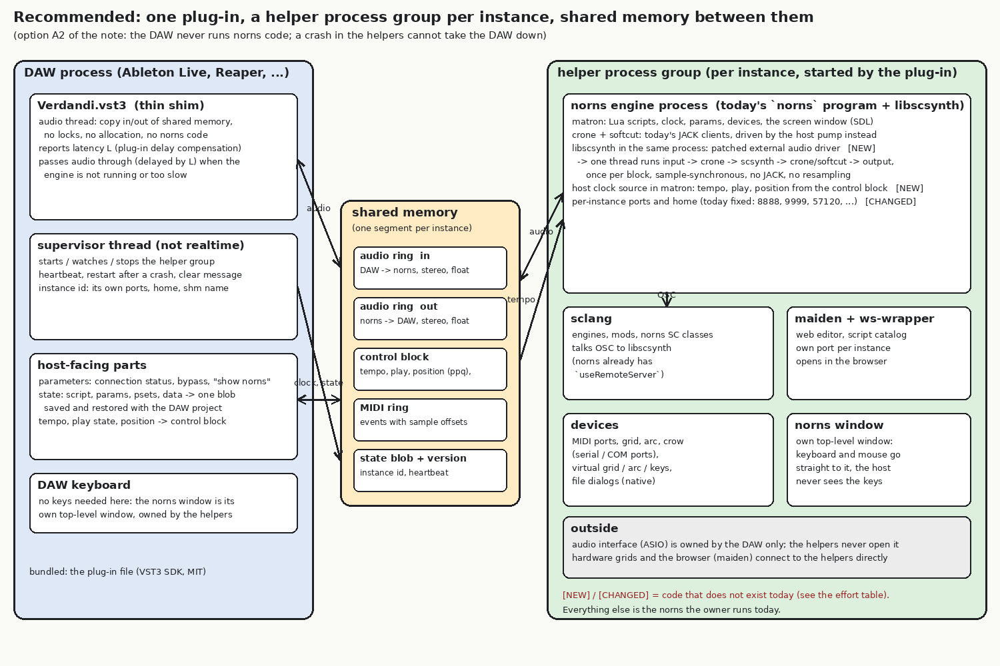
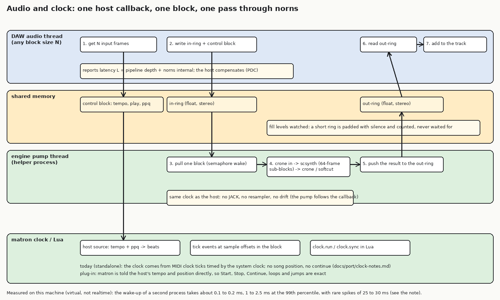

# Verdandi as one self-contained audio plug-in: feasibility investigation

Status: **investigation and plan only. No product code was changed.** The scripts and raw output of what I measured are in `docs/port/plugin-feasibility/` (`shm_rt.c`, `run_matrix.sh`, `matrix.txt`, `make_diagrams.py`). Every fact below says whether it was **read** in this repository, **measured** here, **found on the web** (links at the end; forum posts and older pages, so weak evidence), or is **my expectation**. Section 8 lists what I could not verify.

## 0. Summary and recommendation

**The goal is possible, but not with the thin-client design of `docs/port/linux-vst3.md`, and not by pushing norns into the DAW's process.** The design I recommend (**option A2** below):

- The plug-in is a small **shim** inside the DAW: it copies the track's audio to and from **shared memory**, reports its latency, passes tempo, play state and position, saves and restores a **state blob**, and **starts and watches a group of helper processes** (one group per plug-in instance).
- The helpers are today's norns: matron (Lua, clock, devices, screen window), crone and softcut, sclang, maiden. The one real change is the audio engine: **JACK is replaced by a "host-pumped" backend** that runs once per host block, with **scsynth embedded as a library (libscsynth) inside the norns process** and a small patch to give it an external audio driver. That makes the whole signal path **sample-synchronous with the DAW**: no JACK, no resampler, no drift, the same code on Windows, Linux and macOS, and a clean per-instance separation (ports, homes, window).
- The DAW never runs norns code. A helper crash is a "norns stopped" message on the track, not a DAW crash.
- The norns window stays its **own top-level window owned by the helpers**, which sidesteps the known problem of DAWs swallowing keystrokes in plug-in windows.

**Recommendation: go for a prototype first, not for the whole product.** The three hard unknowns are (1) the patched external driver for libscsynth and crone's host-driven backend, (2) whether the deadline of a synchronous hand-off to a second process holds on real hardware, and (3) the Windows port of the norns stack, which has not been started. Section 7 defines the smallest prototype (**P0**, Linux, headless test host, a stereo stream both ways with host tempo and a state blob) that settles (1) and (2). Windows (3) is the largest piece of work and should be started only after P0 passes.

**Compared with simply continuing with the standalone plus the DAW's routing**: on Linux that already works today (PipeWire links, no plug-in code) and I would not replace it. On Windows the standalone needs ASIO, which the DAW already owns; routing through a virtual cable or ReaRoute works but adds latency, a second sample clock and setup that the owner must repeat per project. What the plug-in adds is: **one project holds everything** (script, params, psets recalled with the project), **audio on the plug-in's own track with delay compensation**, **host tempo, transport and position that are exact** (the standalone's MIDI-clock path ignores song position and continue, `clock-notes.md`), **no virtual cable, no second program owning the interface**, and several tracks of norns processing only if multi-instance is solved. What it does not add: better sound, lower CPU (it adds some), or faster-than-realtime rendering without more work (section 2.3).

## 1. What there is today (read)

| fact | where |
|---|---|
| norns' audio path is a **JACK graph**: `crone` (the mixer, 6 in / 6 out) and `softcut` are two JACK clients inside the `norns` program; scsynth is a third JACK client; matron is a fourth (it also uses JACK for its **clock time** `jack_client_get_current_time`, the CPU load, the xrun count and the port lists of the AUDIO page) | `crone/src/Client.h` (305 lines, the only place crone talks to JACK besides the ring buffer of `Tape.h`), `matron/src/jack_client.*`, `matron/src/clock.cc:30` |
| scsynth on Linux is **JACK only**: the installed `/usr/bin/scsynth` links `libjack`, and `-H none` did not give a driver-less server: it **auto-started a jackd on ALSA** (measured). On Windows scsynth uses **PortAudio** with ASIO (web, 2008 to 2018 sources); on macOS CoreAudio | `ldd /usr/bin/scsynth`; my run of `scsynth -u 57199 -H none`; web |
| `libscsynth.so.1` (3.13 here) exports `World_New`, `World_OpenUDP`, `World_WaitForQuit`, `World_NonRealTimeSynthesis`, `World_Cleanup`, `World_SendPacket`... but **no hook for an external audio driver** | `nm -D` (measured). Projects that embed scsynth in a host (scsynth-rs, nanosynth for 3.14.1) do it with **a build-time patch** that adds an `AUDIOAPI=external` driver (web) |
| norns' own SC code already has a switch for a **remote server**: `Crone.useRemoteServer` makes sclang talk to an scsynth it did not boot | `sc/core/Crone.sc:22,50` |
| **fixed ports** everywhere: matron 8888 and 10111, sclang 57120, crone 9999, scsynth 57110, maiden 5000 with its consoles on 5555/5556; fixed JACK names (`crone`, `softcut`, `SuperCollider`, `Verdandi`) | `docs/port/multi-instance.md` section 2 |
| four norns instances at once need **0.46 GB each and about 6.5 % of a core when idle, 4.5 to 7 s to start**, and only coexist with a **network namespace each**; a separate JACK server per instance does **not** help (the ports collide) | `multi-instance.md` section 3 (measured there) |
| **the macOS AUv3** is a thin client: 128-frame stereo blocks over UDP 127.0.0.1:10200 to `auv3_bridge`, a JACK client next to a norns that the user started separately; the bridge resamples with JACK's audio adapter; **no tempo, no transport, no state**; the extension is sandboxed (`network.client` only), so it **cannot start norns**; one bridge and one port: two instances corrupt each other | `macos/auv3/*`, `norns-au.entitlements`, `multi-instance.md` section 1 |
| the norns **clock** follows MIDI clock ticks timed by the system clock; **continue (0xFB) and song position (0xF2) are ignored**; Link is also built | `docs/port/clock-notes.md` |
| size of what would be bundled: norns 29 MB with SuperCollider built without Qt, maiden 26 MB, sc3-plugins about 10 to 20 MB (estimate): **about 70 MB**; all components are GPL-compatible (`DEPS.md`) | `packaging.md`, `DEPS.md` |

## 2. Architecture options

### 2.1 The options in one table

| | **A1: helpers + JACK** | **A2: helpers + host-pumped shared memory (recommended)** | **B: norns inside the DAW process** | **C: the AUv3 design (thin client over UDP to a norns the user runs)** | **D: standalone + DAW routing (today)** |
|---|---|---|---|---|---|
| audio between plug-in and norns | shared-memory ring to a JACK client, resampling between the DAW clock and a private JACK server's clock | shared-memory rings, **no resampling**: the helper runs one pass **per host block** | in memory, one thread | UDP packets of 128 frames, resampling | JACK/PipeWire links, ReaRoute, virtual cable |
| who owns the clock | two clocks (DAW, JACK dummy or card): drift handled by the resampler | **the DAW**; the pump follows the callback | the DAW | two clocks | two clocks |
| code that changes | almost none in norns (a private jackd per instance) | crone's `Client.h`, matron's JACK clock and port code, **a libscsynth external-driver patch**, a host clock source | the same as A2, plus the whole stack made safe to load into a DAW | a bridge (exists on macOS) | none |
| Windows | **no**: scsynth uses PortAudio there, JACK on Windows would be a second audio stack beside ASIO | **yes** (the same code; the standalone becomes a small host app) | yes in theory | would need a bridge and a way to start norns | needs ASIO exclusive or a cable |
| crash isolation | yes | **yes** (the helpers are separate processes) | **no**: scsynth, 100+ UGen DLLs, Lua and SDL in the DAW | yes | yes |
| latency | ring + resampler + JACK periods: **2 to 4 periods and more** (expected, as in `linux-vst3.md`) | **one pipeline block plus norns' internal loop** (see 2.3) | lowest | like A1 | like A1 plus the cable |
| multi-instance | fixed ports still collide (`multi-instance.md`) | solvable by design: ports, homes and shared-memory names derive from the instance id; **needs a patch of norns' fixed ports** | one process, one Lua state: impossible without bigger changes | one bridge, one port | n/a |
| screen, keyboard | own window of the helper | own window of the helper | would have to be created inside the DAW process (SDL in a plug-in: message loop and focus problems) | own window | own window |
| my rating | a fast Linux start; **dead end on Windows** | **best fit for the stated goal**; the most new code | **no** (isolation, SDL, UGen loading) | already built for macOS; **not enough** (the owner's view, and no state or transport) | **keep as the fallback** |

### 2.2 How option A2 works

See `plugin-feasibility/architecture.png` (structure) and `plugin-feasibility/dataflow.png` (audio and clock).

**Threads and owners.** The DAW's audio thread owns the plug-in's `process` call and does only lock-free copies into the in-ring, from the out-ring and of the control block (tempo, play state, position, MIDI events). A **supervisor thread** (not realtime) in the plug-in owns the helper group: it starts it, gives it the instance id (shared-memory name, port block, home), watches a heartbeat, restarts it after a crash and shows a status. In the engine process an **audio pump thread** (real-time priority) waits for "a block is ready", pulls the input, runs input, crone, scsynth and softcut once and pushes the output; matron's Lua and clock threads run as they do today. scsynth is embedded in the engine process, so **crone and scsynth exchange samples in memory in the same pass** (today they exchange them through JACK ports, a loop that costs a period).

**Different host block sizes and sample rates.** The host tells the plug-in the sample rate and the maximum block size before it processes (`setupProcessing`). The pump consumes the input in **norns' own block of 64 frames** (scsynth's default, `scsynth -h`), so any host block size works: the shim splits or accumulates as needed. A sample-rate change makes the shim restart the engine's audio (scsynth and crone are told the new rate; how norns reacts to a rate change in the standalone was not checked). A fixed latency is reported to the host once per setup.

**Latency and drift.** Because the pump follows the host callback there is **no drift** (one clock). The cost is the hand-off to another process every block. I measured that hand-off on this machine (section 3). To be robust against a late helper, the design runs the helper **one block behind** (a pipeline of one block): the plug-in reports `L = N + norns' internal delay` to the host (plug-in delay compensation, `getLatencySamples`, and `restartComponent(kLatencyChanged)` if it ever changes: web), and if a block is missed it plays silence or a dry copy for that block and counts the miss. The latency is then one host block (1.3 to 43 ms for 64 to 2048 frames at 48 kHz) plus norns' loop.

**Screen window, devices, maiden, file dialogs.** All unchanged and owned by the helpers: the SDL screen window is a normal top-level window (its keyboard and mouse never pass through the host), grids, arcs and MIDI devices are opened by matron as today (serial or COM ports on Windows), maiden is the same Go program on a per-instance port, and the native file dialogs are the helper's. **Mods and scripts** run in the helper's home. The plug-in's "Show norns" parameter raises the window.

**Multi-instance.** One helper group per plug-in instance, each with its own shared-memory segment, port block and home (the instance id is created once and saved in the state). This removes the silent corruption of the AUv3, but it **needs the fixed ports of norns made configurable** (matron 8888, crone 9999, sclang 57120, scsynth, maiden's consoles: `multi-instance.md` lists them), and it costs about **0.5 GB and 5 to 7 s start per instance** (measured there). Until that patch exists, keep the one-instance guard with a clear message.

**Start-up and shutdown.** The shim starts the group when the plug-in is loaded and the audio is activated, waits for "ready" (4.5 to 7 s, measured in `multi-instance.md`) while passing audio through, and stops the group when the plug-in is removed or the host exits (with a watchdog in the helpers that exits when the shim's heartbeat stops, so an orphaned group cannot survive a crashed DAW).

**Crash isolation.** A helper crash: the pump stops, the shim passes audio through and shows "norns stopped, restarting". A DAW crash: the watchdog ends the helpers. The shim itself is small (no Lua, no SC, no SDL).

**Host sandboxing.** Ableton Live's help page for Windows covers VST2 and VST3 and says nothing about sandboxing; a 2022 forum thread says Ableton had not announced plug-in sandboxing, and I found no statement that Live 12 changed it (web, weak). Plug-ins starting helper processes and windows is common practice on Windows (bridges, sample libraries), but **I did not verify it for Live 12 or for Reaper**, nor how antivirus and the Windows firewall react to a plug-in that starts executables and listens on loopback ports (maiden); that needs a test on the owner's machine. On macOS an **AUv3 extension cannot start helpers** (its entitlements, read), which is why the existing design needs the app to be running; a VST3 or AUv2 on macOS is not sandboxed by the format, so A2 is possible there (not verified, no Mac here).

### 2.3 What A2 changes in norns (read, sized by my reading of the code)

| change | size (my guess) |
|---|---|
| **crone's `Client` becomes a backend interface**: `process(numFrames)` is already virtual and the three clients call it with source and sink pointers; the JACK code is 305 lines in `Client.h` (open, ports, connect). A host-pumped backend calls the same `process()` in a fixed order | small to medium (about a week); softcut and the mixer are untouched |
| **matron's JACK client** (`jack_client.*`): replace the clock time source by the pump's sample counter (frames since start / sample rate), the CPU load and xrun count by the pump's own counters, and the port lists of the AUDIO page by a fixed "host" device | medium; the AUDIO page and `audio_devices` behave differently in plug-in mode (no device choice: the DAW owns the interface) |
| **libscsynth external driver**: a driver class that does nothing by itself and exposes "process one block" to the pump (the scsynth-rs approach), built into the SuperCollider 3.14.1 that the project already builds from source without Qt | **the single biggest unknown**: I could not build or test it here (no SC source, no headers). It is a small amount of C++, but it must be kept across SC versions, and the plug-ins (UGens) must be loaded from the bundle |
| **sclang with `useRemoteServer`**, pointing at the embedded scsynth's UDP port | small |
| **host clock source** in matron: a fifth source next to `internal`, `midi`, `link`, `crow`, fed from the control block (tempo, ppq at block start, play flag) and turning it into beats exactly, including continue and jumps (today's MIDI path ignores them) | medium (the Lua side `clock.run/sync` stays) |
| **per-instance ports and homes** | medium and tedious: many fixed numbers in matron, crone, SC classes and maiden |
| **state**: script path, params, psets and the script's data folder written as a blob and restored | small to medium (norns already saves psets and `dust/data/<script>`) |

**Things that stay as they are:** matron's wall-clock time for `util.time`, metros and `clock` threads; in plug-in mode these must follow the audio frames or they will not follow the host when it stops or jumps (part of the host clock source), and this is also why **faster-than-realtime (offline) rendering is possible in principle with A2** (the pump is driven by the callback) but not without more work (scripts that read the wall clock): the first version should say "real-time render only".

### 2.4 What the other options cost, in short

- **A1 (JACK helpers)** is the quickest way to a Linux prototype and needs almost no norns changes (`JACK_DEFAULT_SERVER` per instance), but it needs the elastic buffer and resampler of the AUv3 bridge, adds two or more JACK periods, and **has no path on Windows** (no JACK in the SC build there; a second audio stack beside ASIO). Use it only as a stepping stone, if at all.
- **B (in-process)** needs everything A2 needs, and in addition SC's UGen DLLs, Lua, SDL and a GPL stack inside the DAW; a scsynth crash or an SDL event-loop conflict takes the DAW down; and sclang is a separate program anyway. No.
- **C (the AUv3 design)** is what exists for macOS. It teaches three things: the separation works; resampling by JACK's adapter was enough for a first sound; and a sandboxed extension cannot start norns. It has no transport and no state and it breaks with two instances (`multi-instance.md`), so it is not enough for the goal.

## 3. Measurements here (shared-memory hand-off)

**What I built** (`docs/port/plugin-feasibility/shm_rt.c`, about 150 lines of C, not product code): two processes share a memory segment. The **host** process stands in for a DAW's audio thread: a timer thread that fires once per block period at absolute `CLOCK_MONOTONIC` times. The **helper** is a forked process that plays norns' side (a gain, as a stand-in for the engine). Mode **sync**: the host writes a block, wakes the helper through a process-shared semaphore and waits for the answer: it measures the wait per block, for 5 s per setting. Mode **async**: the helper runs on its own clock (optionally off by some ppm, like another sound card) and the two meet in ring buffers. Both processes ask for `SCHED_FIFO` (the same request works with `chrt -f 20` here; the program does not log whether each of its own calls succeeded).

**Machine:** 4 virtual cores, kernel 6.18 (a Firecracker-style virtual machine), not a realtime kernel, no audio hardware. The numbers below are therefore an **upper bound on how bad it gets on a noisy machine**, not a prediction for the owner's PC.

**Sync hand-off, per block (microseconds, from `matrix.txt`):**

| sample rate | block N | period | wait for the helper: median | p99 | worst | blocks later than the period |
|---|---|---|---|---|---|---|
| 44.1 k | 64 | 1451 | 95 | 442 | 6594 | 6 of 3445 |
| 44.1 k | 256 | 5805 | 143 | 1048 | 30162 | 2 of 861 |
| 44.1 k | 1024 | 23220 | 207 | 2156 | 24000 | 1 of 215 |
| 48 k | 64 | 1333 | 20 | 915 | 6349 | **32 of 3749 (0.85 %)** |
| 48 k | 128 | 2667 | 139 | 1990 | 25249 | 11 of 1875 (0.6 %) |
| 48 k | 256 | 5333 | 166 | 2280 | 30379 | 3 of 937 (0.3 %) |
| 48 k | 512 | 10667 | 214 | 2366 | 3613 | 0 of 468 |
| 48 k | 1024 | 21333 | 189 | 1588 | 3940 | 0 of 234 |
| 48 k | 2048 | 42667 | 245 | 67299 | 72538 | 4 of 117 (a 60 to 100 ms stall of the whole VM) |

(All block sizes 64 to 2048 at both rates are in `matrix.txt`.)

**What this shows.**
- The **cost of waking a second process and getting the answer back is small**: about **0.1 to 0.25 ms in the median** and 0.4 to 2.5 ms at the 99th percentile, at every block size. That is well inside a period for blocks of 256 frames and up, and tight at 64.
- This machine **cannot meet a real-time deadline reliably**: stalls of 5 to 100 ms hit the helper and also the host's own timer (the "host timer lateness" column, with p99 up to 60 ms in some runs). The late blocks above are mostly those stalls. On a desktop with a real-time scheduling class and a quiet system they should be far fewer, but **I cannot show that here**.
- **Design consequence:** the synchronous design needs a **safety margin**: a one-block pipeline (the helper works one block behind) and a **dry fallback** for a missed block. A plug-in that waits for a helper inside the DAW's audio callback without a margin would click on a machine like this one. This is also why the plug-in's reported latency is **N + norns' loop**, not N alone.
- **Drift** (async mode): I could not measure it cleanly, because the stalls above dominate the ring fill (output ring fill 0 to 43 blocks at 0 ppm). In theory (my arithmetic, not measured): a clock that is 100 ppm off moves the ring by 4.8 samples per second at 48 kHz, so **a two-block ring runs dry after about 27 s at N=128 and 213 s at N=1024**; crystals differ by tens of ppm, so any design with two clocks (A1, C, D) needs a resampler steered by the ring fill. A2 has one clock and needs none.

**What I could not measure:** the real latency of scsynth + crone + softcut as a processing chain on a host-driven backend (no backend exists), the latency a DAW would report or compensate, anything on Windows or with a real DAW, and the effect of real-time priorities on a normal desktop.

## 4. Plug-in format, framework and the host

| question | finding |
|---|---|
| **Format** | **VST3** is the common denominator: Ableton Live and Reaper both load it on Windows (Ableton's help page lists VST2 and VST3 on Windows; web). **CLAP**: Live does not list it (older forum evidence, not verified for the current Live); `CLAUDE.md` already says no CLAP. **AU** is needed for Logic only (macOS). |
| **Framework** | **The VST3 SDK directly** (MIT since 3.8.0, read in `linux-vst3.md` section 3 from the SDK repository): a small shim with no editor needs no toolkit. **JUCE** is dual **AGPL-3.0 or a commercial licence** (read there): free to use with a GPL-3.0 project but heavy, and its main value (editor widgets, parameter helpers) is not needed. **DPF** (ISC) and **iPlug2** are alternatives I did not evaluate. The ASIO SDK is **not needed at all**: the DAW owns the interface. |
| **The screen** | Two choices. (1) **The helper's own window** (recommended first): the keyboard goes straight to it. (2) **Embedding the SDL window in the plug-in's editor** (X11 reparenting or `SetParent` on Windows): possible, but then the host decides about keys. |
| **Keyboard in plug-in windows** | The owner relies on the keyboard. Forum evidence (JUCE, nih-plug, baseview) says **Reaper offers a key to the plug-in first and then uses it as its own shortcut if the plug-in does not claim it**, that the spacebar is the usual casualty, that Reaper has a "send all keyboard input to plug-in" setting, and that **Live also acts on keys such as space in plug-in windows in some cases** (mixed-age posts; web). A separate helper-owned window avoids the whole class of problems, at the price that the window is not "in" the plug-in. **Not verified in a real host here.** |
| **Tempo, transport, position** | VST3's `ProcessContext` carries tempo, play state, project position in quarter notes and the time signature (the fields are listed in `linux-vst3.md` section 8, read from the SDK headers). The shim writes them into the control block each block; matron's new host clock source turns them into beats. Which fields Reaper and Live fill is a **host check** (not verified). |
| **MIDI** | VST3 event input with sample offsets: through a MIDI ring into matron's virtual MIDI device (the Linux "keys" source mechanism, or the internal pipe device of PLAN Phase 8). |
| **State** | VST3's `IComponent::getState/setState`: the shim stores **instance id, script, params/pset text and the script's data folder** as one blob; the project then holds the whole norns state. The AUv3 stores nothing today (read). Size limits of hosts for state blobs: not checked. |
| **Latency reporting** | `getLatencySamples`, with `restartComponent(kLatencyChanged)` if it changes (web: hosts must recompute their graph, so it must not change often). A fixed value per setup. |

## 5. Windows specifics

**What is known and what is not.** Nothing of the Windows port exists or was tried here (no Windows machine, no cross-build). `PLAN.md` Phase 6 lists MIDI (WinMM/WinRT/RtMidi), serial for grids, arcs and crow, a virtual grid without ptys (Phase 5.5, serialosc/OSC), GNU tools and the **Gate D** question "JACK2 with ASIO/WASAPI or another audio path"; Phase 8 reuses the Linux VST3's protocol and bridge.

**The plug-in goal changes Gate D.** If the DAW owns the interface, norns on Windows needs **no audio device and no JACK at all**: the audio path is the shared-memory pump of A2. The Windows standalone then becomes a tiny host program (an audio front end such as RtAudio or miniaudio, which can use ASIO or WASAPI) that calls the same pump. That makes the Fireface's ASIO the front end's problem only in the standalone, and **removes the ASIO-versus-DAW clash in the plug-in by construction**.

**What the Windows build of the stack needs** (read where in the code; the Windows side is my expectation):
- **SuperCollider on Windows**: official builds exist (PortAudio); for A2 we need our own build of 3.14.1 with the external driver and libscsynth (the project already builds SC without Qt on Linux and macOS), plus sc3-plugins and mi-UGens built for Windows (their Windows status was not checked).
- **matron and crone**: POSIX assumptions (pthreads, `poll`, `popen` and `/bin/sh` in `os.capture`, `pty` for the virtual grid, signals, `/home/we` virtual paths, the sidecar over nng); the macOS port shows these are workable but a Windows port needs a C++ toolchain decision (MSYS2/MinGW or MSVC) and a lot of small patches. liblo, libsndfile, libsamplerate, Lua, SDL2, cairo, FFTW and nng all exist for Windows (not checked here).
- **Devices**: serial grids and arcs through COM ports (`PLAN.md` Phase 6 says to check libmonome's Windows support and patch or add a backend: not checked here), serialosc, MIDI through WinMM or RtMidi, file dialogs native.
- **maiden**: a Go program plus a web app (portable); its fixed consoles and ports need the same per-instance change.
- **Process and window behaviour inside a DAW**: starting a console-less helper group, a watchdog when the DAW exits, antivirus, firewall prompts, code signing (a signed plug-in and signed helpers are likely needed; not checked).

**A realistic order of work:** P0 on Linux (section 7), the VST3 shim on Linux with the host-driven engine (Reaper on the laptop), then the **Windows port of the helper group** as one project (the largest piece), then the Windows shim and tests in Ableton and Reaper on the owner's machine, then macOS (VST3 first).

## 6. Risks and open questions in plain words

1. **The scsynth external driver is not proven.** I found that others did it with a patch, and that upstream does not offer it (web); I could not build or test it. If it turns out unworkable, fallback: scsynth stays a separate process and a **JACK-like shared-memory driver** is used (more latency, a resampler), or the engine runs against a private JACK server (A1) on Linux only.
2. **A synchronous hand-off needs real-time behaviour from the helpers.** On this VM it misses about 0.3 to 0.9 % of blocks at 64 to 256 frames. Real hardware is likely better; I cannot prove it. The margin (one block) costs latency.
3. **Windows is a full port** that the project has not started. Its cost dominates the plan.
4. **Time inside norns** (`util.time`, metros, clocks) is wall-clock based. In plug-in mode it must follow the audio frames or scripts will drift from a host that stops, jumps or renders offline.
5. **Multi-instance** costs 0.5 GB and several seconds per instance and needs the fixed ports patched across norns and maiden.
6. **Keyboard focus** between the DAW and the helper's window: the helper window is a separate top-level window, so the DAW's own shortcuts do not apply there, but the owner has to click between windows. A way to link the window to the plug-in (always on top while the plug-in is open) is a design choice.
7. **Hosts differ**: how Live and Reaper treat plug-ins that start processes and open windows, plug-in scan time (the shim must load without starting the helpers), state size, latency changes.
8. **Support and licence**: GPL-3.0 everywhere; the VST3 SDK is MIT; JUCE would add AGPL; the bundle is about 70 MB plus Windows libraries. The VST3 trademark rules apply to the name "VST" (`linux-vst3.md` section 3). Not legal advice.
9. **Maintenance**: a patched SuperCollider has to be re-based on each SC release.

## 7. Recommendation, the smallest prototype, effort and decisions

**Recommendation: go for a prototype first (P0), on Linux, headless.** It tests exactly the hard parts and nothing else:

| step | what | proves | effort (a labelled **guess**, one person, my estimate) |
|---|---|---|---|
| **P0a** | build SuperCollider 3.14.1 with an external audio driver; a test program links libscsynth, loads one SynthDef over OSC, and is pumped block by block (64 to 2048 frames); also measure its CPU | the scsynth part is workable; what the patch costs | 1 to 2 weeks |
| **P0b** | a **test host program** standing in for the DAW (calls `process` with variable block sizes, a tempo and a transport), shared-memory rings and control block, the supervisor starting and killing the engine process | hand-off latency and margin, restart after a crash, no drift over an hour at 48 and 44.1 kHz | 1 week |
| **P0c** | a **VST3 shim** (SDK, no editor) with a stereo in/out, tempo, a state blob; checked by the SDK validator and loaded in **Reaper on the Linux laptop** | the format, the host fields, state round trip, latency compensation | 1 to 2 weeks |
| acceptance of P0 | a stereo stream both ways through scsynth with a simple SynthDef, host tempo reaching a Lua `clock`, a state blob restored, no glitches at 128 frames for one hour on the owner's laptop | | |

**If P0 passes** the next steps are: **P1** crone and softcut on the host-pumped backend and the host clock source (2 to 4 weeks); **P2** the full norns in the helper group, per-instance ports and homes, state of scripts and psets, the window and devices (3 to 6 weeks); **P3** the Windows port of the helper group (**6 to 12 weeks**, the largest and least certain), the Windows shim and a test in Ableton and Reaper (2 to 4 weeks); **P4** macOS VST3 (2 to 4 weeks, not tested here), hardening, installers and signing (3 to 6 weeks). **Total: roughly 5 to 9 months of focused work by one person; the range is a guess**, driven mostly by P3 and by what the Windows tests find.

**Decisions the owner has to make:**
1. **Go for P0 or not** (about a month of work for a yes/no on the hard parts).
2. **Accept a patched, self-built SuperCollider** as part of the bundle (needed for A2), or stay with the unpatched one and take A1's limits (Linux only).
3. **The norns window**: a separate window (recommended) or embedded in the plug-in editor.
4. **One instance with a guard first** (as decided before), or per-instance norns from the start.
5. **Real-time render only** at first, or work towards offline rendering (needs wall-clock time removed from scripts' view).
6. **What happens to Phases 6, 7 and 8 of `PLAN.md`**: I would let the Windows standalone and the plug-in share the host-driven backend, and **drop the JACK-on-Windows question (Gate D)**; the thin-client protocol of `linux-vst3.md` would then not be built (the shared-memory shim replaces it) except as the first sound test.
7. **Whether the plug-in has to work in Ableton Live before Reaper**: Live's treatment of helper processes is the least known.

## 8. What I could not verify

- Anything on **Windows or macOS**, in **Ableton Live or Reaper**, or with a real audio interface (none here).
- **Building scsynth with an external driver** (no SC source tree, no headers here; the installed 3.13 library exports no driver hook). Evidence for feasibility is other people's projects (web).
- **Real latency and drift**: the machine is virtual and not real-time; the drift numbers are arithmetic.
- How hosts treat helper processes, windows and loopback ports; antivirus and firewall behaviour; signing needs.
- The keyboard behaviour of Live and Reaper plug-in windows beyond forum posts of mixed age.
- Whether Reaper and Live fill all `ProcessContext` fields, and their limits on state size.
- The Windows status of sc3-plugins, mi-UGens, libmonome and the other dependencies.
- The effort figures: they are guesses.

## Sources (web, read through search; older forum posts are weak evidence)
- SuperCollider embedding with a host-pumped driver: [scsynth-sys external driver](https://docs.rs/crate/scsynth-sys/latest/source/csrc/SC_ExternalDriver.cpp), [scsynth realtime pump test](https://docs.rs/crate/scsynth/0.1.0/source/tests/realtime_pump.rs), [nanosynth](https://pypi.org/project/nanosynth/).
- Keyboard focus in plug-in windows: [JUCE forum, third-party plug-ins and keyboard events](https://forum.juce.com/t/bug-report-juce-tracktion-third-party-plugin-dont-pass-keyboard-events-to-juce-correctly/57971), [Reaper stealing spacebar](https://forum.juce.com/t/reaper-stealing-spacebar-keystrokes-in-texteditor/30689), [nih-plug issue 219](https://github.com/robbert-vdh/nih-plug/issues/219), [nih-plug virtual keys proposal](https://codeberg.org/BillyDM/nih-plug/pulls/9).
- SuperCollider on Windows (PortAudio, ASIO): [README_WINDOWS](https://github.com/supercollider/supercollider/blob/8f97b1c189dd41f97fadb0053e3438f49450fac7/README_WINDOWS.txt), [Sonic Pi forum thread](https://in-thread.sonic-pi.net/t/windows-asio-support/777).
- Ableton Live and plug-ins: [Using VST plug-ins on Windows (Ableton)](https://help.ableton.com/hc/en-us/articles/209071729), [Ableton forum on sandboxing](https://forum.ableton.com/viewtopic.php?p=1804074).
- Latency reporting in VST3: [getLatencySamples](https://dplug.dpldocs.dlang.org/dplug.vst3.ivstaudioprocessor.IAudioProcessor.getLatencySamples.html), [Steinberg forum, reporting latency change](https://forums.steinberg.net/t/reporting-latency-change/201601).
