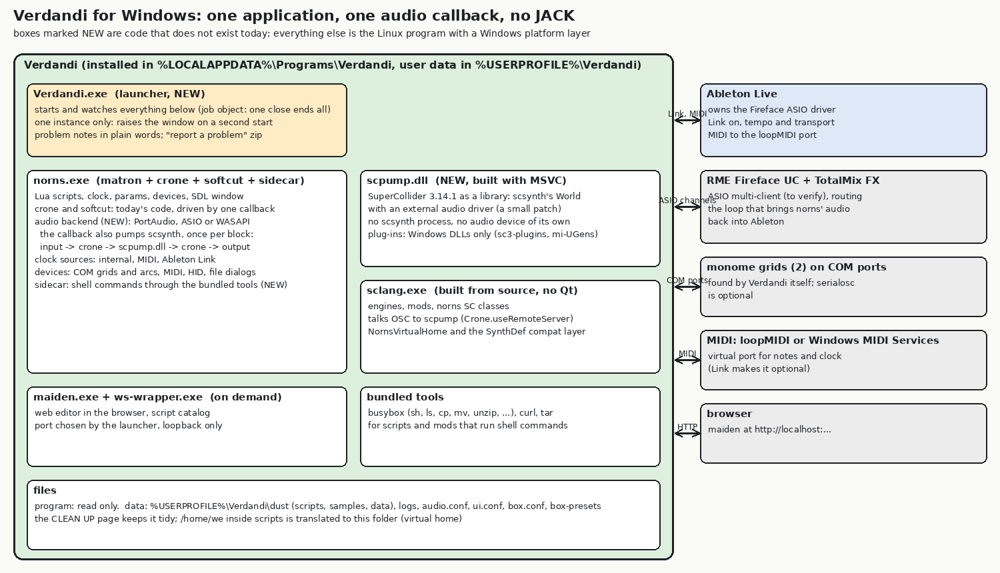
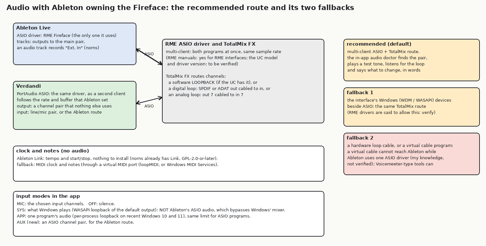

# Windows standalone: plan, version 2 (no product code)

Status: **plan and milestone M0 setup only.** Decision: **no VST3 plug-in for now** (`docs/port/plugin-feasibility.md` stays as reference); a **Windows standalone that does everything the Linux version does**. Reference setup: Windows with **Ableton Live** owning an **RME Fireface UC** (ASIO), keyboard-centred use, **two monome grids** (a 2023-24 grid 128 and a 2011 grid 256 with 4-step LEDs), norns audio into Ableton tracks, and **Ableton's tempo and transport driving norns** (Link, or MIDI clock, selectable). As easy and plug and play as possible, with plain-language guidance in the app, as in the Linux version.

Each claim says whether it was **read** in this repository, **found on the web** (links at the end; forum-level evidence is marked), **my knowledge** (not checked here), or an **estimate / guess**. There is no Windows machine, no mingw cross compiler and no Wine in the cloud session, so **nothing in this plan was built or run on Windows**; what can be checked on Linux (script syntax, the Linux-runnable parts of the M0 scripts, the workflow with `actionlint`) was, and section 10 says what was not.

## 0. What changed since version 1

- Tempo and transport: **both Ableton Link and MIDI clock**, one clock setting that shows which one drives (section 3). v1 had Link first and MIDI as a fallback.
- Audio: the default route is now **the shared RME driver + TotalMix FX Loopback into an Ableton track** (section 4); WASAPI is the fallback.
- Grids: **both grids are identified by USB ids** (section 5); the libmonome Windows layer was read and has **three real gaps** that the plan now names.
- Everything the Linux version learned since v1 is in the **feature table of section 2** with a Windows replacement or "not applicable" for each item.
- **M0 is concrete and split into M0a, M0b, M0c** (section 8), the first two prepared as a GitHub Actions workflow (`.github/workflows/windows-m0.yml`, scripts in `windows/ci/`, your step-by-step in `windows/README.md`).
- Decisions the plan still needs are collected in section 9 with a recommendation each.

## 1. Decisions already taken (recorded)

1. **Tempo and transport:** both Ableton Link and external MIDI clock (start, stop, continue, song position), selectable, with a clear note of which one drives.
2. **Audio:** Ableton owns the Fireface (ASIO). TotalMix FX Loopback is available and known. **Default route: Verdandi uses the shared RME driver and returns to Ableton through a Loopback input on an audio track; fallback WASAPI.**
3. **Grids:** a 2023-24 grid 128 and a 2011 grid 256 (4-step LEDs). **Direct serial through COM ports is preferred; serialosc is optional.** Detection is configurable.
4. **Carry over from Linux:** clean layout, tidy and CLEAN UP, plug-in heal/seed for mi-UGens and NamAmp built for Windows, plain-language notes, the manual, crash reports, MIDI MAP and actions, themes.
5. **Plug and play, per-user installer, no administrator rights, unsigned for now.**

## 2. Every Linux feature and its Windows replacement

(Checked against the current Linux code: `matron/src/platform/linux`, `matron/src/device`, `linux/`, `lua/core`. "shared" = the same source on both platforms. "N/A" = does not exist on Windows, with the reason.)

### 2.1 Window, screen, look

| Linux feature | Windows |
|---|---|
| SDL2 window with the device skin, maiden link, keys, file drop | **shared** (SDL2 runs on Windows). The skin and key mapping are plain C with Cairo and have tests; reused as they are |
| detached screen window, window geometry kept (`screen_window*.c`, `detach_check.sh`) | **shared**; geometry stored in `ui.conf` as now. Multi-monitor and per-monitor DPI behaviour is the owner's M2 test |
| box styles, THEME and SCREEN pages, presets, colour picker, toasts | **shared** (C and Lua; fonts are files in `resources/`, no fontconfig) |
| screenshots and GIFs | **shared** (Cairo); saved under `%USERPROFILE%\Verdandi` |
| open URL (`xdg-open`) | `ShellExecuteW` |
| file picker (`file_picker.cc`: zenity, kdialog, portals) | the Windows common item dialogs (a COM call); **fileselect** (the Lua script browser) keeps its long-name handling (shared) but lists directories natively in C instead of through `ls -p` |
| dust import / drop of samples and scripts | **shared** (SDL drop events), copying done in C |
| clipboard | **shared** (SDL clipboard) |

### 2.2 Virtual devices

| Linux feature | Windows |
|---|---|
| virtual grid and arc as a **pty** opened by libmonome like a USB device (`vgrid_device.c`, `vgrid_proto.c`) | **N/A** (no ptys). Replaced by the **OSC virtual grid** of PLAN.md Phase 5.5 (`device_monome.cc` talks to an in-process virtual device). The same Lua/skin side |
| arc keys, grid keys, `keys_midi.cc` (the window keys as a JACK MIDI output) | the key mapping is **shared**; the MIDI side becomes an internal device (no port) or a loopback port if the user asks for it |
| MIDI virtual device `jack_midi_in.cc` ("Verdandi:midi_in") for DAW notes and clock | **RtMidi** (WinMM, or Windows MIDI Services when present) opening a **loopback port** (see 2.3) |
| MIDI output port for the DAW (`aseq_out.cc`, `aseq_link.h`, `aseq_pump.h`: an ALSA sequencer port "Verdandi out" and its links) | **N/A as such**: Windows has no user-created MIDI ports without a driver. Replaced by opening an **existing loopback endpoint** by name (Windows MIDI Services virtual loopback, or loopMIDI) as the output, with the same name-based auto-connect rules; if none exists the VIRMIDI page says so in plain words |
| VIRMIDI page and the virtual MIDI card (`linux/virmidi`, kernel `snd-virmidi`) | **N/A** (a Linux kernel module). Replaced by a **"virtual ports" page**: which loopback ports exist, which one Verdandi uses, a link to the download of loopMIDI (not bundled, redistribution terms unknown), and the note that Windows 11 with Windows MIDI Services has built-in loopback (section 5.4) |
| `midi_autoconnect.cc` (connects the DAW ports by name) | **shared rules**, RtMidi port names instead of ALSA/JACK names; the rule table is data |

### 2.3 Audio

| Linux feature | Windows |
|---|---|
| JACK or PipeWire-JACK, launcher writes `audio.conf` (`input=`, `output=`, `rate=`, `period=`) | the **audio backend interface** with PortAudio (ASIO, WASAPI) and a **null backend** (section 4); `audio.conf` keeps its keys as hints |
| AUDIO page (ports, xruns, CPU), `jack_client.*` | the backend reports the same counters; the page lists **devices and channel pairs** |
| `audio_devices.c` (ALSA cards) | PortAudio device list |
| MIC / SYS / OFF / APP input (`app_audio_linux.cc`, PipeWire) | MIC = chosen channels, OFF = silence, **SYS = WASAPI loopback of the default render device (does not hear Ableton's ASIO audio; the app says so)**, APP = per-process loopback (same limit) |
| scsynth as a separate JACK client | **in-process** through `scpump.dll` (section 6); fallback JACK2 for Windows |
| `plugin_arch_check.cc`, plug-in architecture note, CLEAN UP page entry | same rule on **PE files** (the machine field of a `.scx`/DLL) instead of ELF: `plugin_arch.h` gets a PE reader; the note says "built for another system/processor" |

### 2.4 Devices

| Linux feature | Windows |
|---|---|
| `device_monitor.cc` (libudev: hot-plug, replug, the **sweep** of stale entries at start) | a **SetupAPI + `WM_DEVICECHANGE` monitor** thread feeding the same add/remove events; the start sweep is a full enumeration |
| MIDI replug (a device that comes back keeps its slot) | the same slot logic (shared Lua/C++); keyed by a stable name + port index, because WinMM ports are numbers that move |
| **device ignore rules** (`midi_ignore` in `ui.conf`, `midi_ignore.h`, tested by `midi_ignore_test.cpp`) | **shared** header and rules; M0a already compiles and runs this test with MinGW. Windows port names differ ("MIDI Out 1", "2- Name"), so the rules match on a normalised name |
| `device_dedupe.h` (same device seen by two paths) | **shared**; M0a runs its test |
| `serialosc_conflict.h` / `serialosc_check.cc` (a running serialosc holds the grid) | **shared** logic; Windows detects `serialosc.exe` in the process list and a COM port that cannot be opened ("busy") |
| udev rule `70-verdandi-monome.rules` (access for the grid without root, FTDI 0403:6001 with serial `m[0-9k]*`, and the newer VID/PID) | **N/A** (no permissions problem on Windows; the CDC serial driver is part of Windows 10 and later, the FTDI VCP driver is delivered by Windows Update: my knowledge, to confirm at M3). The same **VID/PID/serial table** lives in the monitor (section 5) |
| crow (USB serial) | COM monitor by vendor id |
| HID keyboards, gamepads (libevdev stubs) | SDL controller API (M3, optional); physical keyboards through the SDL window |
| mDNS (avahi) | N/A (Bonjour is not part of Windows); maiden is reached by `localhost` |

### 2.5 Clocks and MIDI messages

| Linux feature | Windows |
|---|---|
| clock sources internal, MIDI, Link, crow (`matron/src/clocks/`) | **all shared**; see section 3 |
| MIDI clock in with start, stop, **continue and song position** (`clock_midi.cc`, Linux Phase 3) | shared parser, fed by RtMidi |
| MIDI clock out (`clock_midi_out_1..16`, the legacy `clock_midi_out` option) | shared (Lua) |
| MIDI MAP and MIDI actions, themes, `midimap*.lua` | shared Lua; the data files live in the user folder |

### 2.6 Plug-ins, scripts, tools

| Linux feature | Windows |
|---|---|
| **plug-in heal and seed** (`plugin-heal.sh`, `mi_heal.cc`, `mi-ugens-seed.sh`, `namamp-seed.sh`, pins `mi-ugens.pin`, `namamp.pin`) | **mi-UGens and NamAmp are built for Windows (x64 DLLs) in CI** from the same pinned commits and shipped as seed packs; the heal logic that decides "missing or wrong architecture, replace with the seed" is **C++ (`mi_heal.cc`) and stays shared**; the shell wrapper `plugin-heal.sh` is rewritten in Lua/C++ (decision 9.8) rather than needing a shell. NamAmp needs its own CMake build with MSVC (to be proven at M5) |
| other ARM-only SuperCollider packs | detected by the PE check, with the plain note, and a table of known packs and their Windows status |
| **shims** in `linux/shims`: `sudo`, `systemctl`, `cmp`, `cp` (plain explanations, harmless stand-ins). There is **no `wget` shim** in the repository | `sudo` and `systemctl` as small `.cmd`/busybox applet stand-ins with the same texts; `cmp` and `cp` come with busybox; **`wget` is not shimmed on Linux; on Windows busybox's applet and a bundled `curl.exe` cover it** |
| shell commands from scripts (`os.execute`, sidecar: `fork`, `/bin/sh`) | `CreateProcess` + pipes running **`busybox sh -c`**; M0a shows what happens without it (MinGW Lua's `os.execute` uses `cmd.exe`) |
| SC class check / compile-error notes (class note) | shared (the text of sclang's output is the same) |
| SC compat extensions (`sc/linux-compat/NornsSynthDefCompat.sc`) and the virtual home (`/home/we` in Lua, SC and shell commands) | shared; rename the folders to `desktop-compat` when the Windows layer lands; real home is `%USERPROFILE%\Verdandi` with forward slashes |
| tidy / CLEAN UP / clean layout (`linux/tidy.sh`, 982 lines of shell) | the layout is identical under `%USERPROFILE%\Verdandi`; the tool is run with busybox `sh` if POSIX-clean, otherwise **ported to Lua so both platforms share one** (decision 9.8) |
| logs, **crash reports** (`crash_report.cc`: signal handlers + backtrace) | `SetUnhandledExceptionFilter` + DbgHelp minidump into `logs\crash\`, same plain-language page |
| second start / raise the window (`.norns-raise` control file), `norns.sh` | `Verdandi.exe` launcher: **named mutex**, **job object**, a named event to raise the window |
| **manual** (`linux/manual/manual.html`) | shared HTML, installed in the program folder, opened from the menu |
| maiden (Go, patched), maiden-repl | Go cross-compiles; same patch; the readline REPL is dropped (the web REPL is the console) |
| packaging (`.deb`, privacy scan) | Inno Setup per-user installer (section 7); the privacy scan is ported |
| tests (`run_all.sh`: bash, Xvfb, xdotool, jackd dummy) | Lua and C tests run under MSYS2/busybox; the window scenarios stay the owner's checklist; M0a already runs the ones that need nothing |

## 3. Clocks: how norns's source model maps onto Windows

**Read in `lua/core/clock.lua`:** norns has **one** clock source at a time: the option param `clock_source` with the entries `internal`, `midi`, `link`, `crow` (`set_save false`; the choice is kept in `norns.state.clock`). Scripts read the beat through `clock.run`/`clock.sync`; they do not care where it comes from.

**Mapping.**
- `link` = **Ableton Link** (`clock_link.cc`): tempo, beat phase and start/stop with nothing installed on the Ableton side beyond switching Link on (Preferences > Link). Optional start/stop sync, quantum.
- `midi` = **external MIDI clock** from the port the user chose (a loopback port that Ableton sends to): 0xF8 ticks, start, stop, **continue and song position pointer** (`clock_midi.cc`).
- `internal` = Verdandi's own tempo; `crow` unchanged.

**Selectable, with a clear note of who drives.** A **"clock" line in the window status area and on PARAMS > CLOCK** shows the active source in words: "Clock: Link, 3 peers, 120 BPM, running" / "Clock: MIDI clock from Verdandi in, 120 BPM, stopped" / "Clock: internal". The source is a normal setting remembered across restarts; **it never switches by itself** (a second source that is also active is shown as "also heard: MIDI clock, not used"). A mismatch hint appears when the chosen source is silent for a few seconds ("Link is on, but no other app shares a session: switch Link on in Ableton").

**Link: library and licence (read in `third-party/link`).** The library is **Ableton Link** (`third-party/link`, header-only C++ with the C wrapper `abl_link`), licensed **GPL-2.0-or-later** (`LICENSE.md`; the alternative is a proprietary licence from Ableton). GPL-2.0-or-later is compatible with Verdandi's GPL-3.0. It supports Windows (`LINK_PLATFORM_WINDOWS`, MSVC 2015 or newer in its README; MinGW is **not** a listed compiler, so M0a includes a compile-and-run probe, `windows/ci/link_probe.cpp`). Link needs the bundled `modules/asio-standalone` **networking** library (Boost-licensed, **not** Steinberg's ASIO). Link's README recommends an ASIO audio driver for timing on Windows, which fits the RME route.

**Link open points.** (1) `clock_link.cc` has **no output-latency compensation** (read: no `outputLatency` use), so a "Link latency (ms)" setting plus the backend's reported latency are part of M4. (2) The first start may show a **Windows Firewall prompt** for `Verdandi.exe` (Link discovery uses UDP multicast); allowing it may need an administrator on the owner's PC. Link between two programs on the same PC probably works over loopback without it, **unverified**; M4 tests both. (3) The MIDI clock needs a loopback port (section 5.4).

**MIDI clock timing.** The parser times ticks with the system clock; Windows' timer resolution (about 15.6 ms by default, 1 ms with `timeBeginPeriod`) matters for the tick timestamps: RtMidi gives driver timestamps, which M4 uses instead of the arrival time.

## 4. Audio with Ableton owning the Fireface

Unchanged in structure from v1 (backend interface, PortAudio, null backend, doctor); updated for the decisions.

**Default route (decision 2).** Verdandi opens the **same RME ASIO driver as Ableton** as a second client (RME states multi-client ASIO with the same sample rate; web). Verdandi **follows** the sample rate and buffer size and never sets them. Its stereo output pair goes to **TotalMix FX**, whose **Loopback** feature returns it as an input of the same interface; in Ableton an audio track takes that **Loopback input**. Verdandi's input (MIC) is a free hardware input pair, or Ableton's return.

**Fallback: WASAPI** (shared mode, about 10 ms or more more latency; exclusive mode would block Ableton and is not offered) through the interface's Windows devices, with the same TotalMix route. **Last resort:** a cable from an output to an input.

**Audio doctor** (SYSTEM > AUDIO, M1): lists ASIO drivers and Windows devices, opens the chosen driver, reports "shared with another program: yes/no, rate, buffer", plays a test tone and listens on the input pairs to find the loop, and says in a sentence what to change ("In TotalMix FX, route Verdandi's pair to the Loopback output, then press Test again"). It never changes the interface's settings.

**Open points.** Whether the UC's driver version is truly multi-client with Ableton open, and whether **TotalMix FX Loopback** is offered for the UC (RME documents it for the UCX, UFX and 802; the owner reports having used it). The owner confirms both at M1.

## 5. Grids and devices

### 5.1 What libmonome does on Windows (read: libmonome 1.4.9, `src/platform/windows.c`, `src/private/devices.h`)

- A Windows platform file **exists**: SetupAPI COM-port lookup, overlapped serial I/O on `\\.\COMn` at 115200 8N1 (57600 for `a40h` arduinomes), `GUID_DEVINTERFACE_COMPORT`. `monome_event_loop` is **not implemented** on Windows, so norns needs **its own reader thread** (polling `monome_event_next`).
- **`monome_open(path)` identifies a device only by its USB serial string** (`monome_platform_get_dev_serial`, then a pattern table): `m64-*`, `m128-*`, `m256-*` and `mk*` are "series" devices with **fixed dimensions**, `m40h*` and `a40h-*` are 40h, **`m<digits>` and `M<digits>` (the second is a Windows SetupAPI fix) are "mext"** and report their size by a query.
- **LED levels:** series devices have **only on/off per LED plus one global brightness** (libmonome turns a level above 7 into "on"); only mext devices take per-LED levels. So whether the 2011 256 shows **4 steps** depends on which family it is. A serial like `m256-xxx` would be series (2 states in libmonome: 16 norns levels would collapse to on/off, not 4 steps); a serial like `m1000123` would be mext (the firmware quantises). **I cannot tell which from the description; the Device Manager serial decides** (section 10).
- **Three gaps found by reading** (each is a small patch on libmonome, in the repository's `linux/patches` style, to be proven at M3):
  1. For an FTDI device the serial is taken from the instance id with `sscanf("FTDIBUS\\VID_%*x+PID_%*x+%[a-zA-Z0-9]m")`. That **stops at `-`**, so `m256-021` is cut to `m256`, and the code then strips a trailing `A` that FTDI appends, assuming that form. Hyphenated names, which the family table expects, can come out wrong and select the wrong protocol or no protocol.
  2. The 2023-24 device is a **USB composite/CDC device** (VID_CAFE&PID_1110, shown as "USB Serial Device"); its COM port is likely a child (`USB\VID_CAFE&PID_1110&MI_00\...`). The serial then has to be read from the **parent** device (`CM_Get_Parent`), which the code does not do.
  3. No reader thread and **no hot-plug** (libmonome has none on Windows): both come from our monitor.
- **serialosc on Windows** exists with installers (web) but is reported to need an FTDI device in the registry (web): another reason why serialosc is optional.

### 5.2 The two grids (supplied by the owner) and the detection rules

| grid | USB id | Windows shows | currently |
|---|---|---|---|
| 2023-24 grid 128 | **VID_CAFE & PID_1110** (the same id as the Linux udev rule) | "USB Serial Device" | COM6 |
| 2011 grid 256, 4-step LEDs | FTDI, hardware id `FTDIBUS\COMPORT&VID_0403&PID_6001` | "USB Serial Port" | COM4 |

**Rules of our monitor** (configurable in a small `devices.conf`, defaults as below; **COM numbers are never used for identification**, they change when a device moves to another USB socket):
1. Enumerate COM ports with SetupAPI **without opening them**; for each read VID, PID, the device serial string (from the parent for composite devices) and the friendly name.
2. **CAFE:1110** is a grid. It is opened and asked for its identification (mext query).
3. **0403:6001 is a generic FTDI id** (used by Arduino boards, GPS dongles, lab gear). It is treated as a grid **only if** the USB serial matches a monome pattern (`m64-`, `m128-`, `m256-`, `mk`, `m40h`, `a40h-`, `m<digits>`, `M<digits>`) or the user listed that serial in `devices.conf`. A port that matches neither is **never opened**; it shows in the device list as "serial port, not a monome (ignored)" and the user can add it by one line or one menu item.
4. Settings for the unusual: `monome_vidpid=` extra id pairs, `monome_serial=` extra serial patterns, `monome_ignore=` ports/serials to leave alone, `serialosc=auto|off` (never open ports that serialosc.exe holds).
5. Two grids at once = two vports, the vport assignment by name and serial as on Linux (`lua/core/grid.lua`).

**What the 2011 grid needs:** the serial from the Device Manager decides the protocol (series or mext, 5.1); the hyphen/suffix patch (gap 1); and a note in the app about the LED steps ("this grid shows 4 brightness steps; Verdandi maps its 16 levels onto them"). If the grid turns out to be series, the 4-step display is limited to what libmonome sends (on/off + a global intensity); a better mapping would need a libmonome change, to be decided with the evidence.

### 5.3 Behaviour

Hot-plug add/remove through `WM_DEVICECHANGE`; an unplug while a script runs closes the port and tells the script (as on Linux); a replug within the same session returns to the same vport. The window shows "grid 128 (CAFE:1110) connected on COM6 as vport 1" in plain words, and if a port cannot be opened: "COM4 is in use by another program (serialosc? a serial terminal?)".

### 5.4 MIDI devices and virtual ports

RtMidi over WinMM (or Windows MIDI Services when present). **Windows MIDI Services** reached general availability on Windows 11 on 17 February 2026 (phased rollout; web) and includes **built-in virtual loopback endpoints**, which makes loopMIDI unnecessary on a machine that has it. **loopMIDI** stays the documented alternative for Windows 10 or older Windows 11; its redistribution terms could not be confirmed, so the installer **links to it, it does not bundle it**. WinMM ports are single-opener (my knowledge): a hardware controller used by both Ableton and Verdandi has to be shared through Ableton. Known early issue (web): WinMM apps may not see newly plugged devices under Windows MIDI Services; M3 tests hot-plug.

## 6. SuperCollider and the in-process engine

- **Build 3.14.1 from source with MSVC, Qt off**, plus a small patch giving scsynth an external audio driver and a C wrapper (`scpump.dll`: `create`, `pump`, `send_osc`, `destroy`). Binaries from supercollider.github.io include the Qt IDE and no external driver. M0a builds the **unpatched** no-Qt SuperCollider (this is the base of the patch); the patch itself is **M0c**, with a decision gate.
- **Fallback if the patch fails:** JACK2 for Windows with SuperCollider built for JACK (a second audio stack the user installs; **unverified that it builds on Windows**): worse plug and play, not recommended unless the patch is impossible.
- **Plug-ins:** Windows `.scx` DLLs. sc3-plugins builds against 3.14 (web: 3.13 plug-ins work); M0a **tries** it, non-fatal. mi-UGens and NamAmp: see 2.6.
- **sclang** is started with a generated `sclang_conf.yaml` (norns `sc/core`, `sc/engines`, the compat folder), as `norns.sh` does on Linux; M0b proves the class library compiles with those folders on Windows.
- The **ASIO SDK** (SuperCollider's PortAudio uses it for ASIO): see decision 9.1. M0 builds **without** ASIO (`WITH_ASIO=0`); the workflow has an input to try it later.

## 7. Build, CI and packaging

- **Toolchain:** MSYS2 UCRT64 (gcc, winpthreads) for norns, crone, sidecar and small tools; MSVC for SuperCollider and `scpump.dll`; the two meet only at `scpump.dll`'s C interface and UDP OSC.
- **CI:** GitHub Actions on Windows runners (the cloud session cannot run Windows). **Runner:** `windows-latest` currently points to **Windows Server 2025 with Visual Studio 2026** (read in the runner-images repository), while SuperCollider's own CI recipe uses the **"Visual Studio 17 2022"** generator. The workflow therefore **pins `windows-2022`** (VS 2022 17.14, CMake 3.31, Ninja, Inno Setup, 7-Zip, vcpkg at `C:\vcpkg`, MSYS2 at `C:\msys64`) and offers `windows-latest` as a run option to find out when to move.
- **Installer:** Inno Setup, per-user into `%LOCALAPPDATA%\Programs\Verdandi`, no administrator prompt, uninstall leaves `%USERPROFILE%\Verdandi` alone. **Unsigned:** the owner's PC shows "Windows protected your PC", More info > Run anyway; downloads from the internet need "Unblock" in the file properties.
- **User data:** `%USERPROFILE%\Verdandi` with the Linux layout (`dust\`, `logs\`, `audio.conf`, `ui.conf`, `box.conf`, ...). A user name with spaces or non-ASCII letters is a test case from M0b on (the smoke test runs from such a path).
- **Dependencies:** MSYS2 DLLs (found by a dependency script), SDL2, cairo, freetype, liblo, libsndfile, libsamplerate, FFTW, Lua 5.3 (built from source; MSYS2 ships 5.4), nng, libmonome, RtMidi, PortAudio; busybox and curl; maiden. Licences go into `docs/port/DEPS.md` (Windows column) when they are added to the product; M0 only builds and does not ship them.
- **Privacy scan:** the Linux `package.sh` scan is ported (build with `-ffile-prefix-map`, strip symbols).

## 8. Milestones, effort (a labelled guess) and what you test

**Test loop.** Every push to `linux-port`/`windows-port` that touches `windows/` starts the workflow; you download the artifact and read the report (`windows/README.md`, click by click). Before M6 the artifact is a portable zip; from M6 an installer.

| M | content | what you test | effort (guess) |
|---|---|---|---|
| **M0a** *toolchain and dependencies* | **Proves** that (1) SuperCollider 3.14.1 builds with MSVC without Qt on a runner, with its dependencies from vcpkg and FFTW; (2) MSYS2 UCRT64 has the packages norns needs (listed one by one with their availability); (3) Lua 5.3 builds from source; (4) libmonome builds with its Windows layer; (5) Ableton Link compiles and runs with MinGW; (6) the portable tests (midi ignore, dedupe, serialosc conflict, plug-in architecture, colour, clock options) run; (7) a **porting inventory** lists which matron/crone files already compile. **Does not prove** anything about audio, norns booting, or the external driver | download the artifact and read the report (section 6 of `windows/README.md`) | 1 to 2 weeks (including fixing what the first runs reveal) |
| **M0b** *boot smoke test* | **Proves** that on Windows `sclang.exe` compiles the class library **with norns's `sc/core` and `sc/engines`**, `scsynth.exe` renders a SynthDef offline (`-N`, no audio device) to a non-silent wav, and both work from a path with spaces and a non-ASCII letter. **Does not prove** realtime audio, matron or the engines' boot | runs `verdandi-test.cmd` from the artifact on his PC; sends `M0-LOCAL-REPORT.txt` | about 1 week |
| **M0c** *minimal Windows platform layer* (done as part of M1, see 8b) | matron + crone (null backend) + Lua boot headless on the runner; the `scpump` external-driver prototype with a **decision gate**; the busybox shell decision with evidence | the headless-boot artifact | 3 to 5 weeks |
| **M1** | audio out: PortAudio ASIO/WASAPI, audio doctor v1, TotalMix route | Live running, test tone on the Loopback route; rate/buffer line | 2 to 4 weeks |
| **M2** | window, keyboard, file dialogs, clipboard, screenshots/GIFs, THEME and SCREEN pages, **OSC virtual grid/arc/keys** (Phase 5.5) | types in the window, loads a file, plays the virtual grid | 2 to 4 weeks |
| **M3** | devices: COM monitor, **both grids**, hot-plug, MIDI (RtMidi), loopback ports, crow, controllers | plugs in the 128 and the 256, plays a grid script, replug | 3 to 5 weeks |
| **M4** | clocks: **Link** with latency setting, **MIDI clock** (start/stop/continue/SPP), the "who drives" note, record norns on an Ableton track | starts/stops Live, changes tempo, click test for alignment, firewall prompt behaviour | 3 to 5 weeks |
| **M5** | maiden, scripts and mods, busybox/curl, virtual home, mi-UGens and NamAmp Windows builds, plug-in heal/seed | installs a script, runs it, enables a mod, plug-in pack heal | 3 to 5 weeks |
| **M6** | installer, clean layout, CLEAN UP, notes, one-instance, crash reports, report a problem, privacy scan | installs on his PC, first run, uninstall | 3 to 5 weeks |
| **M7** | polish, pack table, performance, docs | long sessions | ongoing |

**Total roughly 19 to 35 weeks, about 4.5 to 8 months for one person: a guess.** The widest error bars: M0c (the external driver) and M3 (grids).

### M0 in the workflow: what each step proves

`.github/workflows/windows-m0.yml` has four jobs; every step records PASS, FAIL or SKIP in the report and the run goes on (`windows/ci/lib.sh`).

| step | what it shows |
|---|---|
| `sc-source`, `sc-vcpkg-libs`, `sc-fftw`, `sc-configure`, `sc-build`, `sc-package` | SuperCollider 3.14.1 builds (the recipe of SuperCollider's own Windows CI, without Qt/IDE/help/tests/supernova/Link) and the install tree is zipped |
| `msys2-packages` | which MSYS2 UCRT64 package names exist (`liblo`, `cairo`, `freetype`, `libsndfile`, `SDL2`, `nng`, ...); a missing one is a finding, not a failure |
| `lua53-build` | Lua 5.3.6 from source with a `lua53.pc` file (the name the wscript asks for) |
| `libmonome-build` | libmonome 1.4.9 with its CMake file and the Windows serial layer; tries `-Werror` (upstream's flag) first and says so if it had to be dropped |
| `link-probe` | Ableton Link compiled with `LINK_PLATFORM_WINDOWS` under MinGW and run once |
| `pt-*` | Lua colour/clock-option tests and the C++ tests listed above, built with MinGW |
| `inventory` | for every source file outside `platform/{linux,macos}` and `hardware/`: compiles or the first error (the work list of M0c) |
| `smoke-tools`, `smoke-sclang-nrt`, `smoke-spaces` | M0b, as above |

**If a full build does not fit in one go,** this is why it is split: M0a answers "do the tools build", M0b "does the built SuperCollider run norns's classes"; a red M0a part does not stop M0b (it needs only the SuperCollider job). The report's final job fails the run's mark only when SuperCollider or the smoke test failed, so a green mark means "the core is fine", while the table shows the rest.

### M0 results so far (first run: run 42680578683, commit b7ff438; second run pending)

| step | first run | cause and fix (in the second run's workflow) |
|---|---|---|
| SuperCollider 3.14.1 with MSVC, no Qt: all seven `sc-*` steps | **PASS** (about 7 minutes, much faster than guessed) | none; the install tree zip is the base for M0b |
| `smoke-sclang-nrt` (sclang compiles SuperCollider's library with norns's `sc/core`, `sc/engines`; scsynth `-N` renders a non-silent wav) | **PASS** | none |
| `msys2-packages` | **PASS, 14 of 14** (gcc, cmake, ninja, make, pkgconf, liblo, cairo, freetype, libsndfile, SDL2, nng, libsamplerate, fftw, readline) | none |
| `libmonome-build` | **PASS** with MinGW | none |
| `inventory` | PASS (31 files with an error, 11 compile on their own) | now sorted by category in the report |
| `smoke-spaces` (the second sclang run, folder name with spaces **and** an accented letter) | **hung until the 30 minute job cancel** | two separate causes, below |
| `lua53-build` | FAIL: `www.lua.org` unreachable from the runner (curl error 28) | Lua 5.3.6 now comes from `github.com/lua/lua`, tag `v5.3.6`, **pinned to its commit** `75ea9ccb...` and checked after the clone; compiled directly with gcc (no makefile) |
| `link-probe` | FAIL: `ableton/Link.hpp` not found | `third-party/link` (and its nested `asio-standalone`) are **git submodules** and the checkout was not recursive; the msys2 job now checks out `submodules: recursive`, and the probe says plainly if the submodule is missing. Whether Link compiles with MinGW is **still unknown** |
| `pt-cpp-*` (4 tests) | FAIL: `doctest/doctest.h` not found | same cause: `third-party/doctest` is a submodule. Now recursive checkout, with the `git submodule update` and the MSYS2 `doctest` package as fallbacks. Whether the tests also need Linux-only headers is **still unknown** (the report now lists which compile and run) |
| `pt-lua-*` | FAIL: `line 24: : command not found` | the Lua path variable was empty because `lua53-build` had failed; the script now falls back to the built Lua or a Lua on the PATH and otherwise **skips with a reason** instead of running an empty command |
| `Assemble the artifact` | FAIL: `windows/dist/...: No such file` | the repository's `.gitignore` ignores every `dist/` folder, so the helper files were never committed. The folder is now `windows/pack/` |

**Two real findings about SuperCollider on Windows (the product needs both):**
1. **norns's `Crone` class boots a server when sclang starts** (`Crone.bootOnInit`). On a machine with no usable audio device scsynth fails (`Pa_OpenDefaultStream ... Device unavailable`, exit code -1073740791 = 0xC0000409) and sclang then waits for the server for ever. For the tests, a smoke-only class (`windows/ci/sc-smoke/SmokeNoBoot.sc`) switches the boot off; **no test boots a realtime server any more**, scsynth only runs with `-N`. For the product this confirms that the Windows launcher must start sclang **after** the audio backend is up, must give a hang a time limit, and must treat "no audio device" as a message to the user, not a wait.
2. **sclang on Windows reads its command line in the ANSI code page.** With a script path containing a non-ASCII letter it printed `ERROR: Primitive '_FileExists' failed. caught exception 'bad conversion' in primitive in method Meta_File:exists` (path form `C:/Users/RUNNER~1/...`; the folder had a UTF-8 "Ünï"). It is the **path encoding**, not the slash form. Consequence for the product: the launcher starts sclang (and scsynth) **from inside the working folder with relative, ASCII-only arguments**, or with 8.3 short paths, and a user name with accented letters is a test case from M0b on. The second run tests both ways (`info-nonascii-abs`, `info-nonascii-rel`); these two are information and do not decide the green or red mark.

**Hard time limits** are now in every M0b step: each sclang/scsynth call has a 300 s limit (`timeout -k 10`), the smoke step 20 minutes, the other steps 15 to 30 minutes, and stray `sclang.exe`/`scsynth.exe` are killed at the end. A job that produces no result is reported as "NO RESULT" and fails the run's mark.

### M0 second run (run 42689210080, commit b1e59ff): passed

SuperCollider 3.14.1 with MSVC, the sclang compile with norns's classes, the offline render, Lua 5.3 (pinned commit), libmonome, the Ableton Link probe (**Link compiles and runs with MinGW**), and the portable tests all passed. The porting inventory then listed 31 files that do not compile; M1 below starts from that list.

## 8b. M1: the first runnable build (null audio)

Approach note: `docs/port/phase-m1.md`. Workflow: `.github/workflows/windows-m1.yml`. What is built, in one paragraph: the 31 files of the inventory fall into three groups (the missing include path to the built Lua, the Linux-only system headers, the device layer), and the Windows build handles them without changing Linux behaviour:

| gap in the inventory | what M1 does |
|---|---|
| `lualib.h`/`lua.h` (about 23 files) | include path of the built Lua 5.3 (CMake `lua53.pc`) |
| `termios.h`, `sys/wait.h`, `glob.h`, `fnmatch.h`, `sys/queue.h`, `sys/statvfs.h`, `PTHREAD_STACK_MIN`, `insque`, `strndup`, `realpath`, `localtime_r`, ... | `matron/src/platform/windows/include/` (small headers) and `compat_win.h` (force-included), `posix_compat.c` (glob, fnmatch, statvfs, insque) |
| `alsa/asoundlib.h` (device_midi) | MIDI devices are stubs (one log line) |
| `jack/jack.h` (crone, matron) | `matron/src/platform/windows/jack_null/`: a JACK-compatible null backend, in-process: crone's mixer and softcut run on silence, the clock and CPU counters work; unit test on Linux and under Wine |
| `dns_sd.h` (osc.cc) | Bonjour stub (one log line) |
| `monome.h`, serial devices, HID, hot-plug, the pty virtual grid | stubs in `stubs_win.cc` (grids come with M3, the OSC virtual grid with M2) |
| `fork()` for the sidecar (shell commands) | the sidecar runs as a thread; commands run through `cmd.exe` (or `busybox sh` when `busybox.exe` is next to `norns.exe`) in a job object |
| no audio device on the runner (the M0 hang) | scsynth gets a **null audio driver** (`windows/patches/scsynth-null-audio.patch`, `VERDANDI_NULL_AUDIO=1`), tried on Linux against a PortAudio build of the same source |
| crash reports (signals, backtrace) | `SetUnhandledExceptionFilter` + DbgHelp minidump in `logs\crash` |

**Checked without Windows:** all 80 sources of `norns.exe` compile with the mingw-w64 cross compiler on Linux (`windows/ci/xcheck.sh`; with `XC_LINK=1` the only unresolved symbol is SDL's `WinMain`, which `-lSDL2main` provides); the null backend, the POSIX stand-ins, the shell runner and the launcher run under **Wine** (`linux/tests/windows_wine_test.sh`, in `run_all.sh`); the null audio driver booted scsynth with no device and answered `/status` with its clock at the nominal rate. **Then on the runner (run 14, all green):** `norns.exe` links against the MSYS2 libraries, the zip is assembled, and the headless start passes end to end (matron, Lua, crone, sclang with norns's classes, scsynth on the null driver, `startup_status.ok`, a script resumed, drawn and screenshotted). Eleven build problems were found and fixed through the runner's logs; they are listed in `STATUS.md`. **Not checked:** the real window, how it feels, DbgHelp, SmartScreen, the double-click start — the owner's checklist.

**Findings about the design:** `norns.exe` is one process (matron + crone + softcut + the sidecar thread); the launcher `Verdandi.exe` starts it, then sclang from inside its own folder with relative ASCII arguments (the M0 finding), and ends everything with a job object. The program folder is linked into the user folder as `norns` (a directory junction, no rights needed) because matron reads `$HOME/norns/lua`. **scsynth is not yet wired into crone's inputs** (on Linux sclang connects scsynth to crone through JACK ports): in M1 the engines run, but their audio goes nowhere; with the real audio backend (M2) scsynth's null driver is replaced by the pumped one of the plan.

## 9. Decisions still needed (recommendation first)

1. **ASIO SDK licence vs. a WASAPI-only fallback build.** Steinberg added a **GPLv3 option to the ASIO SDK** (a dual licence, proprietary agreement or GPLv3) in October 2025 (web, secondary coverage; **the SDK's own `LICENSE.txt` has to be read before a release**). **Recommendation:** build ASIO with the GPLv3 option, keep a **WASAPI-only build configuration** (CMake switch) as the fallback if the licence reading comes out differently; M0 and M1 can proceed with WASAPI. The SDK is a build input downloaded in CI, never committed.
2. **Toolchain:** MSYS2 UCRT64 for norns + MSVC for SuperCollider; waf if it works in MSYS2, a Windows CMake wrapper if not. *(All-MSVC is a bigger port.)* Decide at M0c with the inventory in hand.
3. **In-process SuperCollider design:** keep the `scpump.dll` external-driver design (one callback, no virtual cable, runs on a runner without a sound card), **gate at M0c**: if the patch is not workable in a few weeks, fall back to JACK2 for Windows.
4. **Default clock source:** `internal` until the user picks one; Link and MIDI both offered; the note shows the driver. *(Alternative: Link by default when a session is found: rejected, a source that switches by itself is confusing.)*
5. **Link and the firewall:** test at M4 on the owner's PC; if a prompt needs an administrator, the app explains it and MIDI clock remains the no-prompt path.
6. **Virtual MIDI ports:** link to Windows MIDI Services (when present) and loopMIDI; do not bundle loopMIDI (terms unknown).
7. **Unsigned installer** for now; revisit if the app is ever shared.
8. **Shell tools:** bundle **busybox + curl**, and port the tidy tool and the plug-in heal wrapper to Lua/C++ if busybox cannot run them cleanly (decide at M5 with a test run; the cost is small because `mi_heal.cc` is already C++).
9. **Repository visibility and Actions minutes:** a public fork has free minutes; a private one pays double for Windows. Recommendation: the owner decides, M0 fits in a month's free quota either way.
10. **The 2011 grid family** (series vs mext): decided by the serial in Device Manager (section 10), then the 4-step LED handling and whether a libmonome change is worth it.

## 10. What I need from you

For the grids: in **Device Manager > Ports (COM & LPT)**, for each grid: right-click > Properties > **Details** and copy (a screenshot or text) the values of **Hardware Ids**, **Device instance path**, **Bus reported device description** and **Parent** (for the 128), plus **Manufacturer** and the **serial** (it is the last part of the instance path). Also: the 2011 grid's name on its back (m256-xxx or similar).

For the rest: the Windows version (`winver`); the RME driver and **TotalMix FX versions**, whether the **Loopback** option is visible for the UC, the sample rate and buffer Live uses; the Ableton version and whether Link is on; whether **Windows MIDI Services** or **loopMIDI** is installed; whether the GitHub fork is public or private and whether Actions is enabled; whether your Windows user name contains spaces or non-ASCII letters; any antivirus that might block unsigned programs.

## 11. What could not be verified

- **Everything on Windows**: MSVC and vcpkg builds, the FFTW download, MSYS2 package names, the Link and libmonome builds with MinGW, `verdandi-test.cmd`, the behaviour of `windows-2022` versus `windows-latest`. The first M0 run is that test.
- **Checked on Linux here:** the scripts pass `shellcheck` and `bash -n`; the workflow passes `actionlint` and parses as YAML; `smoke-sc.sh` was run against the Linux SuperCollider build (compile, NRT render, spaces/non-ASCII path), `portable-tests.sh` and `inventory.sh` and `report.sh` were run on Linux, and the Link probe compiled and ran with `LINK_PLATFORM_LINUX`. `act` could not be run (no Docker daemon in the session).
- Action versions in the workflow (`actions/checkout@v4`, `upload-artifact@v4`, `download-artifact@v4`, `msys2/setup-msys2@v2`, `ilammy/msvc-dev-cmd@v1`) are major tags from my knowledge, **not verified** against the marketplace.
- The ASIO SDK licence text; loopMIDI's terms; Windows MIDI Services behaviour on the owner's build; the UC's multi-client and Loopback behaviour; the 2011 grid's family; the FTDI/CDC drivers coming by Windows Update.
- All effort figures.

## Sources (web; forum-level evidence is marked "forum")
- RME multi-client ASIO and loopback: [RME forum: Multi Client ASIO driver](https://forum.rme-audio.de/viewtopic.php?pid=166261), [Fireface 800 manual](https://manualsdump.com/en/manuals/intel-fireface_800/267972/28), [RME FFUC user manual](https://manualmachine.com/rme/ffuc/5937613-user-manual), [forum: loopback (UCX, UFX, 802)](https://forum.rme-audio.de/viewtopic.php?pid=111904) (forum).
- Ableton Link: the repository copy `third-party/link` (`LICENSE.md`, `README.md`), read.
- SuperCollider on Windows: [3.14.0 release](https://supercollider.github.io/releases/2025/07/26/supercollider-3.14.0.html); SuperCollider's own `build_windows.yml` (read in the source cache); [embedding scsynth with an external driver (scsynth-sys)](https://docs.rs/crate/scsynth-sys/latest/source/csrc/SC_ExternalDriver.cpp).
- GitHub runner images: the runner-images repository README and the Windows 2022 / 2025 image readmes (read).
- Grids on Windows: [serialosc](https://github.com/monome/serialosc), [libmonome](https://github.com/monome/libmonome) (read from the cache), [monome docs](https://monome.org/docs/grid/grid-computer/).
- ASIO SDK licence: [Libre Arts on Steinberg's relicensing](https://librearts.org/2025/11/steinberg-relicenses-vst3-and-asio/), [Steinberg forum: ASIO licence and open source](https://forums.steinberg.net/t/asio-license-and-open-source-software/696630) (forum).
- Windows MIDI Services: [Microsoft MIDI: virtual loopback](https://microsoft.github.io/MIDI/endpoints/virtual-loopback.html).
- Per-process loopback: [Microsoft Learn: ActivateAudioInterfaceAsync](https://learn.microsoft.com/en-us/windows/desktop/api/mmdeviceapi/nf-mmdeviceapi-activateaudiointerfaceasync).
- SmartScreen: [Microsoft Learn: SmartScreen reputation](https://learn.microsoft.com/windows/apps/package-and-deploy/smartscreen-reputation).
