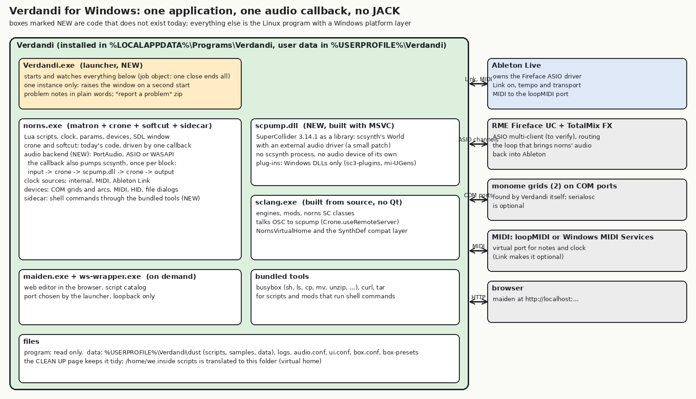
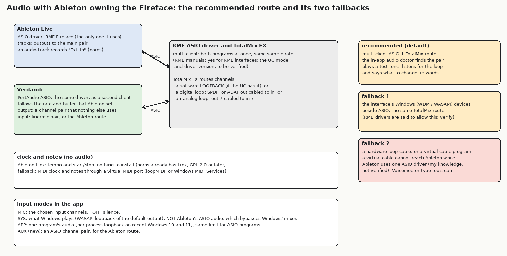

# Windows standalone: plan (no product code)

Status: **plan only.** Decision of the owner: **no VST3 plug-in** (`docs/port/plugin-feasibility.md` stays as reference); build a **Windows standalone that does everything the Linux version does**. Reference setup: Windows with **Ableton Live** and an **RME Fireface UC** (ASIO, owned by Ableton), keyboard-centred use, **two monome grids** (a 2023-24 grid 128 and a 2011 grid 256 with 4-step LEDs), norns audio into Ableton tracks and **Ableton's tempo and transport driving norns**. It must be as easy and plug and play as possible, with plain-language guidance in the app, in the spirit of the Linux version.

Each claim says whether it was **read** in this repository, **found on the web** (links at the end; forum-level evidence is marked), **my knowledge** (not checked here), or an **estimate**. I have no Windows machine, no mingw cross compiler and no Wine in this session (checked), so **nothing in this plan was built or run on Windows**. Section 9 lists what cannot be verified without the owner's hardware.

## 0. Summary

**What we build.** One Windows application "Verdandi": a small launcher (`Verdandi.exe`) that starts and watches `norns.exe` (matron + crone + softcut + the sidecar, today's code), `sclang.exe` and, on demand, maiden. Inside `norns.exe` **one audio callback** (PortAudio, ASIO or WASAPI) runs crone and softcut and **pumps SuperCollider's server, built as a library** (`scpump.dll`, a small patch that gives scsynth an external audio driver), once per block. **No JACK, no separate scsynth process, no virtual audio device of our own.** The same design the feasibility study called A2, now as the standalone's engine. It also lets the tests run on a Windows machine with no sound card.

**Audio with Ableton owning the Fireface** (section 1). Recommended default: **RME's ASIO multi-client mode** (Verdandi opens the same driver as a second client, same sample rate and buffer, which it follows and never sets) plus **a TotalMix FX route that brings norns' output channels back into an Ableton audio track** (a software loopback if the UC has one; otherwise one cable from a digital or analog output to an input of the same interface). An **audio doctor** page in the app finds the channel pair, plays a test tone, listens for the loop, and says in plain words what to change. Fallback: the interface's Windows (WDM/WASAPI) devices beside ASIO with the same TotalMix route. **What I could not verify:** whether the UC's driver is multi-client for the owner's driver version, whether the UC has a loopback, and how the WDM devices behave beside ASIO.

**Tempo and transport** (section 2). **Ableton Link first**: norns already has Link (`clock_link.cc`), Live has it built in, the licence is GPL-2.0-or-later (compatible), it gives tempo, beat phase and start/stop without any MIDI port. Fallback: MIDI clock and notes through **loopMIDI** (or Windows' new MIDI loopback, arriving about now).

**SuperCollider** (section 3): build **3.14.1 from source with MSVC, without Qt**, with the external-driver patch, in CI; plug-ins as Windows DLLs only (sc3-plugins 3.13 work with 3.14; the ARM-only packs need a Windows rebuild or a plain warning).

**Grids and devices** (section 4): find COM ports ourselves (SetupAPI, hot-plug) and talk the monome protocol through libmonome's Windows serial layer; serialosc stays optional (it is reported to need an FTDI device in the registry). Both grid models are tested at milestone M3.

**The code** (section 5): about **30 Linux-specific places** in matron, crone, the sidecar, the launcher, maiden and the tools, each with its Windows replacement; the shared code base stays one tree with a `platform/windows` layer next to `platform/linux` and `platform/macos`.

**Build and packaging** (section 6): **MSYS2 UCRT64 (gcc) for norns, MSVC for SuperCollider and `scpump.dll`**, built by **GitHub Actions on `windows-latest`** (the cloud session cannot run Windows); an **Inno Setup per-user installer** (no administrator prompt), user data in `%USERPROFILE%\Verdandi`, no code signing for now.

**Test loop and milestones** (section 7): M0 to M6, each with what the owner tests; he downloads a build from the CI run, installs it and reports with a "report a problem" zip. **Effort: roughly 4 to 7 months of focused work by one person (a labelled guess).**

**Decisions the owner must make** (section 8, recommendation first for each): toolchain, the engine design, the default audio route, Link first, direct COM for grids, installer and data location, CI.

## 1. The audio path with Ableton owning the Fireface

### 1.1 What the Linux version does today (read)
- **crone**: `crone/src/Client.h` (305 lines) is the only JACK code of crone: it opens a JACK client, registers stereo ports and calls a virtual `process(numFrames)` of the mixer (6 in / 6 out: ADC, softcut, engine) and of softcut. **scsynth** is its own JACK client; matron is a fourth (`matron/src/jack_client.*`: the clock time `jack_client_get_current_time`, the CPU load, the xrun count and the port lists of the AUDIO page).
- **The launcher** (`linux/norns.sh`, 576 lines) starts jackd or uses PipeWire's JACK and writes `audio.conf` (`input=`, `output=`, `rate=`, `period=`); `audio_devices.c` lists ALSA cards; `app_audio_linux.cc` captures another program's audio for the **MIC / SYS / OFF / APP** input modes.
- On Windows there is **no JACK to replace**: the audio backend must be written once, and it replaces all of the above.

### 1.2 The options (what they need from the user, what they cost)

| route | setup the user does once | latency | reliability | verdict |
|---|---|---|---|---|
| **A. RME ASIO multi-client + TotalMix FX route** | in TotalMix FX route Verdandi's output pair to a loop; in Ableton add an audio track fed by that input pair; the audio doctor tells him each step | the ASIO buffer both ways (the same as any ASIO program) plus norns' own block (about 1.3 ms) | the best: no extra software, no resampling, one clock | **default**, if the UC allows it |
| **B. the interface's Windows (WDM / WASAPI / MME) devices beside ASIO** | same TotalMix route, Verdandi opens the WDM device by name | WASAPI shared adds about 10 ms or more, exclusive less | good if the driver allows both at once (RME's drivers are said to; **verify**) | **fallback 1** |
| **C. a virtual audio cable (VB-CABLE and similar)** | install the cable; Verdandi plays to it | one extra buffer (about 10 ms) | works for programs that can read the cable. **Ableton uses one ASIO driver, so it cannot read the cable** unless an ASIO driver that contains the cable (a Voicemeeter-type tool, ASIO4ALL) replaces the RME driver in Live (my knowledge; **not verified**) | not recommended for Ableton |
| **D. an ASIO loopback tool / ASIO linking program** | install and configure | one buffer | fragile, third-party, old (my knowledge) | no |
| **E. a hardware loop** (analog out to in, or SPDIF/ADAT out to in) | one cable | the converter delay for analog (about 1 to 2 ms each way, estimate) | always works; costs a cable and an input pair | the **last resort** and the answer if the UC has no software loopback |

**What I found about the hardware.** RME's manuals say RME interfaces support **ASIO multi-client** operation, more than one ASIO program at once, **with the same sample rate** (the Fireface 800 manual says so; an RME staff post says full multi-client operation since 2011; forum reports are mixed) (web). **TotalMix FX Loopback** is documented for the UCX, UFX and 802 (an RME forum post); **the UC is not named** (web). So **whether the UC has a software loopback is open**: if not, route A needs one cable (digital or analog) from an output to an input of the interface. **Nothing in this section was tried on the owner's UC.**

### 1.3 Recommendation

- **Default: route A.** Verdandi opens the **same ASIO driver as Ableton**, on a channel pair that nothing else uses, and **follows** the sample rate and buffer size it finds (in multi-client mode they belong to whoever opened the driver first; Verdandi never changes them, restarts its stream when the driver asks for a reset, and says so in plain words: "Ableton changed the sample rate to 44100, Verdandi follows"). A TotalMix route (loopback, or the cable) brings the pair back to an Ableton input.
- **Fallback 1: route B**; **fallback 2: route E**. Route C only for hosts other than Ableton.
- **The audio doctor** (SYSTEM > AUDIO, built at M1): lists the ASIO drivers and Windows devices, opens the chosen driver, reports "shared with another program: yes/no, rate, buffer", **plays a test tone on the output pair and listens on the input pairs to find the loop**, and shows the result as a short sentence and one next step ("No signal came back. In TotalMix FX, route Verdandi's pair AN 7/8 to the Loopback output, then press Test again."). It never changes the interface's settings by itself.

### 1.4 What Verdandi must support: the audio backend
| need | choice |
|---|---|
| a Windows audio backend library | **PortAudio** (permissive licence) with **ASIO and WASAPI**. SuperCollider's own Windows build uses PortAudio with ASIO, so the combination is proven (web). The **ASIO SDK licence** changed to a dual model (proprietary or **GPLv3**) in October 2025; whether a GPL-3.0 project may build and redistribute an ASIO-enabled PortAudio is **not settled by what I could read** (web): check the SDK's licence file before the first release (decision 3). **RtAudio** (MIT) has the same ASIO SDK need; **miniaudio** has no ASIO. |
| what replaces `Client.h` | an **audio backend interface** (`start(rate, block)`, a callback that gives input and output pointers) with a PortAudio implementation; the three crone clients keep their `process()` and are called in a fixed order by one callback. A **null backend** (a timer or a test driver) serves CI and headless tests. The Linux build can keep JACK as another backend implementation: **one code base**. |
| what replaces matron's JACK code | the clock time from the callback's sample counter; CPU load and xrun counts from the backend; the AUDIO page lists **devices and channel pairs** instead of JACK ports |
| scsynth's audio | **in-process** through `scpump.dll` (section 3): one callback, sample-synchronous, no loop through a virtual cable |
| sample rate and buffer | follow the driver (ASIO) or the device's mix format (WASAPI shared); norns is happiest at 48 kHz (softcut's buffers are counted in samples, so other rates change times, not function); `audio.conf` keeps `rate=` and `period=` as hints that the doctor explains |
| input modes | **MIC**: the chosen channels. **OFF**: silence. **AUX (new)**: an ASIO channel pair, for the Ableton route. **SYS**: **WASAPI loopback** of the default render device: it hears what Windows plays, **not Ableton's ASIO audio** (ASIO bypasses Windows' mixer): the app says so. **APP**: per-process loopback (a documented Windows API for capturing one program's audio; the minimum Windows 10 build is not clear from my sources: a forum says 20438) (web); same limit for ASIO programs. |
| realtime | the callback thread registers with the Windows multimedia scheduler ("Pro Audio") (my knowledge) |

## 2. Tempo and transport from Ableton

**Ableton Link (default).** Read: norns already has Link: `matron/src/clocks/clock_link.cc` (180 lines), the Ableton Link SDK as a submodule (`third-party/link`, `LINK_PLATFORM_LINUX` or `MACOSX` today), a Link thread started at launch, source `link` in PARAMS > CLOCK, tempo, beat and optional start/stop sync, a settable quantum. **Licence:** Link is **dual-licensed GPL-2.0-or-later or proprietary** (web: README text in forks; not Ableton's page itself); Verdandi is GPL-3.0, which GPL-2.0-or-later allows. **Windows:** Link builds with MSVC 2013 and newer and with MinGW gcc 13 in other projects (web); the platform define is `LINK_PLATFORM_WINDOWS` (web). Live has Link built in (Preferences > Link): tempo, beat phase and start/stop are shared **with nothing installed and no MIDI port**. **Known gap (read):** `clock_link.cc` does not compensate the audio output latency (no `outputLatency` use), so on Windows the beat would sit a buffer late; a setting "Link latency (ms)" and the backend's reported latency fix this (part of M4).

**MIDI clock (fallback, and for notes).** Read (`docs/port/clock-notes.md`): norns follows MIDI clock through `clock_midi.cc` (0xF8, start, stop; **continue and song position are ignored**; tempo is timed with the system clock). On Linux the DAW's clock arrives through `jack_midi_in.cc` (`Verdandi:midi_in`). **On Windows** the same parser is fed by **RtMidi** (MIT-style licence, WinMM backend, my knowledge) from a virtual port: **loopMIDI** (a free driver for personal use; redistribution terms not checked, so the installer would **link to it, not bundle it**) or **Windows MIDI Services' loopback endpoints**, which Microsoft says reach most customers between **November 2026 and January 2027** (web), a built-in replacement for loopMIDI. WinMM MIDI ports are single-opener (my knowledge): a hardware controller used by both Ableton and Verdandi must be shared by routing through Ableton; virtual loopback ports are multi-client. The "norns keys" source of the window (`keys_midi.cc`, a JACK MIDI output on Linux) becomes an **internal pipe device**.

**Order:** Link first (M4), MIDI clock as the fallback (M3/M4). A "clock doctor" line on the PARAMS > CLOCK page says which source is live and what to switch on in Ableton.

## 3. SuperCollider on Windows

- **Binaries or build.** SuperCollider **3.14.1** has Windows binaries (a win64 zip and a winget package, web), but they include the Qt IDE (138 MB) and **do not have the external driver** we need. **Plan: build 3.14.1 from source with MSVC** (the project's documented Windows toolchain is MSVC 2017/2019; web), **Qt off** (`SC_QT=OFF`, as the Linux and macOS packages already do), plus **our small patch**: an `external` audio driver and a C API wrapper that becomes `scpump.dll` (`create`, `pump(frames, in, out)`, `send_osc`, `destroy`). Others embed scsynth this way with a build-time patch; upstream offers no such driver (web). **This patch is the largest unknown of the plan: I could not build or test it here.** It is milestone M0b, and the plan's fallback is below.
- **Fallback if the patch fails:** keep `scsynth.exe` with SuperCollider's own PortAudio ASIO driver and connect crone to it through a second virtual path; the honest fallback is **JACK2 for Windows** (an installer exists) with SuperCollider built `AUDIOAPI=jack` (**not verified that this builds on Windows**): a second audio stack the user must install, worse plug-and-play. I would not go there unless the patch is impossible.
- **Plug-ins.** Windows needs `.scx`/DLL builds. **sc3-plugins 3.13 work with 3.14** (the interface did not change, web); a Windows build is built in CI from the pinned commit. **mi-UGens** (the `nb_mxsynths` and similar packs) and other **ARM-only packs**: scripts download `.so` files built for the Raspberry Pi; the Linux port already **detects wrong-architecture plug-ins and explains** (`plugin_arch_check.cc`, `plugin_arch_note.cc`, the CLEAN UP page). On Windows the same note appears for `.so` and ARM files, and a **table of known packs and their Windows status** (built by us in CI, or "not available for Windows yet") is shipped with the app. Boost-based extensions built for 3.13 may break with 3.14 (web: FluCoMa).
- **sclang startup.** `sclang.exe` is started by the launcher with a generated `sclang_conf.yaml` (include paths: norns' `sc/`, the compat folder, the virtual home folder), as `linux/norns.sh` does; `Crone.useRemoteServer` (exists, read) points it at `scpump.dll`'s UDP port; the REPL websocket wrapper (`ws-wrapper`, a small C program) is rebuilt for Windows (pipes instead of ptys).
- **`sc/linux-compat` and `NornsVirtualHome`.** `NornsSynthDefCompat.sc` (the 3.14 SynthDef compatibility layer) and `NornsVirtualHome.sc` (the virtual `/home/we`) are **platform-neutral SuperCollider code**: rename the folders to `sc/desktop-compat` and `sc/desktop`, used by Linux and Windows. The only change is that the virtual home maps `/home/we` to a Windows path (forward slashes are accepted by SuperCollider's file classes: my knowledge; test at M5) and that path joins are checked for drive letters.

## 4. Grids and devices

- **Today (read):** `device_monitor.cc` (435 lines) uses **libudev** to see serial ports, HID and sound devices; `device_monome.cc` opens a grid with `monome_open(<tty path>)`; the serial number comes from libmonome; Lua assigns grids to vports by name and serial (`lua/core/grid.lua`). The repository's libmonome is patched for the pty virtual grid and for write retries (`linux/patches`).
- **serialosc on Windows** exists with installers (web), but is reported to **require an FTDI device in the Windows registry** (web: a third-party serialosc clone's README). The 2011 grid 256 is an FTDI device (monomeserial's notes list `m256-xxx` names, web); a 2023-24 grid's USB chip is **not known to me**, so **serialosc may not see it**.
- **Plan: direct serial through COM ports, no extra program.** A Windows **device monitor** (SetupAPI enumeration plus `WM_DEVICECHANGE`, run as a thread) lists COM ports with their USB vendor and product ids and friendly names, probes new ports with the monome handshake, and feeds the **same add/remove events** that udev does today; libmonome's serial layer is used as it is (its Windows platform code is present in serialosc's static build, web; **not checked here**). serialosc stays **optional**: if it is running it holds the ports, and the app says so (the Linux port already has this conflict note, `HARDWARE-CHECKLIST.md`).
- **The two grids** (tested at M3): the 2011 256 is an older-protocol device with **4-step LEDs**, so norns' 16 levels are quantised to 4 on it (libmonome and `grid.lua` handle levels per device; the Linux `grid_led_test` shows what is covered); the 2023-24 128 is a current-protocol device. Both at once means **two vports**, as on a norns. The app shows "grid m256-020 connected (vport 1)" and a plain note if a port is busy.
- **MIDI devices:** RtMidi over WinMM; the device list is rebuilt on hot-plug; names are stable ids so `midi.connect` keeps working. **HID:** the window keyboard is already handled through SDL (`hid_virtual.cc`, the window-key mapping), so typing works as on Linux; **gamepads** through SDL's controller API at M3 (optional); physical USB keyboards through the same SDL path. **crow** (a USB serial device) through the COM monitor with its vendor id.

## 5. The code: every Linux-specific assumption and its replacement

(read in the repository; "shared" = stays one code base)

| area | Linux assumption | Windows replacement | shared? |
|---|---|---|---|
| **toolchain** | gcc, waf, pthreads, `poll`, unnamed semaphores, `clock_nanosleep` | MSYS2 UCRT64 gcc with winpthreads (keeps POSIX threads and semaphores); waf if it works there, else a CMake wrapper (decision 1) | yes |
| **crone / audio** | JACK (`Client.h`) | the backend interface + PortAudio; a null backend | interface shared, JACK kept for Linux |
| **matron JACK use** | `jack_client.*` (time, CPU, xruns, ports) | the backend's counters; device and channel lists | split |
| **scsynth** | a JACK client, a separate process | `scpump.dll` in-process | Windows only |
| **ALSA** | `audio_devices.c` (cards), `device_midi.cc` (rawmidi), `matron/src/hardware/*` (device only) | PortAudio device list, RtMidi; hardware files stay excluded | split |
| **udev** | `device_monitor.cc` | SetupAPI + `WM_DEVICECHANGE` monitor | split |
| **libevdev / gpiod** | `device_hid.cc` (device-only); the macOS port has stub headers | SDL controller API; the stubs are reused for compilation | split |
| **pty** | the virtual grid/arc (`vgrid_device.c`, libmonome patch), `ws-wrapper` | the OSC virtual grid of **Phase 5.5** (no ptys); `ws-wrapper` with pipes | Phase 5.5 shared |
| **shell commands** | the sidecar: `fork`, `execl("/bin/sh")`, `poll`, `waitpid` (`norns/sidecar_shell.cpp`, 297 lines) | `CreateProcess` with pipes and a timeout, running **`busybox sh -c`** | rewrite of one file |
| **GNU tools** | scripts call `sh`, `ls`, `cp`, `mv`, `rm`, `unzip`, `tar`, `wget`, `curl`, `grep`, `awk`, `sed` | bundle **busybox for Windows** (GPL-2.0, one small program with these applets, my knowledge) and **curl.exe**; scripts that need git, python or others get a plain error | Windows only |
| **sudo / systemctl** | shims in `linux/shims` that print a plain explanation | the same two as `.cmd` or busybox applets with the same texts | shared texts |
| **virtual home** | `/home/we` translated in Lua (`core/virtual_home.lua`), SC (`NornsVirtualHome.sc`), shell commands (scanners `scan-shell-paths.py`) | the same layers; the real home is `%USERPROFILE%\Verdandi` and is given to shell commands with forward slashes | shared |
| **paths** | `/`-only code, `ls -p` in `util.scandir` | forward-slash normalisation at one place; native directory listing in C instead of a shell `ls` | shared fix |
| **signals / crashes** | `crash_report.cc` (signal handlers, backtrace) | `SetUnhandledExceptionFilter` + DbgHelp, a minidump into `logs/crash/` | split |
| **process control** | `norns.sh`: `pgrep`, `kill` trees, `trap`, `mkfifo`, the **second-start control file** (`.norns-raise`) | `Verdandi.exe` with a **named mutex** (one instance), a **job object** (children die with it), a named event to raise the window; the control-file idea stays for compatibility | Windows launcher |
| **launcher** | a 576-line bash script | `Verdandi.exe` (C++), configuration files unchanged (`audio.conf`, `ui.conf`, `box.conf`, ...) | Windows only |
| **file dialogs** | `file_picker.cc` (zenity, kdialog, portals) | the Windows common item dialogs (a COM call) | split |
| **open URL** | `xdg-open` (`open_url.c`) | `ShellExecuteW` | split |
| **clipboard** | SDL clipboard | the same SDL calls (the picker's clipboard binding is SDL) | shared |
| **window, screen, fonts** | SDL2 + cairo + `resources/*.ttf` (loaded from files) | the same; cairo and freetype from MSYS2; **no fontconfig needed** | shared |
| **mDNS** | avahi (`dns_sd`) in `osc.cc` | dropped on Windows (Bonjour is not part of Windows); maiden is reached by `localhost` | `#ifdef` |
| **app audio (SYS/APP)** | `app_audio_linux.cc` (PipeWire) | WASAPI loopback | split |
| **MIDI to the DAW (Linux)** | `jack_midi_in.cc`, `midi_autoconnect.cc`, `keys_midi.cc` | RtMidi ports with name-based auto-connect (the same rules); an internal pipe for the keys source | split |
| **Link** | `LINK_PLATFORM_LINUX` | `LINK_PLATFORM_WINDOWS` | shared |
| **maiden** | Go; a patch removes systemd/dbus (`maiden-linux-guard-and-units.patch`) and adds an origin guard | Go cross-compiles; the same patch (the unit API already answers "none"); paths with `filepath` | shared patch |
| **maiden-repl** | readline + ncurses console | dropped on Windows (maiden's web REPL is the console) | `#ifdef` |
| **tidy tool** | `linux/tidy.sh`, 982 lines of shell (CLEAN UP, rotate, flatten) | run with busybox `sh` **if it is POSIX-clean (to check)**, else port to Lua (matron runs it) so Linux and Windows share one tool | check |
| **packaging** | `linux/package.sh` (.deb, privacy scan), `setup-deps.sh`, `build.sh` | a CI workflow and an Inno Setup script; the **privacy scan is ported** (no builder identity in any file) | split |
| **tests** | `run_all.sh` (bash, Xvfb, xdotool, jackd dummy) | Lua and C tests run on Windows through busybox/PowerShell wrappers; window tests become CI smoke tests; the real-window scenarios are the owner's checklist | partly |

**One code base.** Keep one tree: `matron/src/platform/{linux,macos,windows}`, `crone` with the backend interface, shared Lua and SC, `linux/` and a new `windows/` for launcher, packaging and tests. Windows-only code stays behind `#ifdef _WIN32` or the build's platform directory; the Linux and macOS builds are untouched (the existing guard tests of `box_c_test.sh` extend to the new identifiers).

## 6. Build and packaging

- **Toolchain.** **MSYS2 UCRT64 (gcc)** for norns, crone, sidecar and the small tools (keeps the POSIX-flavoured code buildable with winpthreads); **MSVC** for SuperCollider 3.14.1 and `scpump.dll` (the project's tested toolchain, web); the two meet only through **`scpump.dll`'s C interface and OSC over UDP**, so no C++ ABI crosses the line. **Build system:** try **waf** in MSYS2 first (one wscript for all platforms); if it fights back, a Windows-only CMake wrapper (decision 1).
- **Where a Windows build is produced (the cloud session cannot run Windows).** **GitHub Actions on `windows-latest`**: it has MSVC and can install MSYS2 (`msys2/setup-msys2`); it builds, runs the headless tests and uploads the zip and installer as **artifacts**. A **cross-compile on Linux with mingw-w64** is possible for norns only if every dependency is cross-built: **not worth it** (no mingw here, and the dependency chain is long). **Wine**: not installed here; would only smoke-test headless pieces and cannot do ASIO, SDL window behaviour or serial ports: **not used**. The fork already has upstream's workflows (`test.yml`, `release.yml` on ARM runners); a new `windows.yml` is added on the `windows-port` branch. **The owner must enable Actions on his fork** (forks start with Actions off; I cannot do it, and I do not open issues or contact anyone).
- **Testing.** The CI runner has **no audio device**, which is exactly why the **null/pumped backend** matters: the headless boot, the Lua and C tests, the engine start and an audio-less render all run there. ASIO, the window feel, grids and Ableton are the owner's tests.
- **Installer.** **Inno Setup** (free, scriptable, per-user install into `%LOCALAPPDATA%\Programs\Verdandi` with **no administrator prompt**, Start menu entry, clean uninstall that leaves `%USERPROFILE%\Verdandi` alone); NSIS is the equal alternative; **MSIX needs signing** and is not for now.
- **Signing and SmartScreen.** **Not needed now**: on the owner's own PC an unsigned installer shows "Windows protected your PC", and "More info > Run anyway" proceeds (the first run notes in the app and in the checklist say so). Signing (a certificate or Microsoft's signing service) and the reputation it needs matter only if the app is shared later (web: SmartScreen reputation is per file and slow).
- **Bundled dependencies.** The MSYS2 DLLs norns needs (found by a dependency script and copied), SDL2, cairo, freetype, liblo, libsndfile, libsamplerate, FFTW, Lua, nng, libmonome, RtMidi, PortAudio; SuperCollider (no Qt) + sc3-plugins + a Windows pack table; maiden (a Go binary + its web app); busybox and curl; the fonts. Licences go into `DEPS.md` (Windows column) and a `licenses` folder in the installer. **Size: about 150 MB installed (an estimate).**
- **Privacy scan.** The Linux `package.sh` scans every file for the builder's identity; Windows CI runs a ported scan (runner names appear in debug paths: build with `-ffile-prefix-map` and strip symbols).
- **User data location and file layout.** Program files are read-only under `%LOCALAPPDATA%\Programs\Verdandi`. User data under **`%USERPROFILE%\Verdandi`**, the same layout as Linux (`~/Verdandi`): `dust\` (scripts, samples, data), `logs\`, `audio.conf`, `ui.conf`, `box.conf`, `box-presets\`, `disabled\`, `cache\`, with the same **CLEAN UP page** and **problem notes** (plain language: what is wrong, what to do). A menu item "Open the Verdandi folder". A user name with spaces is handled by quoting everywhere (a test case at M0).

## 7. The owner's test loop and the milestones

**How he gets a build, installs it and reports.** (1) Push to `windows-port` runs the workflow. (2) On GitHub: Actions > the latest run > **Artifacts** > download `verdandi-windows-<commit>.zip` (portable before M6, installer from M6); Windows marks downloads from the internet, so **right-click the zip > Properties > Unblock** before unpacking (my knowledge). (3) Run `Verdandi.exe` (M0: a test batch file). (4) Anything wrong: the menu item **"Report a problem"** writes `Verdandi-report-<date>.zip` on the Desktop (logs, versions, the audio doctor's result; **no personal data**: the privacy scan applies to it) which he sends or pastes. (5) A **Windows section in `HARDWARE-CHECKLIST.md`** lists what to try per milestone.

| M | content | what the owner tests | expected | effort (guess) |
|---|---|---|---|---|
| **M0** | toolchain and headless boot: CI builds `norns.exe` and the MSVC SuperCollider with the external-driver patch (**M0b**); matron + sclang + `scpump.dll` boot on a runner with a null audio clock; Lua and C tests pass | downloads the zip, runs `verdandi-test.cmd`, sends the log | "boot ok", engines listed, tests pass; a path with spaces works | 3 to 6 weeks |
| **M1** | audio out: the PortAudio backend (ASIO, WASAPI), the audio doctor v1 | with Ableton running, plays the test tone on a free pair of the Fireface; reads the shared-driver line | tone heard, rate and buffer followed, no crackle; plain message if the driver is exclusive | 2 to 4 weeks |
| **M2** | the screen window, keyboard, file dialogs, clipboard, screenshots, GIFs, the THEME and SCREEN pages | types in the window (letters, arrows, Ctrl combinations), loads a file, copies a colour | everything as on Linux | 2 to 3 weeks |
| **M3** | devices: COM monitor and both grids, hot-plug, MIDI (RtMidi), crow, SDL controllers | plugs in the 128 and the 256, plays a grid script; sends notes from Ableton through loopMIDI | both found without any setup, LED levels right (4 steps on the 256), unplug/replug recovers | 3 to 5 weeks |
| **M4** | Ableton: audio return route in the doctor, **Link** clock with latency setting, MIDI clock fallback | records norns on an Ableton track; starts/stops Live; changes tempo | tempo and start/stop follow, the recorded audio is aligned (a click test), plain notes when the loop is missing | 2 to 4 weeks |
| **M5** | maiden, scripts and mods, shell tools (busybox, curl), virtual home, SuperCollider plug-in packs | installs a script from maiden, runs it, enables a mod, downloads samples | works as on Linux; ARM-only packs explained | 3 to 5 weeks |
| **M6** | installer, clean layout, CLEAN UP, problem notes, one-instance, crash reports, report-a-problem, privacy scan | installs on his PC (and a clean VM if he has one), first run, uninstall | no administrator prompt, no manual file moving, every problem has a sentence | 3 to 5 weeks |
| **M7** | polish, the pack table, performance, docs | long sessions | nothing new broken | ongoing |

**Total roughly 17 to 31 weeks, about 4 to 7 months for one person: a guess.** M0b (the SuperCollider patch) and M3 (grids) have the widest error bars.

## 8. Risks, open questions and decisions

**Risks, in plain words.**
1. **The scsynth external-driver patch** may be harder than it looks or need re-basing at each SuperCollider release. Fallback: JACK2 for Windows (worse plug and play).
2. **Audio with Ableton depends on the owner's UC**: multi-client ASIO and the loop. Worst case: one cable and a clear doctor, still workable.
3. **Grids**: the 2023-24 grid's USB identity is unknown to me; direct COM must be proven at M3.
4. **Toolchain**: waf on MSYS2, two compilers meeting at a C interface, a large dependency set.
5. **The ASIO SDK licence** for an ASIO-enabled PortAudio in a GPL-3.0 program is unsettled (web).
6. **Shell-dependent scripts** assume a Linux userland; busybox covers the common cases, not all.
7. **Windows details** I could not test: SmartScreen on an unsigned installer, antivirus with a program that starts helpers, the MIDI loopback timing, serial hot-plug.
8. **Effort** is a guess; **Phase 5.5 (serialosc/OSC virtual grid)** and the Linux standalone's open items interact.

**Decisions the owner must make (recommendation first).**
1. **Toolchain:** MSYS2 UCRT64 for norns + MSVC for SuperCollider and `scpump.dll`; try waf, fall back to CMake. *(Alternative: all-MSVC: a bigger port.)*
2. **Engine design:** the **in-process pumped scsynth** (one audio callback) as described. *(Alternative: JACK2 for Windows: more setup, a second audio stack.)*
3. **Audio backend and licence:** PortAudio with ASIO and WASAPI, after checking the ASIO SDK licence file; *(alternative: WASAPI only for a first release, no ASIO).*
4. **Default audio route:** multi-client ASIO + TotalMix route with the audio doctor; fallbacks WDM/WASAPI and a hardware loop. **Please check which TotalMix FX version and whether the UC shows a Loopback option** (decides cable or no cable).
5. **Clock:** Ableton Link first, MIDI clock via loopMIDI/Windows MIDI loopback as fallback.
6. **Grids:** direct COM with our own monitor; serialosc optional. **Please tell me the USB identity (device manager name) of the 2023-24 grid** if you can.
7. **Installer and data:** Inno Setup per-user, no signing for now, user data in `%USERPROFILE%\Verdandi`.
8. **CI:** GitHub Actions on `windows-latest` for builds and headless tests; enable Actions on the fork; builds delivered as workflow artifacts.
9. **Shell tools:** bundle busybox and curl.
10. **Phases:** `PLAN.md` Phase 7 and 8 (the VST3 plug-ins) are parked; Phase 6 becomes this plan (updated in `PLAN.md`).

## 9. What I could not verify
- Anything on Windows or with the owner's hardware: the UC's ASIO multi-client behaviour and driver version, whether the UC has a TotalMix Loopback, WDM devices beside ASIO, the 2023-24 grid's USB chip, the 2011 grid's protocol and LED handling on Windows, Ableton's Link and MIDI behaviour on his setup.
- Building SuperCollider 3.14.1 with MSVC and the external-driver patch; waf and MSYS2; libmonome's Windows serial layer; Link, RtMidi and PortAudio builds.
- The ASIO SDK licence terms for a GPL-3.0 redistribution; loopMIDI's redistribution terms; the minimum Windows build for per-process loopback; whether `curl.exe` and `tar.exe` are present on his Windows (assumed to be bundled anyway).
- GitHub Actions on the fork (whether enabled), runner contents and their limits.
- All effort figures.

## Sources (web; forum-level evidence is marked "forum")
- RME multi-client ASIO and loopback: [RME forum: Multi Client ASIO driver](https://forum.rme-audio.de/viewtopic.php?pid=166261), [Fireface 800 manual, multi-client operation](https://manualsdump.com/en/manuals/intel-fireface_800/267972/28), [RME FFUC user manual](https://manualmachine.com/rme/ffuc/5937613-user-manual), [forum: loopback and CC mode (UCX, UFX, 802)](https://forum.rme-audio.de/viewtopic.php?pid=111904) (forum).
- Ableton Link licence and Windows: [Link forks' README text (GPL-2.0-or-later or proprietary)](https://github.com/gluon/Void-LinkAudio) (a third-party project quoting it), [Ableton Link on GitHub (forks)](https://github.com/thomasf/link).
- SuperCollider on Windows: [3.14.0 release](https://supercollider.github.io/releases/2025/07/26/supercollider-3.14.0.html), [Windows README (older fork)](https://github.com/8c6794b6/supercollider/blob/master/README_WINDOWS.md), [3.14.1 win64 zip listing](https://www.sourceforge.net/projects/supercollider.mirror/files/Version-3.12.2), [embedding scsynth with an external driver (scsynth-sys)](https://docs.rs/crate/scsynth-sys/latest/source/csrc/SC_ExternalDriver.cpp).
- Grids on Windows: [serialosc](https://github.com/monome/serialosc), [pyserialoscd (the FTDI note)](https://github.com/nexxyz/pyserialoscd), [monomeserial](https://github.com/monome/monomeserial), [monome docs](https://monome.org/docs/grid/grid-computer/).
- ASIO SDK licence: [Libre Arts on Steinberg's relicensing](https://librearts.org/2025/11/steinberg-relicenses-vst3-and-asio/), [Steinberg forum: ASIO licence and open source](https://forums.steinberg.net/t/asio-license-and-open-source-software/696630) (forum).
- Windows MIDI Services loopback: [Microsoft MIDI: virtual loopback](https://microsoft.github.io/MIDI/endpoints/virtual-loopback.html).
- Per-process loopback: [Microsoft Learn: ActivateAudioInterfaceAsync](https://learn.microsoft.com/en-us/windows/desktop/api/mmdeviceapi/nf-mmdeviceapi-activateaudiointerfaceasync), [Application loopback audio sample](https://learn.microsoft.com/en-us/samples/microsoft/windows-classic-samples/applicationloopbackaudio-sample/), [PureBasic forum: minimum build](https://www.purebasic.fr/english/viewtopic.php?p=636463) (forum).
- SmartScreen: [Microsoft Learn: SmartScreen reputation](https://learn.microsoft.com/windows/apps/package-and-deploy/smartscreen-reputation).
